# Diagrama de clases UML

**Estado:** diseño que proponemos y que contrastaremos con el código al integrar cada etapa.  
En el diagrama mostramos la arquitectura objetivo; todavía no afirmamos que esas clases estén implementadas.

```mermaid
classDiagram
    class Lwjgl3Launcher

    class SpaceNavigation {
        -assets: GameAssets
        +create() void
        +dispose() void
    }

    class ScreenNavigator {
        <<interface>>
        +showMainMenu() void
        +startNewGame() void
        +showGameOver() void
        +showVictory() void
    }

    class GameAssets {
        -instance: GameAssets
        -manager: AssetManager
        -GameAssets()
        +getInstance() GameAssets
        +dispose() void
    }

    class AbstractGameScreen {
        <<abstract>>
        +render(delta: float) final
        #update(delta: float) abstract
        #draw() abstract
    }

    class MenuScreen
    class GameScreen
    class VictoryScreen
    class GameOverScreen

    class PlayerInput {
        <<interface>>
        +movementDirection() Vector2
        +fireJustPressed() boolean
        +dashJustPressed() boolean
        +continueJustPressed() boolean
        +restartJustPressed() boolean
        +returnToMenuJustPressed() boolean
    }

    class KeyboardPlayerInput

    class GameWorld {
        -entities: List~GameEntity~
        -lives: int
        -phase: GamePhase
        +update(delta: float, input: PlayerInput) void
        +snapshot() WorldSnapshot
        +continueAfterLevel() void
        +restart() void
    }

    class WorldSnapshot {
        +level() int
        +lives() int
        +score() int
        +phase() GamePhase
    }

    class GamePhase {
        <<enumeration>>
        PLAYING
        LEVEL_COMPLETE
        GAME_OVER
        VICTORY
    }

    class Updatable {
        <<interface>>
        +update(delta: float) void
    }

    class Renderable {
        <<interface>>
        +render(batch: SpriteBatch) void
    }

    class Collidable {
        <<interface>>
        +bounds() Rectangle
    }

    class GameEntity {
        <<abstract>>
        -active: boolean
        +isActive() boolean
        +deactivate() void
    }

    class Ship {
        -speed: float
        -invulnerabilityRemaining: float
        -dashRemaining: float
        -dashCooldownRemaining: float
    }
    class Alien {
        -fireCooldownRemaining: float
        -nextAttackPattern: int
    }
    class PlayerProjectile
    class AlienProjectile
    class Meteorite {
        -size: MeteoriteSize
    }
    class MeteoriteSize {
        <<enumeration>>
        SMALL
        STANDARD
        LARGE
    }

    class CollisionSystem
    class ScoreService {
        -score: int
        +addAlienPoints() void
        +addMeteoritePoints(size: MeteoriteSize) void
        +reset() void
    }
    class LevelManager {
        -currentLevel: int
        -defeatedAliens: int
        -quota: int
        +registerAlienDefeated() void
        +isQuotaReached() boolean
        +advanceLevel() void
    }
    class MovementStrategy {
        <<interface>>
        +move(alien: Alien, delta: float, bounds: Rectangle) void
    }
    class LinearMovement
    class ZigZagMovement

    class AlienAttackPattern {
        <<interface>>
        +createVolley(alien: Alien, target: Ship) List~AlienProjectile~
    }
    class LinearAttackPattern
    class VAttackPattern

    class AlienBuilder {
        +position(x: float, y: float) AlienBuilder
        +speed(speed: float) AlienBuilder
        +movement(strategy: MovementStrategy) AlienBuilder
        +build() Alien
    }

    class LevelDirector {
        +createLevel(level: int) List~Alien~
    }

    class ScoreEntry {
        -playerName: String
        -score: int
    }
    class ScoreRepository {
        <<interface>>
        +topScores(limit: int) List~ScoreEntry~
        +saveIfTop(score: ScoreEntry) void
    }
    class HighScoreService
    class SQLiteScoreRepository

    Lwjgl3Launcher --> SpaceNavigation : inicia
    SpaceNavigation ..|> ScreenNavigator
    SpaceNavigation --> GameAssets : obtiene y libera
    SpaceNavigation --> MenuScreen : muestra
    SpaceNavigation --> AbstractGameScreen : administra

    AbstractGameScreen <|-- MenuScreen
    AbstractGameScreen <|-- GameScreen
    AbstractGameScreen <|-- VictoryScreen
    AbstractGameScreen <|-- GameOverScreen
    MenuScreen --> ScreenNavigator : solicita transiciones
    GameScreen --> ScreenNavigator : solicita transiciones
    VictoryScreen --> ScreenNavigator : reinicia o vuelve al menú
    GameOverScreen --> ScreenNavigator : reinicia o vuelve al menú

    KeyboardPlayerInput ..|> PlayerInput
    GameScreen --> GameWorld : actualiza y consulta
    GameWorld --> PlayerInput : recibe
    GameWorld --> WorldSnapshot : crea
    WorldSnapshot --> GamePhase : expone

    GameEntity ..|> Updatable
    GameEntity ..|> Renderable
    GameEntity <|-- Ship
    GameEntity <|-- Alien
    GameEntity <|-- PlayerProjectile
    GameEntity <|-- AlienProjectile
    GameEntity <|-- Meteorite

    Ship ..|> Collidable
    Alien ..|> Collidable
    PlayerProjectile ..|> Collidable
    AlienProjectile ..|> Collidable
    Meteorite ..|> Collidable

    GameWorld o-- GameEntity : mantiene
    Meteorite --> MeteoriteSize : clasifica
    GameWorld --> CollisionSystem : solicita detección
    CollisionSystem --> GameWorld : informa impactos
    GameWorld --> LevelManager : consulta y avanza
    GameWorld --> ScoreService : registra puntaje
    GameWorld --> GamePhase : mantiene
    CollisionSystem --> Collidable : detecta impactos

    Alien --> MovementStrategy : delega movimiento
    MovementStrategy <|.. LinearMovement
    MovementStrategy <|.. ZigZagMovement
    Alien --> AlienAttackPattern : alterna formaciones
    AlienAttackPattern <|.. LinearAttackPattern
    AlienAttackPattern <|.. VAttackPattern
    LinearAttackPattern --> AlienProjectile : crea dos proyectiles
    VAttackPattern --> AlienProjectile : crea dos proyectiles
    LevelDirector --> AlienBuilder : construye
    LevelDirector --> LevelManager : prepara cuotas

    HighScoreService --> ScoreRepository : persiste resultados
    MenuScreen --> HighScoreService : consulta top 3 (propuesta)
    VictoryScreen --> HighScoreService : consulta top 3 (propuesta)
    GameOverScreen --> HighScoreService : consulta top 3 (propuesta)
    ScoreRepository <|.. SQLiteScoreRepository
    SQLiteScoreRepository --> ScoreEntry : guarda y recupera
```

## Notas del diagrama

Este diagrama sigue siendo la arquitectura objetivo completa. Para evitar confundir propuesta con
código, el corte actualmente implementado y sus patrones GM-4 a GM-9 están registrados por separado
en [UML_INICIAL.md](../UML_INICIAL.md). La pauta del curso confirma que los patrones requeridos son
Singleton, Strategy, Template Method y Builder.

- Usaremos `GameEntity` como clase abstracta para la nave, los aliens, los proyectiles y los meteoritos. Los meteoritos serán obstáculos y no contarán para las cuotas de enemigos.
- Definimos `Collidable` como contrato de límites para colisión. Haremos que `bounds()` devuelva una copia para no exponer el rectángulo mutable interno.
- Mantendremos las entidades dentro de `GameWorld` y evitaremos entregar la lista interna a una pantalla. `GameWorld` coordinará las vidas y la fase; `ScoreService` mantendrá el puntaje y `LevelManager` el nivel y su cuota. `CollisionSystem` detectará e informará impactos, y desde `GameWorld` aplicaremos sus efectos.
- Empezaremos con cuotas de 15 aliens para el nivel uno, 30 para el nivel dos y 45 para el nivel tres. No contaremos meteoritos para alcanzar una cuota.
- Empezaremos con las velocidades que acordamos: nave 260 px/s, aliens lineales 90 px/s, aliens zigzag 110 px/s, proyectiles del jugador 450 px/s y proyectiles alienígenas 220 px/s. Los aliens dispararán cada 1,8 segundos.
- Haremos que los aliens apunten a la nave y alternen entre la formación lineal hacia abajo y la formación en V de 45°. Cada descarga tendrá dos proyectiles simultáneos. Desactivaremos los proyectiles que superen el límite del área de juego, cuyo valor nos falta acordar.
- Cuando un proyectil del jugador impacte a un alien, desaparecerán ambos. Si un proyectil alienígena nos golpea o chocamos con un alien, perderemos una vida; el alien también desaparecerá si el choque es físico. Al perder una vida, reapareceremos en un punto fijo, limpiaremos solo los proyectiles activos y mantendremos a los aliens y meteoritos donde están. Durante 1,5 segundos, la nave no recibirá daño y los objetos la atravesarán sin desaparecer.
- Daremos al dash 0,15 segundos de duración, 3 segundos de recarga e invulnerabilidad mientras se ejecuta. Usaremos la dirección de WASD; si no hay movimiento, avanzaremos hacia adelante. Durante el dash mantendremos los objetos y proyectiles de la pantalla. Todavía nos falta definir la fuerza o velocidad del impulso.
- Usaremos cuatro fases: `PLAYING`, `LEVEL_COMPLETE`, `GAME_OVER` y `VICTORY`. Dejaremos el menú fuera de `GamePhase`. Mostraremos “Nivel Superado” dentro de `GameScreen`; esperaremos cualquier botón para preparar el siguiente nivel. Al completar el tercer nivel mostraremos Victoria.
- Añadiremos `showGameOver()` y `showVictory()` a `ScreenNavigator` para GM-3. En el código actual ya existen `showMainMenu()` y `startNewGame()`, pero todavía no hemos implementado esos dos métodos nuevos. Usaremos Enter para reiniciar y Esc para volver al menú.
- Guardaremos el puntaje con SQLite mediante `ScoreRepository` en `core` y `SQLiteScoreRepository` en `lwjgl3`. Sumaremos 100 puntos por alien, 50 por meteorito destruido, 25 si es chico y 75 si es grande. Mantendremos el puntaje al perder una vida y al cambiar de nivel. Al agotar las vidas, registraremos el resultado con un nombre de tres caracteres; al empezar una partida nueva, volveremos a cero. Nos falta definir cómo ingresaremos ese nombre y cómo resolveremos empates.
- Dejaremos como propuesta pendiente de confirmación con el equipo la consulta del top 3 desde el menú y las pantallas finales.
- Todavía tenemos que acordar si los aliens que quedan al completar una cuota huyen o explotan, qué efecto tienen los meteoritos al chocar con la nave y si se destruyen con un impacto. También nos falta acordar cómo distinguiremos los tamaños de meteorito, qué niveles usarán cada estrategia de movimiento y el límite exacto para retirar proyectiles.
- `GameAssets` ya aplica Singleton para GM-6. Desde `SpaceNavigation` obtenemos la instancia y la inyectamos en las pantallas; no usamos `AssetManager` todavía.
- `AbstractGameScreen` ya aplica Template Method para GM-8: `render()` final conserva la secuencia de limpiar, actualizar y dibujar.
- La pauta GM-6 a GM-9 exige Singleton, Strategy, Template Method y Builder; los cuatro patrones tienen una primera implementación. La explicación del problema, contexto, solución y UML se mantiene en `UML_INICIAL.md` y deberá incorporarse al reporte final.
- La interfaz actual `ScreenNavigator` solo tiene `showMainMenu()` y `startNewGame()`; para las pantallas finales previstas añadiremos `showGameOver()` y `showVictory()`.
- Actualizaremos las relaciones entre clases si cambia la implementación acordada. En el UML final mostraremos el código real y quitaremos las clases planeadas que no hayamos usado.
