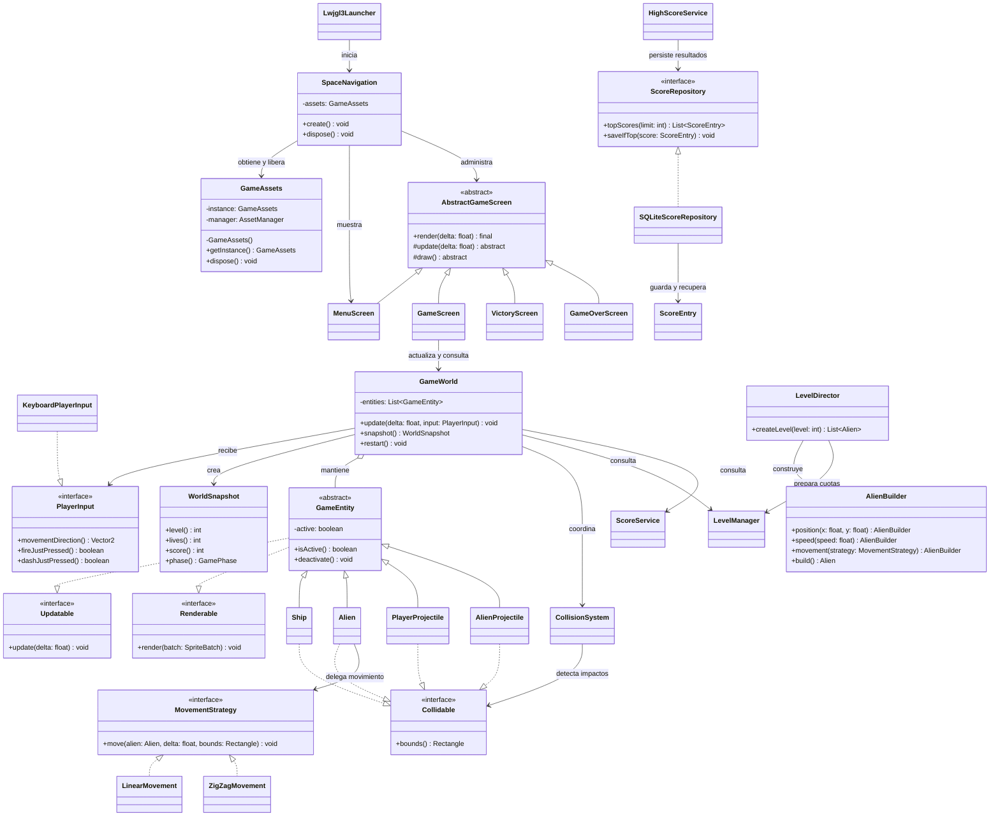

# Diagrama de clases UML

**Estado:** diseño que proponemos y que contrastaremos con el código al integrar cada etapa.  
En el diagrama mostramos la arquitectura objetivo; todavía no afirmamos que esas clases estén implementadas.

## Notas del diagrama

- Vamos a usar `GameEntity` como clase abstracta para la nave, el alien y los proyectiles.
- Definimos `Collidable` como contrato de límites para colisión. Haremos que `bounds()` devuelva una copia para no exponer el rectángulo mutable interno.
- Mantendremos las entidades dentro de `GameWorld` y evitaremos entregar la lista interna a una pantalla.
- Ubicaremos el adaptador `SQLiteScoreRepository` en el módulo de escritorio si acordamos esa tecnología; todavía tenemos pendiente confirmarla.
- Usaremos `GameAssets` como Singleton para GM-6. Desde la aplicación obtendremos la instancia y la inyectaremos en los objetos que la necesiten.
- Aplicaremos Template Method en `AbstractGameScreen` para GM-8 cuando las pantallas concretas compartan ese ciclo.
- Actualizaremos las relaciones entre clases si cambia la implementación acordada. En el UML final mostraremos el código real y quitaremos las clases planeadas que no hayamos usado.
