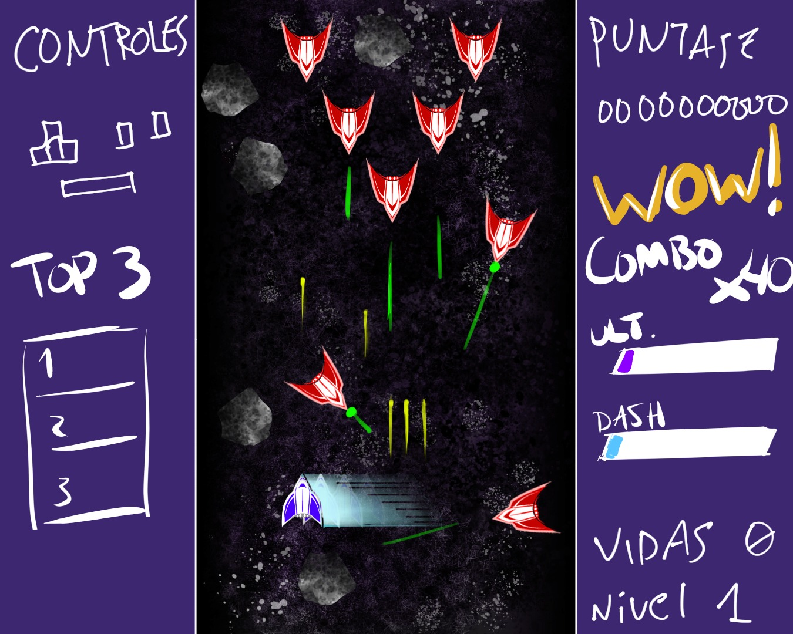
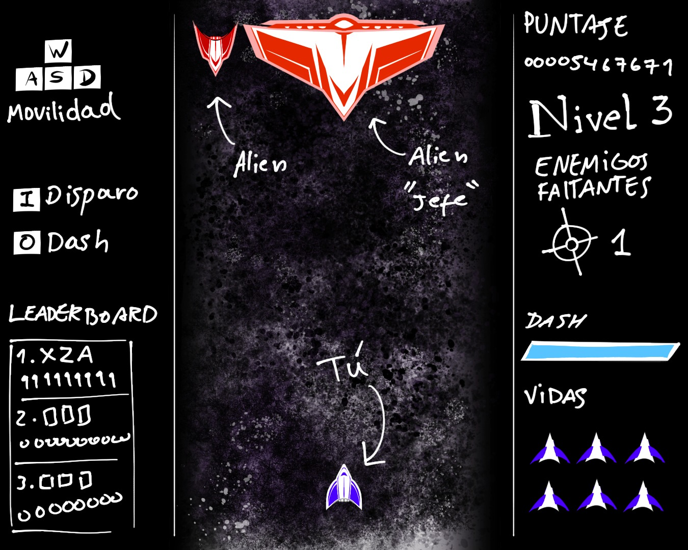
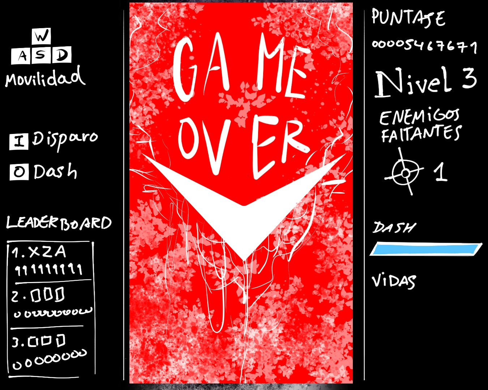
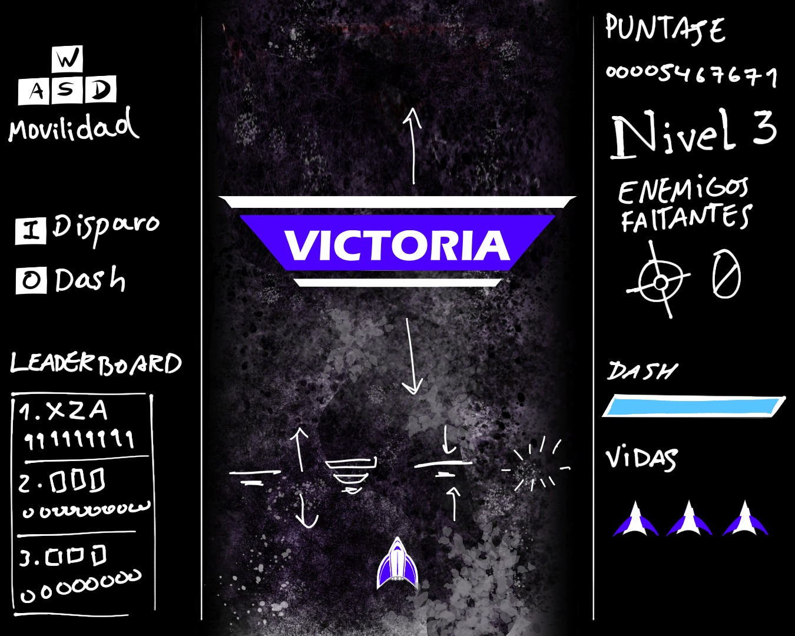
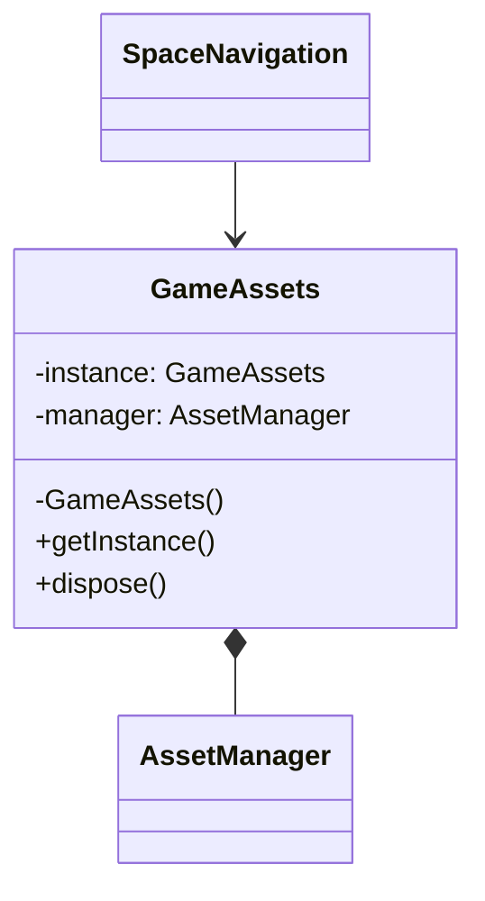
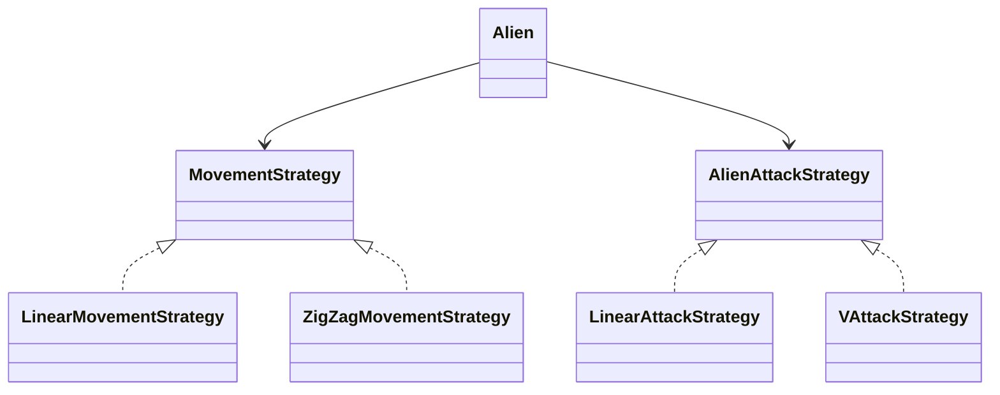
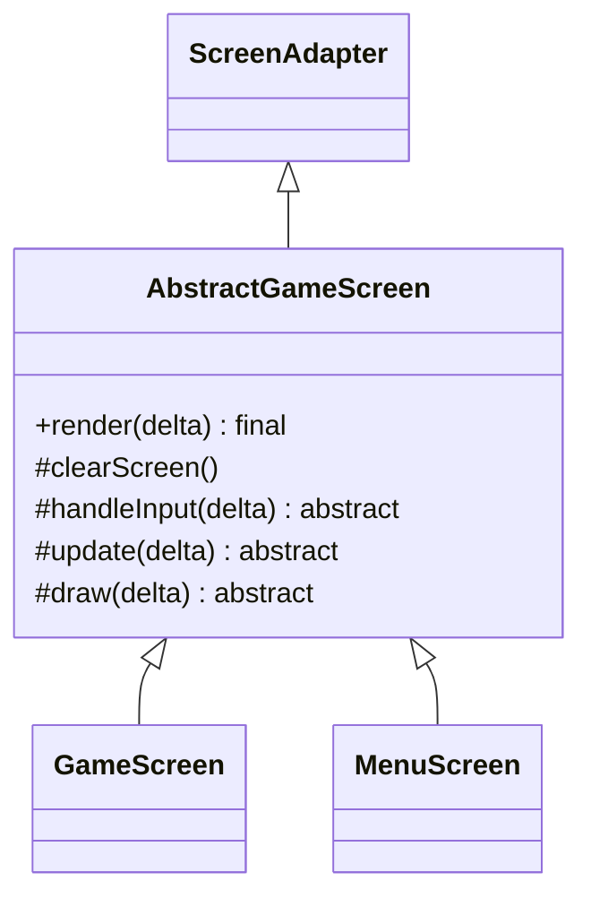
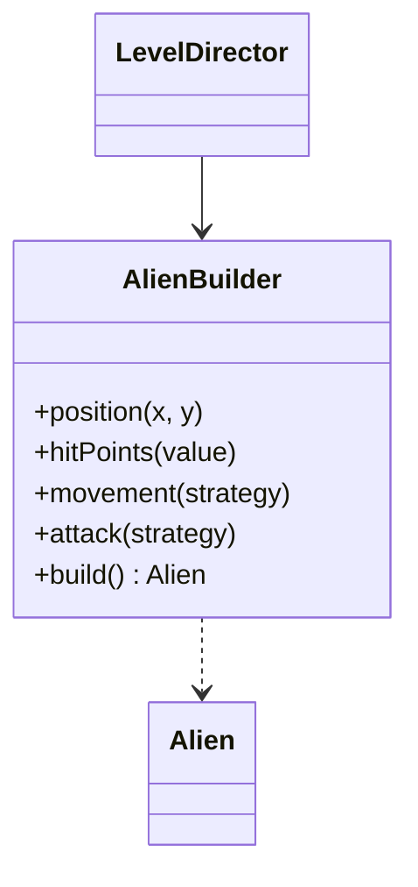

# Reporte del proyecto — Space Navigation

## Alcance de esta entrega

Nosotros integramos una demo de escritorio jugable para recibir feedback. El código permite mover y disparar, recibir daño, reaparecer, destruir meteoritos, completar las cuotas 15/30/45, registrar iniciales y llegar a Game Over o Victoria. Este corte cubre la base jugable y académica de la entrega; no lo presentamos como el producto completo.

## GM-1 — Experiencia del jugador

Nosotros presentamos un arcade 2D en el que pilotamos una nave, esquivamos ataques y despejamos tres niveles. Empezamos con tres vidas; usamos WASD para mover, I mantenida para disparar y O para hacer dash. El nivel uno pide destruir 15 aliens con 1 HP; los niveles dos y tres piden 30 y 45 con 2 y 3 HP. Sumamos 100 puntos por alien destruido y 25, 50 o 75 por meteorito.

Nosotros registramos la experiencia propuesta mediante cuatro bocetos de menú, partida y pantallas finales:

Nosotros mostramos Nivel Superado al terminar los niveles uno y dos y esperamos una tecla o clic para continuar. La última cuota lleva a Victoria. En las pantallas finales, Enter guarda las iniciales si el resultado clasifica o inicia otra partida cuando ya se guardó o no clasifica; Escape vuelve al menú. Al perder una vida reaparecemos en el punto inicial con 1,5 segundos de invulnerabilidad; conservamos puntaje y progreso.

Nosotros dejamos provisional el multiplicador de dash en 3. Las bases fijan duración y recarga, pero no el impulso; debemos validar este valor al probar.

## GM-2 — Comparación con el juego base

Nosotros conservamos intacto el paquete puppy.code.prototype. El prototipo concentraba el ciclo del juego y las colisiones en PantallaJuego. En PantallaJuego.java, líneas 88–101, el proyectil recorre la colección de objetos y el ciclo de colisión continúa después de cada impacto. En el nuevo flujo retiramos el proyectil tras un único impacto y salimos del ciclo interno en GameWorld.java, líneas 148–172.

Nosotros expresamos el movimiento con delta en Ship.java, línea 22, y PlayerProjectile.java, línea 16. Centralizamos velocidades y cuotas en GameConfig. GameWorld mantiene listas privadas y entrega un WorldSnapshot con vistas inmutables para que la pantalla no modifique entidades.

## GM-3 — UML y estructura

Nosotros actualizamos UML_INICIAL.md para reflejar las clases y relaciones que compilamos, incluido el flujo de ingreso de iniciales y consulta del Top 3. Organizamos el código por responsabilidades en app, assets, behaviors, config, entities, factories, input, screens, systems y world. Mantenemos el lanzador de escritorio en lwjgl3.

## GM-4 — Clases abstractas e interfaces

Nosotros hacemos que GameEntity implemente Collidable y que Ship, Alien, Meteorite, PlayerProjectile y AlienProjectile hereden ese contrato. GameEntity.bounds() devuelve un Rectangle nuevo (GameEntity.java, línea 56; Collidable.java, línea 9).

Nosotros hacemos que AbstractGameScreen extienda ScreenAdapter. Su render(float delta) final mantiene la secuencia limpiar, leer entrada, actualizar y dibujar (AbstractGameScreen.java, línea 28). MovementStrategy tiene implementaciones LinearMovementStrategy y ZigZagMovementStrategy; InitialsInput tiene KeyboardInitialsInput como adaptador de teclado. GameEntity cuenta con cinco clases concretas derivadas y Collidable define el contrato geométrico.

## GM-5 — Encapsulamiento, GRASP y SOLID

### Encapsulamiento

Nosotros guardamos la posición y activación de cada entidad en campos privados. GameWorld no expone colecciones mutables; WorldSnapshot copia los datos a EntityView y envuelve las listas con Collections.unmodifiableList (WorldSnapshot.java, líneas 21–67).

### GRASP

- Nosotros aplicamos Information Expert en Ship, Alien y Meteorite, que mantienen su propio estado y comportamiento.
- Nosotros usamos Creator en LevelDirector y AlienBuilder para construir aliens según el nivel (LevelDirector.java, línea 37; AlienBuilder.java, línea 60).
- Nosotros usamos Controller en GameWorld, que coordina la simulación y sus consecuencias (GameWorld.java, línea 72).
- Nosotros buscamos Low Coupling y alta cohesión al separar entrada, presentación, detección de colisiones y reglas de partida.
- Nosotros aplicamos Pure Fabrication en CollisionSystem, PlayerWeapon y GameAssets para responsabilidades que no corresponden a una entidad.

### SOLID

Nosotros separamos presentación y simulación (SRP), permitimos variar movimientos y ataques con estrategias (OCP), y dejamos que CollisionSystem opere sobre Collidable (LSP). PlayerInput, NavigationInput, InitialsInput y las estrategias son contratos pequeños (ISP). Mantenemos limitaciones en DIP: GameWorld recibe LevelDirector y CollisionSystem concretos, las pantallas reciben ScoreRepository concreto y SpaceNavigation obtiene GameAssets mediante Singleton.

## GM-6 — Singleton: GameAssets

### 1. Problema concreto

Nosotros necesitábamos compartir texturas, audio y objetos de dibujo entre pantallas y liberar los recursos al cerrar la aplicación.

### 2. Contexto

SpaceNavigation obtiene la instancia al iniciar. Las pantallas reciben GameAssets por constructor.

### 3. Solución implementada

Nosotros usamos el campo estático instance, el constructor privado, getInstance() y dispose() en GameAssets.java (líneas 27, 37, 45 y 177). AssetManager carga y libera los recursos.

### 4. Diagrama del patrón

## GM-7 — Strategy: movimiento y ataque

### 1. Problema concreto

Nosotros necesitamos cambiar la trayectoria y la descarga alienígena sin concentrar condiciones de movimiento y ataque dentro de Alien.

### 2. Contexto

Nosotros configuramos movimiento lineal para el nivel uno y zigzag para los niveles dos y tres. Elegimos disparo dirigido en el nivel uno y descarga en V en los niveles siguientes.

### 3. Solución implementada

Alien recibe MovementStrategy y AlienAttackStrategy, y las consulta al actualizarse y disparar (Alien.java, líneas 73 y 93). Implementamos movimiento lineal y zigzag en LinearMovementStrategy.java, línea 6, y ZigZagMovementStrategy.java, línea 11. Separamos los ataques en LinearAttackStrategy.java, línea 12, y VAttackStrategy.java, línea 13. LevelDirector selecciona las estrategias en LevelDirector.java, líneas 37–52.

### 4. Diagrama del patrón

## GM-8 — Template Method: AbstractGameScreen

### 1. Problema concreto

Nosotros queremos que todas las pantallas limpien, procesen entrada, actualicen y dibujen en el mismo orden.

### 2. Contexto

MenuScreen, GameScreen, GameOverScreen y VictoryScreen comparten el ciclo de renderizado.

### 3. Solución implementada

Nosotros declaramos render(float delta) final en AbstractGameScreen.java, línea 28, y dejamos clearScreen, handleInput, update y draw como pasos del algoritmo base.

### 4. Diagrama del patrón

## GM-9 — Builder: AlienBuilder y LevelDirector

### 1. Problema concreto

Nosotros necesitamos construir aliens con combinaciones válidas de posición, vida, movimiento y ataque.

### 2. Contexto

Los niveles tienen HP, movimiento y estrategia de ataque distintos; el resto de la partida los consume con la misma interfaz Alien.

### 3. Solución implementada

Nosotros validamos la configuración al llamar build() en AlienBuilder.java, línea 60. LevelDirector prepara y distribuye cada oleada con esas configuraciones en LevelDirector.java, línea 37.

### 4. Diagrama del patrón

## GM-10 — GitHub y commits

Nosotros trabajamos sobre feature/rama-Alex y registramos avances pequeños con mensajes en primera persona. La secuencia de implementación incluye estos ocho commits:

1. cb7b090 — Corrijo los errores de compilación del juego.
2. beae3fd — Conecto el combate y la progresión de la partida.
3. ff6f2fc — Conecto las transiciones y cierro las reglas de nivel.
4. e47eeb4 — Conecto los finales con el estado real de la partida.
5. 34ace3d — Actualizo la guía para probar la demo jugable.
6. ba9ad75 — Limpio el estado al volver al menú.
7. b25a232 — Actualizo el UML con el flujo jugable real.
8. 099f775 — Conecto el Top 3 y cierro el flujo de iniciales.

En una verificación anterior ejecutamos gradlew.bat test compileJava; se registró la compilación de core y lwjgl3, sin fuentes automatizadas de prueba (test finalizó como NO-SOURCE). En esta revisión aislada el wrapper no pudo conectar con su daemon. Para validar el cambio actual compilamos core y lwjgl3 con javac 11 y el classpath local. La prueba manual completa de controles y balance sigue pendiente.

## Cierre y límites conocidos

Nosotros completamos la conexión de ScoreRepository con el menú, Game Over y Victoria. Si el resultado supera el tercer puntaje, el jugador ingresa tres letras A-Z; Retroceso corrige la entrada y Enter persiste el resultado. Mostramos el Top 3 en el menú y ambas pantallas finales. También restauramos el uso de los sprites de jugador y alienígenas, los proyectiles, el icono de vidas y los banners ya incluidos en assets/. La partida reproduce background_music.MP3 y Game Over reproduce gameover.mp3. Para el siguiente ciclo dejamos la validación manual de controles y del multiplicador provisional del dash. Sigue sin conocerse la fuente ni la licencia de los recursos gráficos y de audio.
