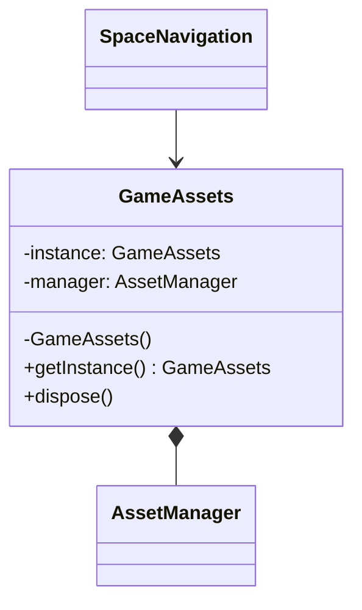
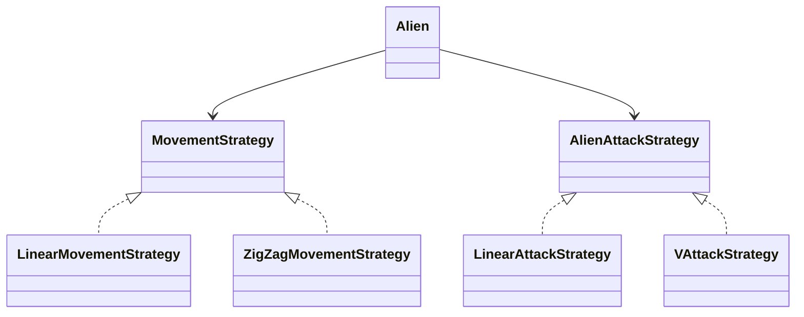
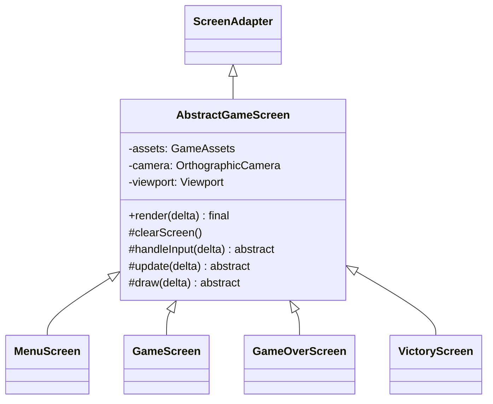
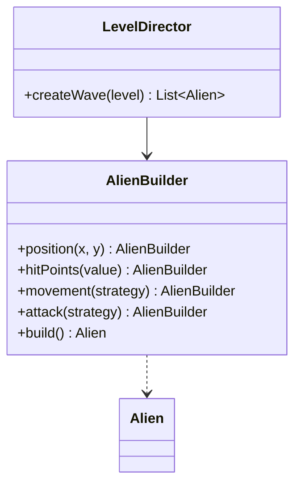

# Reporte del proyecto - Space Navigation

## Alcance de la entrega

Nosotros cerramos una base jugable para recibir retroalimentación en INF2236. Implementamos el movimiento y combate de la nave, tres niveles con cuotas, pérdida y recuperación de vidas, meteoritos, pantallas de cierre y registro local del Top 3. Conservamos el paquete `puppy.code.prototype` para comparar la evolución del diseño. En este reporte distinguimos el comportamiento implementado de la evidencia que aún debe agregarse para la evaluación.

## GM-1 - Perspectiva del jugador

### Propuesta y objetivo

Nosotros planteamos un arcade 2D de navegación espacial. Pilotamos una nave, esquivamos los ataques alienígenas y destruimos aliens para avanzar por tres niveles. El jugador comienza con tres vidas. Cada nivel exige una cuota distinta y aumenta los puntos de vida de los aliens.

### Flujo de juego

Nosotros iniciamos en `MenuScreen`. Al confirmar, `SpaceNavigation` crea un `GameWorld` y muestra `GameScreen`. Cuando cumplimos una cuota, el mundo cambia a `LEVEL_COMPLETED`; la pantalla muestra Nivel superado y espera una acción para continuar. Al completar el tercer nivel mostramos `VictoryScreen`. Al perder las tres vidas mostramos `GameOverScreen`. En las pantallas finales, `ENTER` guarda las iniciales cuando el puntaje clasifica o inicia una partida nueva una vez terminado ese paso; `ESC` vuelve al menú. La coordinación está en `SpaceNavigation.java:46-84`, y las transiciones de partida en `GameScreen.java:78-91`.

### Controles y combate

| Entrada | Comportamiento implementado |
| --- | --- |
| `W`, `A`, `S`, `D` | Nosotros movemos la nave en ocho direcciones a 260 px/s; normalizamos el vector diagonal. |
| `I` mantenida | Nosotros disparamos automáticamente cada 0,25 s; cada proyectil del jugador viaja a 450 px/s. |
| `O` | Nosotros activamos un dash en la dirección de movimiento, con velocidad multiplicada por 3 durante 0,15 s, invulnerabilidad durante el dash y un enfriamiento de 3,0 s. |
| `ENTER` | Nosotros iniciamos o continuamos, confirmamos las iniciales o reiniciamos desde el final. |
| `ESC` | Nosotros regresamos al menú desde la partida o las pantallas finales. |
| `A` a `Z` | Nosotros ingresamos iniciales cuando un puntaje califica para el Top 3. |
| `Retroceso` | Nosotros eliminamos la última inicial. |

Los valores principales están en `GameConfig.java:18-41` y `GameConfig.java:69-88`; el movimiento y la activación del dash están en `Ship.java:22-81`; el disparo continuo se regula en `PlayerWeapon.java:13-31`. Nosotros dejamos el multiplicador 3 como valor provisional, porque las bases fijan duración y enfriamiento, pero el balance debe confirmarse jugando. La estela visual se construye con `AfterImage` durante 0,20 s en `GameScreen.java:22-24` y `GameScreen.java:114-135`.

### Niveles, obstáculos y puntaje

| Nivel | Cuota | HP alien | Movimiento alien | Ataque alienígena |
| --- | ---: | ---: | --- | --- |
| 1 | 15 aliens | 1 | Lineal, 90 px/s | Un proyectil dirigido, 220 px/s, cada 1,8 s |
| 2 | 30 aliens | 2 | Zigzag, 110 px/s | Dos proyectiles en V a 45 grados, 220 px/s, cada 1,8 s |
| 3 | 45 aliens | 3 | Zigzag, 110 px/s | Dos proyectiles en V a 45 grados, 220 px/s, cada 1,8 s |

Nosotros centralizamos cuotas, velocidades y vida por nivel en `GameConfig.java:47-88`, y seleccionamos las configuraciones en `LevelDirector.java:37-78`. Un alien destruido por proyectil del jugador entrega 100 puntos; los meteoritos pequeños, medianos y grandes entregan 25, 50 y 75 puntos, respectivamente (`GameConfig.java:51-63`). El contacto físico nave-alien consume una vida y destruye el alien, pero no concede puntaje ni progreso de cuota (`GameWorld.java:204-223`).

Nosotros no describimos un modo de depuración en el menú porque no encontramos controles ni una ruta de debug en el paquete activo `puppy.code`; no lo presentamos como una función disponible.

Nosotros reaparecemos en la posición inicial con 1,5 s de invulnerabilidad. Al perder una vida limpiamos los proyectiles de ambos bandos, manteniendo aliens y meteoritos (`GameWorld.java:227-244`). El Top 3 almacena tres iniciales de `A` a `Z` localmente mediante Preferences con la clave `space_navigation_scores` (`ScoreRepository.java:10-13`, `ScoreRepository.java:38-85`).

### Evidencia visual

Nosotros contamos con los bocetos conceptuales `Planificacion/Bocetos/B1.jpeg` a `B4.jpeg`; los presentamos como bocetos, no como capturas del juego ejecutándose. Para la entrega final proponemos insertar las capturas reales en los siguientes lugares:

1. Después del flujo de juego: captura del menú con el Top 3 visible.
2. Después de la tabla de niveles: captura de partida con nave, cuota, vidas y proyectiles.
3. Después de las reglas de puntuación: captura de Game Over con ingreso de iniciales o Top 3.
4. Después de explicar el último nivel: captura de Victoria y su puntaje final.

## GM-2 - Análisis del juego base y cambios

Nosotros conservamos sin cambios el paquete `puppy.code.prototype` como evidencia histórica. El prototipo `PantallaJuego` concentraba creación de recursos, HUD, actualización, colisiones, puntaje y transiciones en una sola pantalla (`prototype/PantallaJuego.java:16-72`, `prototype/PantallaJuego.java:74-159`). Esto mezclaba varias razones de cambio y reducía la cohesión de la clase.

Nosotros identificamos estos problemas concretos:

| Hallazgo en el prototipo | Evidencia | Cambio aplicado en la versión actual |
| --- | --- | --- |
| La pantalla reúne demasiadas responsabilidades. | `PantallaJuego.render()` actualiza entidades, procesa colisiones, dibuja y cambia de ronda o pantalla (`prototype/PantallaJuego.java:82-159`). | Nosotros distribuimos la simulación en `GameWorld`, la presentación en `GameScreen`, las colisiones en `CollisionSystem` y la configuración en `GameConfig`. |
| La nave depende de entrada global y de la pantalla concreta. | `Nave4.draw(SpriteBatch, PantallaJuego)` lee `Gdx.input` y llama a `juego.agregarBala(...)` (`prototype/Nave4.java:37-84`). | Nosotros separamos los contratos `PlayerInput`, `NavigationInput` e `InitialsInput`; `GameWorld` recibe `PlayerInput` y las pantallas delegan la navegación a `ScreenNavigator`. |
| Mantenemos dos listas de asteroides con las mismas referencias. | `PantallaJuego` agrega cada `Ball2` a `balls1` y `balls2` (`prototype/PantallaJuego.java:63-71`). | Nosotros mantenemos una colección por tipo de entidad dentro de `GameWorld` y calculamos colisiones mediante `CollisionSystem`. |
| El movimiento depende de la frecuencia de cuadros. | `Ball2.update()` y `Bullet.update()` no reciben `delta` (`prototype/Ball2.java:34-43`, `prototype/Bullet.java:22-31`). | Nosotros expresamos movimiento con tiempo delta, por ejemplo en `Ship.update(float delta, ...)` y `PlayerProjectile.update(float delta)`. |
| Los recursos se crean repetidamente sin un ciclo de vida común. | `PantallaJuego` crea texturas y sonidos al crear la nave y los meteoritos (`prototype/PantallaJuego.java:47-70`); `dispose()` libera solo algunos sonidos y música (`prototype/PantallaJuego.java:195-200`). Las texturas y sonidos entregados a `Nave4`, `Ball2` y `Bullet` no se liberan ahí. | Nosotros centralizamos carga y liberación en `GameAssets`, que usa `AssetManager` y un único ciclo de vida. |
| Una bala puede destruir varios asteroides en el mismo cuadro. | El bucle interno de `PantallaJuego` continúa luego de `b.checkCollision(...)`; `Bullet.checkCollision` marca la bala como destruida, pero no evita nuevas comprobaciones (`prototype/PantallaJuego.java:88-106`, `prototype/Bullet.java:37-45`). | Nosotros desactivamos el proyectil y salimos del bucle al primer impacto (`GameWorld.java:157-183`). |

Nosotros también separamos el estado de simulación de la pantalla mediante `WorldSnapshot`, añadimos eventos de combate para reproducir audio desde `GameScreen`, y hacemos que el código histórico permanezca intacto. No afirmamos que esta comparación sustituya una validación manual completa del juego.

## GM-3 - Diseño conceptual, UML y trazabilidad

Nosotros documentamos las relaciones y colaboraciones en [UML_INICIAL.md](UML_INICIAL.md). El diagrama corresponde a los 38 archivos Java activos fuera del paquete histórico, más las dos clases internas `EntityView` y `HighScore`. Registramos cada clase y responsabilidad:

En las referencias siguientes, nosotros abreviamos el prefijo `core/src/main/java/puppy/code/`; las rutas del prototipo se indican desde `core/src/main/java/puppy/code/prototype/`.

| Paquete | Clase o interfaz | Responsabilidad que implementamos |
| --- | --- | --- |
| `app` | `SpaceNavigation.java` | Nosotros componemos los servicios, creamos los mundos y navegamos entre pantallas. |
| `app` | `ScreenNavigator.java` | Nosotros declaramos las transiciones disponibles entre menú, partida y finales. |
| `assets` | `GameAssets.java` | Nosotros centralizamos recursos gráficos y de audio y su liberación. |
| `behaviors` | `MovementStrategy.java` | Nosotros definimos el contrato de movimiento de los aliens. |
| `behaviors` | `LinearMovementStrategy.java` | Nosotros calculamos el movimiento lineal. |
| `behaviors` | `ZigZagMovementStrategy.java` | Nosotros calculamos el movimiento zigzag. |
| `behaviors` | `AlienAttackStrategy.java` | Nosotros definimos el contrato de creación de descargas alienígenas. |
| `behaviors` | `LinearAttackStrategy.java` | Nosotros creamos un proyectil dirigido al jugador. |
| `behaviors` | `VAttackStrategy.java` | Nosotros creamos dos proyectiles separados en V. |
| `config` | `GameConfig.java` | Nosotros concentramos dimensiones, velocidades, cuotas y valores de puntaje. |
| `entities` | `Collidable.java` | Nosotros abstraemos los límites geométricos de entidades colisionables. |
| `entities` | `GameEntity.java` | Nosotros compartimos posición, tamaño, activación y límites entre entidades. |
| `entities` | `Ship.java` | Nosotros modelamos movimiento, dash, vidas y protección temporal de la nave. |
| `entities` | `Alien.java` | Nosotros modelamos vida, movimiento, ataques y estado de cada alien. |
| `entities` | `Meteorite.java` | Nosotros modelamos movimiento y puntaje según tamaño del meteorito. |
| `entities` | `MeteoriteSize.java` | Nosotros enumeramos los tamaños de meteorito disponibles. |
| `entities` | `PlayerProjectile.java` | Nosotros modelamos el movimiento y ciclo de vida de los disparos del jugador. |
| `entities` | `AlienProjectile.java` | Nosotros modelamos dirección, velocidad y ciclo de vida de ataques alienígenas. |
| `factories` | `AlienBuilder.java` | Nosotros validamos y construimos aliens con sus atributos y estrategias. |
| `factories` | `LevelDirector.java` | Nosotros seleccionamos las configuraciones por nivel y organizamos sus oleadas. |
| `input` | `PlayerInput.java` | Nosotros abstraemos movimiento, disparo y dash del jugador. |
| `input` | `KeyboardPlayerInput.java` | Nosotros traducimos teclado a acciones de jugador. |
| `input` | `NavigationInput.java` | Nosotros abstraemos confirmar, volver y continuar. |
| `input` | `KeyboardNavigationInput.java` | Nosotros traducimos teclado a acciones de navegación. |
| `input` | `InitialsInput.java` | Nosotros abstraemos escritura y borrado de iniciales. |
| `input` | `KeyboardInitialsInput.java` | Nosotros traducimos teclas a letras y borrado. |
| `screens` | `AbstractGameScreen.java` | Nosotros fijamos el ciclo común de presentación con Template Method. |
| `screens` | `MenuScreen.java` | Nosotros presentamos el menú, instrucciones y puntajes locales. |
| `screens` | `GameScreen.java` | Nosotros leemos la entrada de partida, presentamos la simulación y reproducimos SFX. |
| `screens` | `GameOverScreen.java` | Nosotros presentamos el resultado, el ingreso de iniciales y el Top 3. |
| `screens` | `VictoryScreen.java` | Nosotros presentamos la victoria, el ingreso de iniciales y el Top 3. |
| `screens` | `AfterImage.java` | Nosotros representamos una estela translúcida durante el dash. |
| `systems` | `CollisionSystem.java` | Nosotros comprobamos intersecciones sobre el contrato `Collidable`. |
| `systems` | `PlayerWeapon.java` | Nosotros controlamos la cadencia y creación de proyectiles del jugador. |
| `systems` | `ScoreRepository.java` | Nosotros consultamos y persistimos los tres puntajes locales. |
| `systems` | `ScoreRepository.HighScore` | Nosotros representamos de forma ordenable un nombre y puntaje. |
| `world` | `GamePhase.java` | Nosotros enumeramos las fases de la partida. |
| `world` | `GameWorld.java` | Nosotros coordinamos el estado, reglas, progreso y colisiones del mundo. |
| `world` | `WorldSnapshot.java` | Nosotros transferimos una vista de estado de solo lectura a la presentación. |
| `world` | `WorldSnapshot.EntityView` | Nosotros copiamos posición, tamaño y ruta visual de una entidad. |

Nosotros mantenemos el lanzador de escritorio en `lwjgl3/src/main/java/puppy/code/lwjgl3/Lwjgl3Launcher.java`. Las clases del paquete histórico `prototype` se excluyen deliberadamente de este conteo y del diagrama principal.

## GM-4 - Clases abstractas e interfaces

Nosotros usamos dos clases abstractas. `GameEntity` implementa `Collidable`; `Ship`, `Alien`, `Meteorite`, `PlayerProjectile` y `AlienProjectile` heredan ese contrato geométrico. `GameEntity.bounds()` entrega un `Rectangle` nuevo (`entities/GameEntity.java:6-6`, `entities/GameEntity.java:56-58`; contrato en `entities/Collidable.java:6-9`).

Nosotros usamos `AbstractGameScreen`, que extiende `ScreenAdapter` y es la base de `MenuScreen`, `GameScreen`, `GameOverScreen` y `VictoryScreen`. Su `render(float delta)` es final y ejecuta `clearScreen()`, `handleInput(delta)`, `update(delta)` y `draw(delta)` en ese orden (`screens/AbstractGameScreen.java:39-57`).

Nosotros definimos `MovementStrategy.nextPosition(float x, float y, float age, float delta)` y sus implementaciones `LinearMovementStrategy` y `ZigZagMovementStrategy` (`behaviors/MovementStrategy.java:6-13`). `Alien.update(...)` llama a `movement.nextPosition(...)` (`entities/Alien.java:64-78`). También definimos `AlienAttackStrategy.createVolley(Alien alien, Ship target)` y sus implementaciones lineal y en V (`behaviors/AlienAttackStrategy.java:6-11`); `Alien.fireDue(...)` usa `attackStrategy.createVolley(...)` (`entities/Alien.java:82-96`).

Nosotros hacemos que `CollisionSystem.collides(Collidable first, Collidable second)` opere mediante el contrato, y que `GameWorld` invoque ese método con la nave, aliens, meteoritos y proyectiles (`systems/CollisionSystem.java:9-23`, `world/GameWorld.java:157-223`). Así dejamos que el tipo concreto determine sus límites sin ramas por clase.

## GM-5 - Encapsulamiento, GRASP y SOLID

### Encapsulamiento

Nosotros mantenemos privados los campos de estado de instancia en las clases activas; las constantes compartidas se publican como `static final`. `GameEntity.bounds()` crea un rectángulo nuevo para no entregar la geometría interna (`entities/GameEntity.java:56-58`). `WorldSnapshot` copia entidades a `EntityView` y devuelve listas con `Collections.unmodifiableList()` (`world/WorldSnapshot.java:66-72`, `world/WorldSnapshot.java:139-179`). Sus valores y banderas de eventos son finales y se transfieren mediante getters (`world/WorldSnapshot.java:14-63`, `world/WorldSnapshot.java:126-135`).

### GRASP

- **Information Expert:** Nosotros dejamos en `Ship` el movimiento, dash e invulnerabilidad; en `Alien`, la vida y estrategias; en `Meteorite`, el tamaño y puntaje; y en `GameWorld`, las reglas de progresión que requieren el estado global.
- **Creator:** Nosotros hacemos que `LevelDirector` configure y solicite aliens a `AlienBuilder` (`factories/LevelDirector.java:37-54`, `factories/AlienBuilder.java:26-68`).
- **Controller:** Nosotros usamos `GameWorld` para recibir acciones y coordinar actualización, colisiones, puntaje y fases (`world/GameWorld.java:43-110`).
- **Low Coupling:** Nosotros evitamos que el mundo dependa de `GameAssets` o del audio LibGDX; `GameScreen` reproduce los eventos leídos desde `WorldSnapshot` (`screens/GameScreen.java:101-111`). `GameWorld` recibe `PlayerInput` y publica una instantánea a la pantalla.
- **High Cohesion:** Nosotros agrupamos cada responsabilidad por paquete: entidades modelan estado, comportamientos calculan estrategias, sistemas resuelven operaciones auxiliares y pantallas presentan resultados.
- **Polymorphism:** Nosotros despachamos movimiento y ataque a estrategias, y colisiones mediante `Collidable`, sin condicionar el comportamiento al nombre de cada clase.
- **Pure Fabrication:** Nosotros ubicamos carga de recursos en `GameAssets`, colisiones en `CollisionSystem`, cadencia en `PlayerWeapon` y persistencia en `ScoreRepository` en vez de concentrarlas en entidades del dominio.
- **Indirection:** Nosotros usamos `PlayerInput`, `NavigationInput`, `InitialsInput`, `ScreenNavigator` y `WorldSnapshot` para interponer contratos entre teclado, pantallas y simulación.

### SOLID

- **SRP:** Nosotros separamos entrada, simulación, presentación, colisiones, recursos, disparo y persistencia en clases distintas.
- **OCP:** Nosotros podemos agregar una implementación de movimiento o ataque sin alterar el código de `Alien`, que consume interfaces. Para asignar una estrategia a un nivel nuevo, sí debemos revisar `LevelDirector`.
- **LSP:** Nosotros hacemos que las cinco entidades concretas conserven el contrato de `GameEntity` y `Collidable`; los sistemas pueden tratarlas como entidad o colisionable.
- **ISP:** Nosotros mantenemos contratos de entrada separados para juego, navegación e iniciales, evitando una interfaz única con acciones no relacionadas.
- **DIP:** Nosotros invertimos algunas dependencias a través de interfaces de entrada y navegación. No afirmamos que toda la arquitectura lo aplique: `GameWorld` recibe `LevelDirector` y `CollisionSystem` concretos, las pantallas reciben `ScoreRepository` concreto y `SpaceNavigation` obtiene `GameAssets` mediante Singleton.

## GM-6 - Singleton: GameAssets

### 1. Problema

Nosotros necesitábamos compartir un único administrador de texturas, audio y recursos de dibujo entre las pantallas, evitando cargas duplicadas y concentrando la liberación al cerrar el juego.

### 2. Contexto

Nosotros creamos el gestor durante `SpaceNavigation.create()` y lo entregamos a las pantallas. Algunos archivos son opcionales; la ausencia de un recurso no debe impedir el uso de alternativas visuales.

### 3. Solución implementada

Nosotros ocultamos el constructor (`assets/GameAssets.java:61`), mantenemos la instancia en un campo estático privado (`assets/GameAssets.java:43`) y exponemos `getInstance()` sincronizado (`assets/GameAssets.java:73-78`). El gestor usa `AssetManager` y libera los recursos desde `dispose()` (`assets/GameAssets.java:45-49`, `assets/GameAssets.java:253-268`). En `load(...)` comprobamos `Gdx.files` y la existencia del recurso antes de pedirlo al administrador (`assets/GameAssets.java:211-224`). `playSound(...)` y `playMusic(...)` toleran retornos nulos (`assets/GameAssets.java:228-247`).

### 4. Diagrama UML del Singleton

## GM-7 - Strategy: movimiento y ataque

### 1. Problema

Nosotros necesitábamos variar el movimiento y las descargas de los aliens entre niveles sin llenar `Alien` de condicionales de trayectoria y patrón de disparo.

### 2. Contexto

Nosotros usamos movimiento lineal y ataque dirigido en el primer nivel, y movimiento zigzag con ataque en V en los niveles segundo y tercero. Cada comportamiento recibe el tiempo delta y puede sustituirse detrás de su contrato.

### 3. Solución implementada

Nosotros declaramos `MovementStrategy.nextPosition(...)` y `AlienAttackStrategy.createVolley(...)` en sus interfaces. `Alien` recibe ambos contratos por constructor y los llama desde `update(...)` y `fireDue(...)` (`entities/Alien.java:20-43`, `entities/Alien.java:64-96`). `LinearMovementStrategy` y `ZigZagMovementStrategy` calculan trayectorias distintas. `LinearAttackStrategy` y `VAttackStrategy` construyen descargas diferentes. `LevelDirector` selecciona estrategias y vida por nivel (`factories/LevelDirector.java:57-78`).

### 4. Diagrama UML de Strategy

## GM-8 - Template Method: AbstractGameScreen

### 1. Problema

Nosotros necesitábamos que todas las pantallas procesaran cada cuadro en un orden común y que ninguna subclase lo cambiara accidentalmente.

### 2. Contexto

Nosotros compartimos cámara, viewport y acceso a `GameAssets` entre menú, partida y pantallas finales. Cada pantalla concreta define sus propias acciones, actualización y dibujo.

### 3. Solución implementada

Nosotros declaramos `render(float delta)` como final en `AbstractGameScreen.java:39-46`. El método llama en orden a `clearScreen()`, `handleInput(frameDelta)`, `update(frameDelta)` y `draw(frameDelta)` (`AbstractGameScreen.java:42-57`). Las cuatro pantallas extienden esta clase; sus campos comunes son privados y se consultan mediante getters protegidos finales (`AbstractGameScreen.java:14-37`).

### 4. Diagrama UML de Template Method

## GM-9 - Builder: AlienBuilder y LevelDirector

### 1. Problema

Nosotros necesitábamos crear aliens con combinaciones válidas de posición, dimensiones, vida, movimiento y ataque sin usar constructores extensos en la lógica del mundo.

### 2. Contexto

Nosotros cambiamos vida, movimiento y ataque según el nivel, pero cada alien conserva el mismo tipo y es consumido por los mismos sistemas.

### 3. Solución implementada

Nosotros encadenamos `position(...)`, `size(...)`, `hitPoints(...)`, `movement(...)` y `attack(...)` en `AlienBuilder`; `build()` valida la configuración antes de crear el alien (`factories/AlienBuilder.java:26-68`). `LevelDirector.createWave(level)` decide configuración y distribución, y usa el Builder para cada alien (`factories/LevelDirector.java:37-54`).

### 4. Diagrama UML de Builder y Director

## GM-10 - GitHub, ramas, revisiones y commits

Nosotros trabajamos en la rama local `feature/rama-Alex`, que sigue a `origin/feature/rama-Alex`. Los tres commits de código de la tabla están por delante del último estado remoto observado; al agregar la documentación, quedarán cuatro commits locales sin publicar. En esta tarea no ejecutamos `push`. El remoto configurado es `https://github.com/L3v1smpr/GameProject.git`. El repositorio también registra ramas de planificación, arquitectura, patrones y gráficos, entre ellas `main`, `estructura-inicial`, `feature/base-arquitectura`, `feature/base-patrones`, `feature/frente-graficos-pantallas`, `feature/overhaul-assets` y `planificacion`.

| Hash | Autor registrado por Git | Mensaje |
| --- | --- | --- |
| `95fa778` | `L3v1smpr` | `test: agrega pruebas unitarias para validar reglas de GameWorld, Builder y Strategies` |
| `15fb122` | `L3v1smpr` | `feat: integra efectos de sonido en GameScreen y ajusta colision kamikaze en GameWorld` |
| `5ee68b2` | `L3v1smpr` | `fix: protege carga de recursos faltantes en GameAssets y encapsula AbstractGameScreen` |
| `67fa597` | `L3v1smpr` | `Aclaro el cierre y los pendientes de la entrega` |
| `099f775` | `L3v1smpr` | `Conecto el Top 3 y cierro el flujo de iniciales` |
| `4f13a19` | `L3v1smpr` | `Cierro el reporte de la primera entrega` |
| `b25a232` | `L3v1smpr` | `Actualizo el UML con el flujo jugable real` |
| `ba9ad75` | `L3v1smpr` | `Limpio el estado al volver al menú` |
| `34ace3d` | `L3v1smpr` | `Actualizo la guía para probar la demo jugable` |

Nosotros no inferimos la identidad de Cristian, Alex o Elvis a partir del nombre de una rama. El historial local atribuye estos commits a `L3v1smpr`, así que para evaluación debemos agregar los enlaces a PR, revisiones y cuentas GitHub que acrediten a cada integrante.

| Integrante | Rama, commits y revisión que debemos vincular antes de entregar |
| --- | --- |
| Cristian | Nosotros debemos asociar aquí la rama o PR y sus commits verificados. |
| Alex | Nosotros debemos vincular la evidencia del PR y confirmar la relación entre su cuenta y `feature/rama-Alex`. |
| Elvis | Nosotros debemos asociar aquí la cuenta, rama o PR y sus commits verificados. |

Nosotros registramos la suite de regresión en `core/src/test/java/puppy/code/entities/EntityAndStrategyTest.java` y `core/src/test/java/puppy/code/world/GameWorldTest.java`. Con OpenJDK 11.0.32 ejecutamos `.\gradlew.bat test build --warning-mode all`: Gradle terminó con `BUILD SUCCESSFUL`, 12 pruebas aprobadas y sin fallos. El daemon de Gradle 8.10.1 sí advierte que ejecutar Gradle sobre Java 16 o anterior dejará de estar soportado en Gradle 9; el código mantiene compatibilidad Java 11. Nosotros dejamos la prueba manual completa de controles, audio y balance como validación presencial pendiente.

El commit de documentación de este reporte se registra en el historial Git del proyecto después de incorporarlo; no incluimos su propio hash dentro del archivo que ese mismo commit versiona.

## Cierre

Nosotros dejamos sincronizados el README, el diagrama UML y este reporte con la arquitectura activa, y conservamos intactos `assets/` y `puppy.code.prototype`. La carga de recursos opcionales, los eventos de audio, la colisión física nave-alien y el icono de cuota quedan documentados junto con las pruebas que verifican las reglas. Para cerrar la evidencia de la entrega necesitamos adjuntar capturas reales, enlaces de revisiones de GitHub y la atribución verificable de los commits al equipo.
