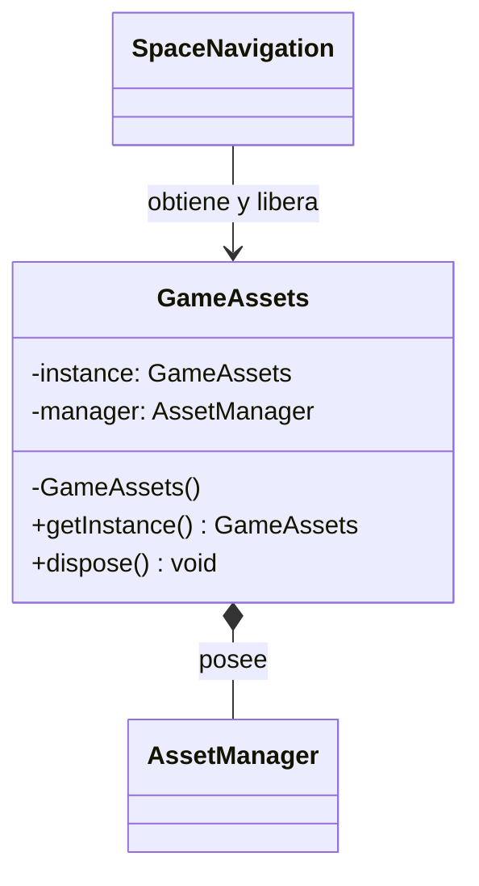
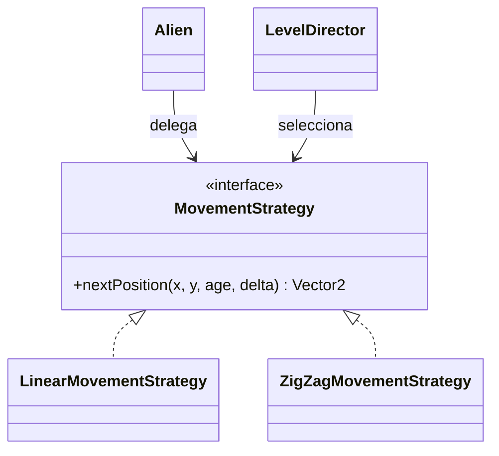
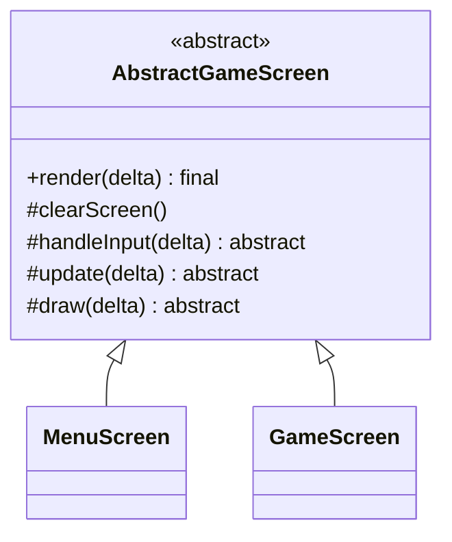
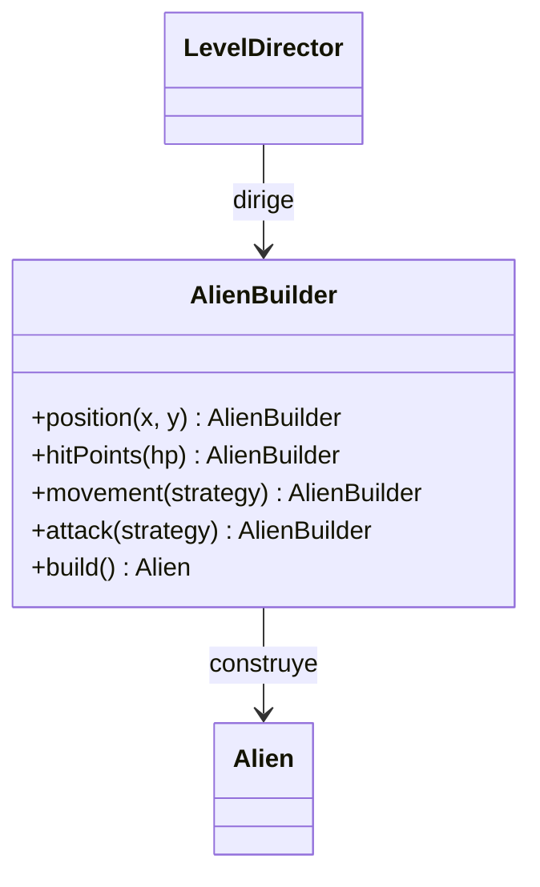

# Reporte del proyecto — Space Navigation

## Alcance de esta versión

Nosotros preparamos una base de desarrollo en Java 11 y LibGDX 1.12.1, manteniendo aparte el código
histórico del paquete `puppy.code.prototype`. Nosotros implementamos los patrones y los modelos que
no dependen de las reglas de colisión/vidas/respawn, las fases/progresión ni el puntaje/leaderboard.
Nosotros dejamos esas tres secciones funcionales para la siguiente IA, junto con sus integraciones.

Nosotros distinguimos las secciones funcionales 3, 4 y 5 de los requisitos académicos GM-3, GM-4 y
GM-5. Nosotros sí dejamos un UML actual, una clase abstracta, varias interfaces y evidencia de
encapsulamiento y diseño; nosotros no completamos la jugabilidad de las secciones funcionales reservadas.

## GM-1 — Juego desde la perspectiva del jugador

Nosotros planteamos Space Navigation como un juego en que pilotamos una nave, esquivamos amenazas y
despejamos oleadas alienígenas. Nosotros diseñamos tres arquetipos de nivel: 15, 30 y 45 aliens como
cuotas; un impacto destruye un alien en el primer nivel, dos en el segundo y tres en el tercero.
Nosotros definimos movimiento lineal para el primer nivel y zigzag para los dos siguientes. Nosotros
preparamos un disparo alienígena lineal en el primer nivel y descargas dobles en V en los siguientes.

Nosotros definimos W/A/S/D para mover, I mantenida para disparar, O para el dash, Enter para confirmar
y Escape para volver. En esta base nosotros ya movemos la nave con W/A/S/D, detectamos la entrada de I
y O, y preparamos el enfriamiento del arma; nosotros todavía no conectamos el arma ni el dash al ciclo
de la partida. Nosotros dejamos los meteoritos modelados por tamaño y ruta de imagen, pero sin
generación, colisión o puntaje integrados.

Nosotros no presentamos la cuota, el dash, la partida completa ni la tabla local como funciones listas.
Nosotros dejamos su integración para la etapa siguiente y actualizaremos esta descripción cuando
esas reglas estén conectadas y verificadas.

## GM-2 — Análisis de ingeniería del juego base y los cambios

Nosotros conservamos el prototipo para compararlo, sin modificar sus archivos. En el prototipo, nosotros
concentramos creación de recursos, actualización, colisiones, puntaje y rondas en `prototype/PantallaJuego`;
nosotros hacemos que `prototype/Nave4.draw()` lea el teclado y que la misma clase mueva la nave, gestione
vidas y cree balas. Nosotros avanzamos proyectiles y asteroides por fotograma en `prototype/Bullet.update()`
y `prototype/Ball2.update()`, por lo que su velocidad no está expresada en unidades por segundo.

Nosotros creamos texturas, sonidos y música dentro de la pantalla de juego (`prototype/PantallaJuego`),
de modo que el reinicio puede crear nuevos recursos. Nosotros observamos también que el ciclo de la
bala continúa por los asteroides después del primer impacto; todavía no declaramos corregido ese caso,
porque dejamos para la siguiente IA la resolución de colisiones de proyectiles.

En el flujo nuevo nosotros aislamos el teclado en `KeyboardPlayerInput`, usamos `delta` en las entidades,
centralizamos los límites de mundo y velocidades en `GameConfig`, y dejamos `GameWorld` como dueño de
la nave y los aliens. Nosotros separamos la presentación del estado mediante `WorldSnapshot`, y la
carga de recursos compartidos mediante `GameAssets`. Nosotros dejamos los proyectiles y meteoritos como
modelos independientes listos para integración; su ciclo de vida, impactos, efectos y puntaje siguen
pendientes.

## GM-3 — UML del dominio

Nosotros documentamos el corte implementado y sus clases LibGDX en [UML_INICIAL.md](UML_INICIAL.md).
Nosotros mostramos `Lwjgl3Launcher` y `Game`, `ScreenAdapter`, `AssetManager`, `SpriteBatch`,
`Rectangle`, y las clases propias en sus paquetes `app`, `assets`, `behaviors`, `config`, `entities`,
`factories`, `input`, `screens`, `systems` y `world`.

Nosotros dejamos `ScoreRepository` fuera del diagrama implementado, porque no existe todavía. Nosotros
documentamos que deberá aparecer en la integración futura junto con `ScoreEntry` y `HighScoreService`.
Nosotros mantenemos `ScreenNavigator` con sus dos operaciones reales (`showMainMenu()` y
`startNewGame()`) y `GamePhase` con sus dos valores actuales; nosotros no dibujamos como terminadas
las transiciones o fases que reservamos.

## GM-4 — Clase abstracta e interfaz

Nosotros usamos `AbstractGameScreen` como clase abstracta común de `MenuScreen` y `GameScreen`.
Nosotros hacemos que su `render(delta)` final conserve el orden limpiar, entrada, actualización y dibujo.
Nosotros usamos `MovementStrategy` en `Alien` y la implementamos mediante `LinearMovementStrategy` y
`ZigZagMovementStrategy`; así mostramos una interfaz polimórfica con dos implementaciones concretas.

Nosotros hacemos que `GameEntity` implemente `Collidable` y que `Ship`, `Alien`, `PlayerProjectile`,
`AlienProjectile` y `Meteorite` hereden el contrato de límites defensivos. Nosotros dejamos el método
genérico `CollisionSystem.collidingWith()` preparado para recibir `Collidable`; nosotros reservamos
para la siguiente IA la integración de las nuevas entidades en las reglas de contacto.

## GM-5 — Encapsulamiento, GRASP y SOLID

### Encapsulamiento

Nosotros mantenemos privada la posición, tamaño y activación de `GameEntity`, y exponemos solamente
lecturas o cambios controlados. Nosotros devolvemos un `Rectangle` nuevo desde `bounds()` para impedir
que el llamador modifique los límites internos. Nosotros copiamos las entidades a valores `EntityView`
y hacemos inmutable la lista de aliens en `WorldSnapshot`.

### GRASP

- Nosotros aplicamos **Information Expert** al dejar que cada entidad conozca su posición y límites, y que `Alien` conozca sus estrategias y cadencia.
- Nosotros usamos **Creator** en `LevelDirector`, que conoce las configuraciones por nivel y dirige a `AlienBuilder` para crear aliens.
- Nosotros usamos **Controller** en `GameWorld`, que coordina la actualización de la partida y aplica las consecuencias del contacto físico que ya están en el corte.
- Nosotros buscamos **Low Coupling** al hacer que las pantallas reciban `ScreenNavigator` e interfaces de entrada, y que `Alien` dependa de estrategias.
- Nosotros buscamos **High Cohesion** al reservar movimiento para sus estrategias, creación de recursos para `GameAssets`, detección de contactos para `CollisionSystem` y coordinación de juego para `GameWorld`.
- Nosotros aplicamos **Pure Fabrication** en `CollisionSystem`, `GameAssets`, `PlayerWeapon` y `LevelDirector`, que concentran tareas que no pertenecen a una entidad del dominio.
- Nosotros usamos **Indirection** mediante `PlayerInput`, `NavigationInput`, `Collidable`, `MovementStrategy` y `AlienAttackStrategy`.
- Nosotros usamos **Polymorphism** al elegir movimiento y formación de ataque a través de interfaces.

### SOLID

- Nosotros seguimos **SRP** al separar entrada, presentación, mundo, detección de colisiones, construcción y recursos.
- Nosotros dejamos un punto de extensión **OCP** en las estrategias de movimiento y ataque; agregar niveles todavía requiere registrar su configuración en `LevelDirector`.
- Nosotros mantenemos **LSP** en las entidades que cumplen `Collidable`: `CollisionSystem` puede pedir límites sin conocer la clase concreta.
- Nosotros aplicamos **ISP** con interfaces pequeñas para entrada de jugador, navegación, límites y estrategias.
- Nosotros avanzamos hacia **DIP** en las pantallas y en `Alien`, que dependen de contratos; nosotros mantenemos una limitación pendiente porque `GameWorld` todavía recibe `CollisionSystem` y `LevelDirector` concretos.

## GM-6 — Singleton: `GameAssets`

### 1. Problema concreto en el juego

Nosotros necesitábamos compartir texturas, sonidos, música y recursos de dibujo entre pantallas sin
crear una instancia distinta en cada cambio de pantalla.

### 2. Contexto

Nosotros centralizamos las rutas actuales y el ciclo de vida en `GameAssets`, mientras `SpaceNavigation`
obtiene la instancia al iniciar la aplicación.

### 3. Solución implementada

Nosotros limitamos el constructor, sincronizamos `getInstance()` y cargamos cada archivo bajo demanda
mediante `AssetManager`. Nosotros liberamos el administrador y los recursos de dibujo en `dispose()`.
Nosotros dejamos las rutas constantes en `GameAssets.java` (líneas 14–22), el acceso Singleton en las
líneas 32–44 y la carga/liberación en las líneas 61–103.

### 4. Diagrama UML del patrón

## GM-7 — Strategy: movimiento de aliens

### 1. Problema concreto en el juego

Nosotros necesitamos cambiar la trayectoria según el nivel sin llenar `Alien` de condiciones que
mezclen comportamientos.

### 2. Contexto

Nosotros configuramos movimiento lineal a 90 px/s en el nivel uno y zigzag a 110 px/s en los niveles
dos y tres. Nosotros mantenemos el movimiento separado de las formaciones de ataque.

### 3. Solución implementada

Nosotros hacemos que `Alien` reciba `MovementStrategy` y consulte `nextPosition()` al actualizarse.
Nosotros implementamos `LinearMovementStrategy` y `ZigZagMovementStrategy`, y dejamos que
`LevelDirector` seleccione el arquetipo del nivel. Nosotros registramos el contrato en
`MovementStrategy.java` (líneas 12–29), sus implementaciones en `LinearMovementStrategy.java`
(líneas 6–27) y `ZigZagMovementStrategy.java` (líneas 11–44), y la selección en `LevelDirector.java`
(líneas 37–65).

### 4. Diagrama UML del patrón

## GM-8 — Template Method: ciclo de pantalla

### 1. Problema concreto en el juego

Nosotros necesitamos mantener el mismo orden de preparación, entrada, actualización y dibujo para
que una pantalla no omita un paso del ciclo.

### 2. Contexto

Nosotros hacemos que el menú y la partida compartan `AbstractGameScreen`, y dejamos que cada pantalla
defina la entrada, actualización y dibujo concretos.

### 3. Solución implementada

Nosotros declaramos final `render(delta)` y fijamos la secuencia `clearScreen()`, `handleInput(delta)`,
`update(delta)` y `draw(delta)`. Nosotros ubicamos la plantilla y sus hooks en
`AbstractGameScreen.java` (líneas 28–45), y sus subclases en `MenuScreen.java` y `GameScreen.java`.

### 4. Diagrama UML del patrón

## GM-9 — Builder: configuración de aliens

### 1. Problema concreto en el juego

Nosotros configuramos aliens con vida, movimiento, ataque, tamaño y posición. Nosotros usamos
`AlienBuilder` para evitar constructores largos y rechazar configuraciones incompletas.

### 2. Contexto

Nosotros dejamos que `LevelDirector` elija los arquetipos: el nivel uno tiene 1 HP, movimiento lineal
y disparo unitario; los niveles dos y tres tienen 2 y 3 HP, zigzag y descarga en V. Nosotros todavía
no conectamos la transición entre esos niveles a la partida.

### 3. Solución implementada

Nosotros hacemos que `AlienBuilder` exija posición, vida, estrategia de movimiento y estrategia de
ataque, y valide la velocidad reportada por el movimiento. Nosotros hacemos que `LevelDirector`
construya oleadas de tres aliens con el arquetipo del nivel solicitado; nosotros dejamos la cantidad
provisional, porque la cuota y la generación por nivel pertenecen a la progresión reservada.
Nosotros ubicamos la validación en `AlienBuilder.java` (líneas 26–75) y la selección/configuración
en `LevelDirector.java` (líneas 37–79).

### 4. Diagrama UML del patrón

## GM-10 — Uso de GitHub

Nosotros trabajamos en `feature/base-patrones` y separamos los incrementos en commits. Nosotros
verificamos cada incremento con `gradlew.bat test compileJava`; Gradle terminó correctamente con
JDK 11. Nosotros no añadimos pruebas porque el repositorio todavía no contiene fuentes de prueba;
el resultado de la tarea `test` es `NO-SOURCE`.

Nosotros dejamos estos commits de trabajo con mensajes en primera persona:

| Commit | Mensaje |
| --- | --- |
| `a045e85` | Ajusto la compilación para usar Java 11 |
| `fa7655b` | Centralizo las velocidades y las cadencias en GameConfig |
| `f10a545` | Administro los recursos compartidos con el Singleton |
| `b38219c` | Configuro los aliens de cada nivel con estrategias separadas |
| `aba9ea2` | Preparo el disparo mantenido y los modelos de obstáculos |
| `1db77b3` | Mantengo el ciclo de pantalla en un solo Template Method |
| `d2c7d82` | Evito que Gradle escriba archivos auxiliares en assets |

## Trabajo reservado para la siguiente IA

Nosotros dejamos pendiente completar e integrar estas reglas, sin considerarlas terminadas en esta
base:

1. Nosotros dejamos para la siguiente IA las colisiones de proyectiles, el HP restante, el daño por
   meteoritos, la pérdida de vida, el respawn de 1,5 s, la limpieza únicamente de proyectiles y la
   invulnerabilidad común al respawn y al dash. Nosotros ya conservamos una resolución básica de
   choque físico nave-alien de la iteración anterior, pero no la ampliamos en este trabajo.
2. Nosotros dejamos para la siguiente IA las cuatro fases solicitadas, las cuotas 15/30/45, la
   desactivación de aliens restantes, la continuación de nivel y las pantallas/transiciones finales.
   Nosotros mantenemos la navegación actual solo con menú e inicio, y la fase existente solo tiene
   `PLAYING` y `GAME_OVER`.
3. Nosotros dejamos para la siguiente IA los puntos, el ingreso del nombre de tres caracteres y la
   persistencia Top 3. Nosotros todavía no creamos `ScoreRepository` ni ubicamos una base local.

Nosotros dejamos como dependencias directas la conexión de `PlayerWeapon`, `Alien.fireDue()`, ambos
proyectiles y `Meteorite` al mundo y a `WorldSnapshot`; la vida/daño de entidades; la generación de
meteoritos; el parámetro de impulso del dash; el uso visual de las rutas de `GameAssets`; y la
integración del puntaje. Nosotros verificaremos esas piezas en conjunto cuando se implemente el bloque
reservado.
