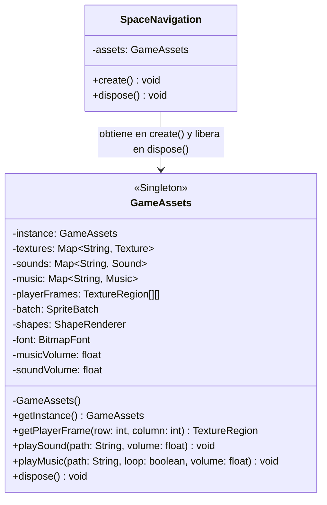
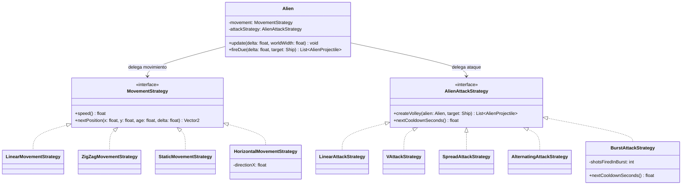
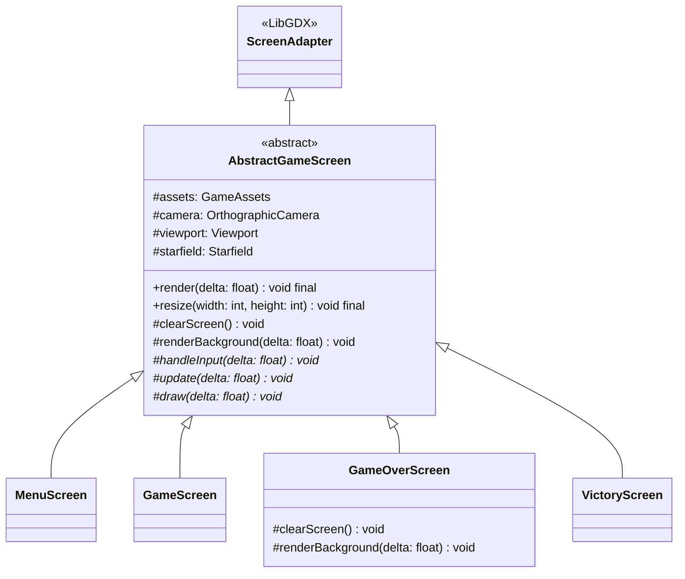
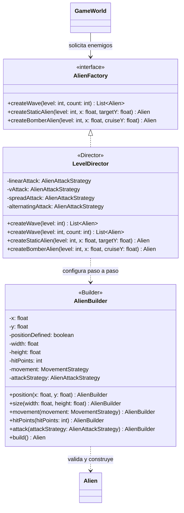

# Reporte y Narrativa de Operación: Space Navigation (Fuga del Régimen)

**Pontificia Universidad Católica de Valparaíso**  
**Escuela de Ingeniería Informática**  
**Asignatura:** INF2236 - Programación Avanzada  
**Docente:** Claudio Cubillos  
**Semestre:** 2026-2  
**Enlace del Repositorio:** [https://github.com/L3v1smpr/GameProject.git](https://github.com/L3v1smpr/GameProject.git) (Rama oficial consolidada: `main`)  

**Integrantes:**
* Elvis Peñaloza (L3v1smpr)
* Cristian Ávalos (NotChinoski)
* Alex Reyes (MrLynel)

---

En los confines de un sistema estelar dominado por un régimen cruel y despiadado, una nave de la resistencia clandestina emprende la huida definitiva. Para alcanzar la libertad, la tripulación debe atravesar tres sectores de una ruta espacial hostil, donde la flota tiránica incrementa su asedio constante. Este documento fusiona la narrativa de escape con la memoria técnica de ingeniería de software y las evidencias de código bajo las bases oficiales del proyecto.

---

## Alcance Operativo de la Fuga

* Presentamos un arcade 2D para un jugador enfocado en la supervivencia táctica y la evasión del bloqueo militar en tres sectores progresivos.
* Pilotamos la nave insignia a través de tres sectores hiperespaciales vigilados; debemos despejar la cuota de naves enemigas asignada a cada tramo para habilitar el salto al siguiente sector.
* La misión culmina con la **Victoria** absoluta al completar el tercer sector o con un **Game Over** si las fuerzas del régimen destruyen la nave al agotar sus tres vidas.
* El código primitivo del simulador base se conserva intacto en `core/src/main/java/puppy/code/prototype` exclusivamente como respaldo empírico para el análisis comparativo (GM-2), mientras que la aplicación moderna arranca oficialmente desde `puppy.code.app.SpaceNavigation` y se despliega mediante el paquete `puppy.code.screens`.

---

## GM-1 - El Piloto en Perspectiva (Experiencia de Juego)

La lucha por la libertad se libra bajo estrictas condiciones tácticas en la cabina:

* **Vidas y Supervivencia:** Comenzamos la misión con 3 vidas operativas (`GameConfig.INITIAL_LIVES = 3`). Si la nave sufre un impacto o colisiona sin estar invulnerable, pierde una vida, se detona una sacudida de cámara (*Screen Shake*) junto a un anillo de partículas (`PlayerRing`) y reaparece en su posición inicial (`SHIP_START_X`, `SHIP_START_Y`) con 1.5 segundos de invulnerabilidad táctica (`RESPAWN_INVULNERABILITY_SECONDS`), limpiando los proyectiles activos en pantalla.
* **Controles de Vuelo y Combate:** El pilotaje se ejecuta en ocho direcciones con las teclas **WASD** a una velocidad base calibrada de 390 px/s (`SHIP_SPEED`), aplicando normalización vectorial para impedir aceleración artificial en diagonales. Los cañones láser responden a la tecla **I** mantenida (cadencia automática de 0.25 s y proyectiles a 450 px/s), y el sistema de propulsión de emergencia (**Dash**) se acciona con la tecla **O**.
* **Sistema de Propulsión Dash:** Otorga un impulso hiperveloz durante 0.15 segundos (`DASH_DURATION_SECONDS`) multiplicando la velocidad por factor 3 (`DASH_SPEED_MULTIPLIER`), con un enfriamiento de 3.0 segundos (`DASH_COOLDOWN_SECONDS`). Concede invulnerabilidad total durante el desplazamiento más un búfer de gracia adicional de 0.5 segundos (`DASH_INVULNERABILITY_POST_SECONDS`) al finalizar el impulso. El HUD proyecta una barra de recarga en tiempo real.
* **Amenazas y Progresión por Sectores:**
  * **Sector 1:** Cuota de 15 naves (`LEVEL_ONE_ALIEN_QUOTA`), invasores de 1 HP con descenso lineal variado (base 90 px/s) y disparo vertical hacia abajo (220 px/s).
  * **Sector 2:** Cuota de 30 naves (`LEVEL_TWO_ALIEN_QUOTA`), invasores de 2 HP con trayectoria en zigzag (base 110 px/s) y disparo en V (±45 grados). Se incorporan **Centinelas** estacionarios con fuego alternado (50% recto / 50% apuntado) y **Bombarderos** de patrulla horizontal con ráfagas continuas de 6 disparos.
  * **Sector 3:** Cuota de 45 naves (`LEVEL_THREE_ALIEN_QUOTA`), invasores de 3 HP en zigzag, Centinelas con disparo triple en abanico (*Spread* a ±15 grados) y alta frecuencia de Bombarderos pesados.
* **Campos de Meteoritos y Puntajes:** Los meteoritos descienden como obstáculos destructibles ajenos a la cuota militar, otorgando puntaje escalado según su tamaño y resistencia:
  * **Meteorito Pequeño:** 1 HP — **25 puntos**.
  * **Meteorito Mediano:** 2 HP — **50 puntos**.
  * **Meteorito Grande:** 3 HP — **100 puntos**.
  * **Nave Enemiga (cualquier variante):** 1 / 2 / 3 HP (según sector) — **100 puntos**.
* **Transiciones de Sector y Cierre:** Al despejar las cuotas de los sectores 1 y 2, el sistema despliega el modal táctico «SECTOR ASEGURADO» con un enfriamiento de 3.0 segundos antes de habilitar el salto manual hiperespacial. Completar el Sector 3 activa la transición hacia la pantalla de Victoria.
* **Persistencia del Top 3 Local:** Al concluir la partida (Victoria o Game Over), si el puntaje supera la tercera marca histórica, el piloto registra sus 3 iniciales (A-Z), corrigiendo con Retroceso y confirmando con Enter.
* **Menú de Pausa y Protocolo Konami (Modo Dios):** La tecla **Escape** congela la simulación y despliega un modal interactivo para reanudar la partida, calibrar el volumen de música y efectos sonoros, o abortar hacia el menú principal. Introducir la secuencia secreta del Código Konami (**Arriba, Arriba, Abajo, Abajo, Izquierda, Derecha, Izquierda, Derecha, I, O**) durante la pausa desbloquea el submenú **DEBUG**, permitiendo alternar el **Modo Dios** (invulnerabilidad permanente).
* **Planos y Bocetos Conceptuales:** Las maquetas de diseño visual de las pantallas se archivan en `Planificacion/Bocetos/B1.jpeg` a `B4.jpeg`.

**Evidencias en código fuente:**
* `puppy.code.config.GameConfig.java` (líneas 11 a 98): Definición de dimensiones, velocidades, tiempos de Dash, cuotas por sector (15/30/45), HP y puntajes.
* `puppy.code.entities.Ship.java` (líneas 27 a 34): Hitbox centrada de 26x48 px; (líneas 36 a 87): integración física del Dash y ventana de invulnerabilidad; (líneas 104 a 112): cálculo normalizado para la barra de HUD.
* `puppy.code.screens.GameScreen.java` (líneas 176 a 295): Máquina de estados del menú de pausa, ajuste de audio y detector de secuencia Konami; (líneas 373 a 458): renderizado de barra de Dash y modal de sector asegurado; (líneas 530 a 574): dibujado del HUD.
* `puppy.code.world.GameWorld.java` (líneas 66 a 107): Ciclo principal de partida; (líneas 279 a 340): control de cuotas, refuerzos y avance de sector.

---

## GM-2 - Evolución de la Flota (Juego Base frente a la Nueva Arquitectura)

El proyecto base original (`puppy.code.prototype`) presentaba deficiencias estructurales severas de acoplamiento, pérdida de memoria gráfica y ausencia de separación de responsabilidades. A continuación se detalla el diagnóstico de ingeniería del código legado frente a la arquitectura final implementada:

* **1. Fuga Masiva de Memoria VRAM en GPU:**
  * **Problema en Juego Base:** En `prototype/PantallaJuego.java` (líneas 45 a 68), cada vez que iniciaba o avanzaba una ronda se ejecutaban llamadas directas a `new Texture(...)`, `new Sound(...)` y `new Music(...)`. Críticamente, dentro del bucle `for` de generación de asteroides (líneas 61 a 68) se instanciaba un `new Texture(Gdx.files.internal("aGreyMedium4.png"))` por cada asteroide creado, saturando la memoria nativa OpenGL sin liberar las texturas de los asteroides en `dispose()` (líneas 185 a 189).
  * **Solución en Nueva Arquitectura:** Se implementó el patrón **Singleton** en `assets/GameAssets.java` (líneas 80 a 157, 251 a 260), que carga todas las texturas, hojas de sprites y pistas de audio una sola vez al iniciar la aplicación y las libera de forma centralizada al cerrar el juego.

* **2. Violación Extrema de Responsabilidad Única (God Object y God Method):**
  * **Problema en Juego Base:** La clase `prototype/Nave4.java` en su método `draw(SpriteBatch batch, PantallaJuego juego)` (líneas 37 a 84) mezclaba cinco responsabilidades incompatibles: leía directamente el teclado con `Gdx.input`, actualizaba la física de velocidad, creaba instancias de `new Bullet(...)`, invocaba `soundBala.play()` y se dibujaba en el `SpriteBatch`. A su vez, `prototype/PantallaJuego.java` (líneas 79 a 152) concentraba toda la simulación física, colisiones, dibujo y cambios de pantalla dentro de `render(float delta)`.
  * **Solución en Nueva Arquitectura:** Se separó el dominio de la presentación. `world/GameWorld.java` (líneas 66 a 107) actúa como controlador puro de simulación física; `entities/Ship.java` (líneas 36 a 66) solo gestiona su estado cinemático; `systems/PlayerWeapon.java` (líneas 14 a 30) administra la cadencia de disparo; y `screens/GameScreen.java` (líneas 340 a 371) se limita a renderizar vistas inmutables (`WorldSnapshot`).

* **3. Listas Paralelas Frágiles y Error Lógico de Colisión Múltiple:**
  * **Problema en Juego Base:** `prototype/PantallaJuego.java` mantenía dos listas idénticas de asteroides (`balls1` y `balls2` en líneas 29 y 30) que debían eliminarse manualmente en paralelo al colisionar (líneas 92 y 93). Además, en el bucle de colisión bala-asteroide (líneas 89 a 97) faltaba una instrucción `break` tras detectar el impacto, provocando que un solo proyectil destruyera múltiples asteroides superpuestos en el mismo cuadro.
  * **Solución en Nueva Arquitectura:** Se erradicaron las listas duplicadas en `world/GameWorld.java` (líneas 27 a 30) y se delegó la intersección geométrica a `systems/CollisionSystem.java` (líneas 8 a 16). En `GameWorld.resolveProjectileCollisions()` (líneas 165 a 204), cada proyectil que impacta se desactiva inmediatamente (`projectile.deactivate()`) y corta la iteración con `break` (líneas 180 y 201).

* **4. Cinemática Dependiente de la Tasa de Cuadros (Framerate-Dependent):**
  * **Problema en Juego Base:** En `prototype/Ball2.java` (líneas 34 a 36), `prototype/Bullet.java` (línea 22) y `prototype/Nave4.java` (líneas 66 y 73), las posiciones y el temporizador de daño (`tiempoHerido--`) se sumaban o restaban como números enteros fijos por fotograma ignorando el tiempo `delta`. En monitores de 120 Hz o 144 Hz el juego corría al doble o triple de velocidad que a 60 Hz.
  * **Solución en Nueva Arquitectura:** Todas las entidades y temporizadores integran su movimiento multiplicando velocidades por `delta` en segundos: `Ship.update()` (líneas 47 a 65), `Alien.update()` (líneas 88 a 95), `Meteorite.update()` (líneas 65 a 71) y `PlayerProjectile.update()` (líneas 16 a 21).

* **5. Acoplamiento Cíclico y Puntuación Volátil en RAM:**
  * **Problema en Juego Base:** Las pantallas dependían directamente de la clase concreta `prototype/SpaceNavigation.java` y accedían a sus recursos mediante `game.getBatch()` y `game.getFont()`. El récord se guardaba en un atributo entero `highScore` en memoria RAM (línea 13), perdiéndose al cerrar la ventana.
  * **Solución en Nueva Arquitectura:** Las pantallas se comunican mediante la interfaz `app/ScreenNavigator.java` (líneas 6 a 17) y persisten el Top 3 en disco mediante `systems/ScoreRepository.java` (líneas 13 a 60) implementando el contrato `systems/ScoreStore.java`.

---

## GM-3 - Planos Estelares (UML y Estructura de Código)

* El diagrama de clases completo de la arquitectura y sus vistas modulares desglosadas se documentan en el archivo [UML.md](UML.md).
* El modelo UML refleja con exactitud las clases, interfaces, enumeraciones, constructores, firmas de métodos y relaciones de herencia, composición, agregación y dependencia del código activo.
* El código fuente se organiza en 10 paquetes de dominio y presentación bajo `core/src/main/java/puppy/code/` (`app`, `assets`, `behaviors`, `config`, `entities`, `factories`, `input`, `screens`, `systems`, `world`), además del paquete histórico `prototype` y el lanzador de escritorio en `lwjgl3/src/main/java/puppy/code/lwjgl3/Lwjgl3Launcher.java`.

---

## GM-4 - El Arsenal de Abstracción (Clases Abstractas e Interfaces)

Para cumplir de forma rigurosa con la exigencia de contar con clases abstractas e interfaces que posean al menos dos implementaciones concretas activas en el juego, se diseñaron las siguientes jerarquías principales:

* **1. Clase Abstracta del Requisito — `GameEntity` (5 subclases concretas):**
  * **Definición:** `puppy.code.entities.GameEntity.java` (líneas 6 a 91). Encapsula las coordenadas espaciales (`x`, `y`), dimensiones (`width`, `height`), estado de vigencia (`active`), temporizador de destello de daño (`hurtTimer`), cálculo defensivo de caja de colisión (`bounds()`) y el método gancho polimórfico `takeDamage()`.
  * **Clases hijas concretas (5):**
    1. `Ship` (`entities/Ship.java`, líneas 7 a 121): Nave del jugador con hitbox ajustada, Dash e invulnerabilidad.
    2. `Alien` (`entities/Alien.java`, líneas 13 a 129): Enemigo configurable que sobrescribe `takeDamage()` (líneas 64 a 76).
    3. `Meteorite` (`entities/Meteorite.java`, líneas 7 a 88): Obstáculo descendente que sobrescribe `takeDamage()` (líneas 50 a 63).
    4. `PlayerProjectile` (`entities/PlayerProjectile.java`, líneas 7 a 26): Proyectil ascendente del jugador.
    5. `AlienProjectile` (`entities/AlienProjectile.java`, líneas 7 a 42): Proyectil vectorial enemigo con rotación orientada.

* **2. Segunda Clase Abstracta — `AbstractGameScreen` (4 subclases concretas):**
  * **Definición:** `puppy.code.screens.AbstractGameScreen.java` (líneas 14 a 91). Define el esqueleto del ciclo de renderizado y administra la cámara ortográfica, el `FitViewport` y el fondo animado de estrellas (`Starfield`).
  * **Clases hijas concretas (4):**
    1. `MenuScreen` (`screens/MenuScreen.java`, líneas 11 a 65).
    2. `GameScreen` (`screens/GameScreen.java`, líneas 26 a 739).
    3. `GameOverScreen` (`screens/GameOverScreen.java`, líneas 14 a 161).
    4. `VictoryScreen` (`screens/VictoryScreen.java`, líneas 13 a 138).

* **3. Interfaz del Requisito — `MovementStrategy` (4 implementaciones concretas):**
  * **Definición:** `puppy.code.behaviors.MovementStrategy.java` (líneas 12 a 27). Contrato cinemático para el desplazamiento de enemigos (`speed()` y `nextPosition()`).
  * **Implementaciones concretas (4):**
    1. `LinearMovementStrategy` (`behaviors/LinearMovementStrategy.java`, líneas 6 a 27): Descenso vertical uniforme.
    2. `ZigZagMovementStrategy` (`behaviors/ZigZagMovementStrategy.java`, líneas 10 a 36): Descenso diagonal oscilante con factor de normalización `Math.sqrt(0.5)`.
    3. `StaticMovementStrategy` (`behaviors/StaticMovementStrategy.java`, líneas 9 a 38): Entrada suave hasta altitud objetivo y fijación estacionaria (`speed() = 0f`).
    4. `HorizontalMovementStrategy` (`behaviors/HorizontalMovementStrategy.java`, líneas 7 a 59): Descenso hasta cota de crucero y patrullaje horizontal con rebote en bordes.

* **4. Segunda Interfaz con Múltiples Implementaciones — `AlienAttackStrategy` (5 implementaciones concretas):**
  * **Definición:** `puppy.code.behaviors.AlienAttackStrategy.java` (líneas 10 a 18). Contrato balístico (`createVolley()` y método por defecto `nextCooldownSeconds()`).
  * **Implementaciones concretas (5):**
    1. `LinearAttackStrategy` (`behaviors/LinearAttackStrategy.java`, líneas 13 a 51): Disparo vertical recto hacia abajo y utilidades vectoriales.
    2. `VAttackStrategy` (`behaviors/VAttackStrategy.java`, líneas 13 a 26): Salva doble abierta a ±45 grados hacia la nave.
    3. `SpreadAttackStrategy` (`behaviors/SpreadAttackStrategy.java`, líneas 15 a 35): Abanico triple de perdigones (central y ±15 grados).
    4. `AlternatingAttackStrategy` (`behaviors/AlternatingAttackStrategy.java`, líneas 15 a 31): Selección aleatoria 50/50 entre tiro recto y tiro apuntado al jugador.
    5. `BurstAttackStrategy` (`behaviors/BurstAttackStrategy.java`, líneas 15 a 43): Ráfaga continua de 6 tiros cada 0.20 s con pausa de 1.20 s.

*(Nota arquitectónica: El sistema incluye además contratos de desacoplamiento como `Collidable`, `AlienFactory`, `CollisionDetector`, `ScreenNavigator`, `ScoreStore`, `WorldAudioListener`, `PlayerInput`, `NavigationInput` e `InitialsInput`, los cuales sustentan los principios SOLID y GRASP en GM-5).*

---

## GM-5 - Protocolos de Blindaje (Encapsulamiento, GRASP y SOLID)

### Encapsulamiento Riguroso
* **Atributos Privados y Copias Defensivas:** Todas las clases del dominio declaran sus campos como `private`. Para impedir que código externo modifique las cajas de colisión internas, `GameEntity.bounds()` (`entities/GameEntity.java`, líneas 72 a 75) y `Ship.bounds()` (`entities/Ship.java`, líneas 28 a 34) retornan una instancia nueva de `Rectangle` en cada consulta.
* **Protección del Estado del Mundo con `WorldSnapshot`:** `GameWorld` jamás entrega sus listas mutables (`aliens`, `meteorites`, `playerProjectiles`, `alienProjectiles`) a las pantallas. En `GameWorld.snapshot()` (`world/GameWorld.java`, líneas 386 a 399) construye un `WorldSnapshot` (`world/WorldSnapshot.java`, líneas 32 a 57) que transforma cada entidad en un objeto de valor inmutable `EntityView` (líneas 115 a 202) y envuelve todas las listas con `Collections.unmodifiableList()` (línea 56).
* **Ocultamiento del Spritesheet en `GameAssets`:** La matriz bidimensional `private TextureRegion[][] playerFrames` (`assets/GameAssets.java`, línea 71) permanece oculta; las pantallas solicitan únicamente el cuadro requerido mediante `getPlayerFrame(int row, int column)` (líneas 192 a 200), el cual valida límites de fila y columna antes de retornar la región.
* **Clase Utilitaria Inmutable `GameConfig`:** Declarada como `public final class GameConfig` con constructor privado `private GameConfig()` (`config/GameConfig.java`, líneas 9 y 100 a 101) y constantes `public static final`, evitando su instanciación o alteración en tiempo de ejecución.

### Principios GRASP
* **Controller (Controlador):** `GameWorld` (`world/GameWorld.java`, líneas 21 a 409) recibe los eventos de entrada del jugador en `update(float delta, PlayerInput input)` (líneas 66 a 107) y coordina el ciclo de vida de las entidades, colisiones, puntajes y cambios de fase sin depender de clases gráficas de LibGDX.
* **Information Expert (Experto en Información):**
  * `Ship` (`entities/Ship.java`, líneas 36 a 112) posee los temporizadores y velocidades para calcular su propia posición, el impulso del Dash y su porcentaje de recarga.
  * `Alien` (`entities/Alien.java`, líneas 64 a 125) administra sus puntos de vida, su cadencia de fuego y delega el cálculo espacial a sus estrategias.
  * `ScoreRepository` (`systems/ScoreRepository.java`, líneas 21 a 75) conoce la estructura de almacenamiento en `Preferences`, evaluando si un puntaje entra al Top 3 y normalizando las iniciales a 3 letras mayúsculas A-Z.
* **Creator (Creador):** `LevelDirector` (`factories/LevelDirector.java`, líneas 37 a 117) y `AlienBuilder` (`factories/AlienBuilder.java`, líneas 19 a 63) reúnen las reglas de configuración por sector para instanciar objetos `Alien` válidos. `PlayerWeapon` (`systems/PlayerWeapon.java`, líneas 14 a 30) crea instancias de `PlayerProjectile` a partir de las dimensiones de `Ship`.
* **Pure Fabrication (Fabricación Pura):** Se diseñaron clases técnicas que no representan conceptos físicos del mundo pero reducen el acoplamiento: `CollisionSystem` (`systems/CollisionSystem.java`, líneas 7 a 29) para detección geométrica, `ScoreRepository` para persistencia en disco y `GameAssets` para gestión de recursos OpenGL.
* **Low Coupling (Bajo Acoplamiento) e Indirection (Indirección):** `WorldAudioListener` (`world/WorldAudioListener.java`, líneas 4 a 14) actúa como intermediario entre `GameWorld` y el sistema de sonido; `GameWorld` emite notificaciones de eventos (`notifyAudio`, líneas 48 a 52) sin conocer `GameAssets` ni `GameScreen`.

### Principios SOLID
* **SRP (Single Responsibility Principle):** Las responsabilidades nucleares están separadas en paquetes cohesivos: `GameWorld` ejecuta las reglas de negocio; `CollisionSystem` evalúa intersecciones; `ScoreRepository` persiste récords; `LevelDirector` fabrica oleadas; y las clases de `screens` gestionan la interfaz visual y sonora.
* **OCP (Open/Closed Principle):** Nuevas trayectorias de vuelo o patrones de disparo enemigo se incorporan creando nuevas clases que implementen `MovementStrategy` o `AlienAttackStrategy` sin modificar la lógica de `update()` ni `fireDue()` en `Alien.java` (líneas 78 a 125).
* **LSP (Liskov Substitution Principle):** Todas las subclases de `GameEntity` (`Ship`, `Alien`, `Meteorite`, `PlayerProjectile`, `AlienProjectile`) cumplen el contrato de `Collidable` (`entities/Collidable.java`, líneas 6 a 9), pudiendo ser evaluadas de manera uniforme por `CollisionDetector.collides(Collidable first, Collidable second)` sin lanzar excepciones inesperadas.
* **ISP (Interface Segregation Principle):** En lugar de una interfaz monolítica de control, el paquete `input` divide la lectura en tres interfaces especializadas: `PlayerInput` (`input/PlayerInput.java`, líneas 6 a 15) para vuelo y combate, `NavigationInput` (`input/NavigationInput.java`, líneas 4 a 20) para menús y pausa, e `InitialsInput` (`input/InitialsInput.java`, líneas 4 a 11) para captura de texto en pantallas de récord.
* **DIP (Dependency Inversion Principle):** Los módulos de alto nivel dependen de abstracciones:
  * `GameWorld` recibe en su constructor (`world/GameWorld.java`, línea 38) las interfaces `AlienFactory` y `CollisionDetector`.
  * `MenuScreen`, `GameOverScreen` y `VictoryScreen` reciben las interfaces `ScreenNavigator`, `NavigationInput`, `InitialsInput` y `ScoreStore`.
  * `SpaceNavigation` (`app/SpaceNavigation.java`, líneas 32 a 43) opera como la **Raíz de Composición**, instanciando las clases concretas e inyectándolas en los constructores.

---

## GM-6 a GM-9 - Los Núcleos Tecnológicos (Patrones de Diseño GoF)

### GM-6 - Patrón Singleton (`GameAssets`)

* **Problema:** En un videojuego arcade, múltiples pantallas y sistemas requieren acceder a las mismas texturas, hojas de sprites, fuentes (`BitmapFont`), renderizadores (`SpriteBatch`, `ShapeRenderer`) y archivos de audio (`Sound`, `Music`). Instanciar estos recursos repetidamente en cada cambio de pantalla (como ocurría en el prototipo base) provoca fugas de memoria VRAM, pausas por carga de disco y fallos al liberar recursos que siguen en uso.
* **Contexto:** `SpaceNavigation` inicializa el entorno gráfico de LibGDX y transita continuamente entre `MenuScreen`, `GameScreen`, `GameOverScreen` y `VictoryScreen`, las cuales necesitan dibujar y reproducir audio compartiendo el mismo estado de volumen configurado por el jugador.
* **Solución:** Implementar el patrón **Singleton** en la clase `GameAssets`. Se define un atributo estático privado `instance`, un constructor privado `private GameAssets()` que ejecuta `loadAll()` para poblar los mapas internos (`textures`, `sounds`, `music`), y el método estático sincronizado `getInstance()` que garantiza una única instancia global. La liberación de memoria nativa se centraliza en `dispose()`, invocado al cerrar la aplicación en `SpaceNavigation.dispose()`.

**Evidencias en código fuente:**
* `puppy.code.assets.GameAssets.java`:
  * Línea 18: Atributo estático `private static GameAssets instance;`.
  * Líneas 66 a 69: Mapas privados de almacenamiento de recursos (`textures`, `sounds`, `music`).
  * Líneas 80 a 82: Constructor privado `private GameAssets()`.
  * Líneas 84 a 89: Método de acceso global `public static synchronized GameAssets getInstance()`.
  * Líneas 251 a 260: Método `dispose()` que libera todos los recursos gráficos/sonoros y restablece `instance = null`.
* `puppy.code.app.SpaceNavigation.java`:
  * Línea 34: Obtención de la instancia única `assets = GameAssets.getInstance();`.
  * Líneas 80 a 86: Liberación segura en el cierre de la aplicación.

---

### GM-7 - Strategy (Estrategias de Movimiento y Ataque)

* **Problema:** Los enemigos de la flota presentan cuatro comportamientos de vuelo distintos (descenso lineal, zigzag diagonal, entrada estacionaria de centinela y patrullaje horizontal de bombardero) y cinco modalidades de disparo (recto, doble en V, abanico triple, alternado aleatorio y ráfaga de metralleta). Codificar todas estas variantes mediante bloques `if/else` o `switch` dentro de `Alien` generaría una clase rígida y difícil de mantener.
* **Contexto:** Durante la partida coexisten en `GameWorld` múltiples instancias de `Alien` que deben actualizar su trayectoria y disparar en cada fotograma según la configuración asignada a su sector y arquetipo.
* **Solución:** Aplicar el patrón **Strategy** definiendo dos familias de interfaces independientes: `MovementStrategy` y `AlienAttackStrategy`. La clase `Alien` actúa como el Contexto, manteniendo referencias inmutables a ambas interfaces y delegando el cálculo de su siguiente coordenada en `movement.nextPosition(getX(), getY(), age, delta)` y la generación de proyectiles en `attackStrategy.createVolley(this, target)` junto al tiempo de recarga polimórfico `attackStrategy.nextCooldownSeconds()`. Las estrategias sin estado interno (`LinearAttack`, `VAttack`, `SpreadAttack`, `AlternatingAttack`) son compartidas por `LevelDirector`, mientras que las estrategias que mantienen estado por unidad (`HorizontalMovementStrategy` con su dirección de rebote `directionX` y `BurstAttackStrategy` con su contador `shotsFiredInBurst`) se instancian individualmente por enemigo.

**Evidencias en código fuente:**
* `puppy.code.behaviors.MovementStrategy.java` (líneas 12 a 27) y sus 4 implementaciones: `LinearMovementStrategy.java` (líneas 6 a 27), `ZigZagMovementStrategy.java` (líneas 10 a 36), `StaticMovementStrategy.java` (líneas 9 a 38) y `HorizontalMovementStrategy.java` (líneas 7 a 59).
* `puppy.code.behaviors.AlienAttackStrategy.java` (líneas 10 a 18) y sus 5 implementaciones: `LinearAttackStrategy.java` (líneas 13 a 51), `VAttackStrategy.java` (líneas 13 a 26), `SpreadAttackStrategy.java` (líneas 15 a 35), `AlternatingAttackStrategy.java` (líneas 15 a 31) y `BurstAttackStrategy.java` (líneas 15 a 43).
* `puppy.code.entities.Alien.java`:
  * Líneas 18 y 19: Atributos `private final MovementStrategy movement;` y `private final AlienAttackStrategy attackStrategy;`.
  * Línea 90: Delegación cinemática `Vector2 next = movement.nextPosition(getX(), getY(), age, delta);`.
  * Líneas 115 a 122: Delegación balística `attackStrategy.createVolley(this, target)` y `attackStrategy.nextCooldownSeconds()`.

---

### GM-8 - Template Method (`AbstractGameScreen`)

* **Problema:** Todas las pantallas del juego (`MenuScreen`, `GameScreen`, `GameOverScreen`, `VictoryScreen`) deben ejecutar en cada fotograma una secuencia estricta de operaciones gráficas (normalizar el delta, limpiar el búfer de color, aplicar el viewport, desplazar y dibujar el fondo espacial, procesar la entrada, actualizar el estado y dibujar la escena). Repetir esta estructura en cada pantalla provocaba código duplicado y riesgo de omitir pasos del ciclo de renderizado.
* **Contexto:** LibGDX invoca `render(float delta)` en la pantalla activa a 60 cuadros por segundo. Mientras que el menú, la partida y la victoria comparten el fondo animado en cinta continua y el campo de estrellas (`Starfield`), la pantalla de derrota (`GameOverScreen`) requiere un fondo rojo sólido estático sin estrellas.
* **Solución:** Implementar el patrón **Template Method** en `AbstractGameScreen`. El método `public final void render(float delta)` se declara `final` para fijar de forma inmutable el esqueleto algorítmico de 5 pasos: `clearScreen()` -> `renderBackground(frameDelta)` -> `handleInput(frameDelta)` -> `update(frameDelta)` -> `draw(frameDelta)`. Los dos primeros pasos actúan como métodos gancho (*hooks*) con implementación por defecto, mientras que `handleInput`, `update` y `draw` son operaciones primitivas abstractas que cada subclase implementa. `GameOverScreen` sobrescribe los *hooks* `clearScreen()` (aplicando el color rojo de derrota) y `renderBackground()` (dejándolo vacío para suprimir las estrellas).

**Evidencias en código fuente:**
* `puppy.code.screens.AbstractGameScreen.java`:
  * Líneas 33 a 40: Método plantilla inmutable `public final void render(float delta)`.
  * Líneas 42 a 45: Hook `protected void clearScreen()`.
  * Líneas 51 a 78: Hook `protected void renderBackground(float delta)` que desplaza `background.png` en cinta continua y actualiza `starfield`.
  * Líneas 80 a 84: Pasos abstractos `handleInput(float delta)`, `update(float delta)` y `draw(float delta)`.
* `puppy.code.screens.GameOverScreen.java`:
  * Líneas 59 a 66: Sobrescritura de los hooks `clearScreen()` y `renderBackground(float delta)`.

---

### GM-9 - Builder (`AlienBuilder` y `LevelDirector`)

* **Problema:** La creación de una entidad `Alien` requiere combinar múltiples parámetros (coordenadas `x` e `y`, ancho, alto, puntos de vida, estrategia de movimiento y estrategia de ataque) que varían según el sector (1, 2 o 3) y el rol del enemigo (oleada estándar, centinela estático o bombardero pesado). Construir estos objetos directamente desde el mundo mediante constructores extensos dispersaría las reglas de validación y dificultaría la lectura.
* **Contexto:** `GameWorld` necesita solicitar oleadas completas y refuerzos específicos durante la partida sin acoplarse a los detalles de construcción de cada variante enemiga.
* **Solución:** Implementar el patrón **Builder**. `AlienBuilder` proporciona una interfaz fluida paso a paso (`position`, `size`, `movement`, `hitPoints`, `attack`) y concentra en su método `build()` la validación defensiva de todas las precondiciones (posición definida, estrategias no nulas, velocidad finita no negativa y vida positiva) antes de invocar al constructor de `Alien`. `LevelDirector` actúa como el Director del patrón (implementando además la interfaz `AlienFactory` para desacoplar a `GameWorld`), definiendo las recetas exactas para construir oleadas escalonadas (`createWave`), centinelas (`createStaticAlien`) y bombarderos (`createBomberAlien`).

**Evidencias en código fuente:**
* `puppy.code.factories.AlienBuilder.java`:
  * Líneas 9 a 18: Atributos internos de configuración con dimensiones por defecto (`ALIEN_WIDTH`, `ALIEN_HEIGHT`).
  * Líneas 20 a 44: Métodos encadenados de configuración fluida (`position`, `size`, `movement`, `hitPoints`, `attack`).
  * Líneas 46 a 63: Método `public Alien build()` con validaciones que lanzan `IllegalStateException` o `IllegalArgumentException` si la configuración es incompleta o inválida.
* `puppy.code.factories.LevelDirector.java`:
  * Línea 23: Declaración `public final class LevelDirector implements AlienFactory`.
  * Líneas 41 a 80: Construcción de oleadas por zonas barajadas en `createWave(int level, int count)` utilizando `new AlienBuilder()`.
  * Líneas 87 a 96: Receta de construcción de centinelas en `createStaticAlien`.
  * Líneas 103 a 113: Receta de construcción de bombarderos en `createBomberAlien`.
* `puppy.code.factories.AlienFactory.java` (líneas 6 a 14): Interfaz consumida por `GameWorld`.

---

## GM-10 - Telemetría y Despliegue (GitHub y Control de Versiones)

* **Enlace del Repositorio:** [https://github.com/L3v1smpr/GameProject.git](https://github.com/L3v1smpr/GameProject.git) *(Destinado a la rama `main` tras el merge final de entrega)*.
* El desarrollo colaborativo se estructuró bajo ramas de trabajo (como `feature/overhaul-assets`), registrando un historial consolidado de más de seis commits de avance técnico frente a los puntos de control del repositorio.
* La persistencia de los registros locales opera mediante el mecanismo de `Preferences` de LibGDX en el equipo anfitrión.
* Para compilar y poner en órbita la aplicación empleando Java 11, se ejecutan los comandos del gestor de dependencias de Gradle: `gradlew.bat :lwjgl3:run` en entornos Windows o `./gradlew :lwjgl3:run` en sistemas Linux y macOS.