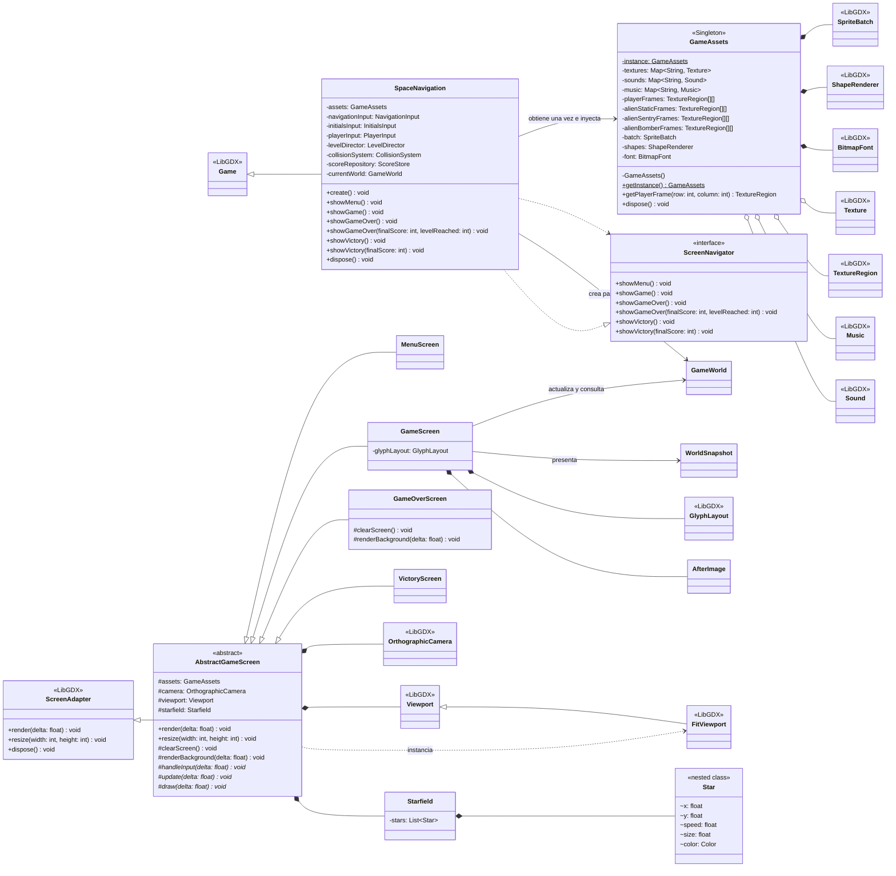
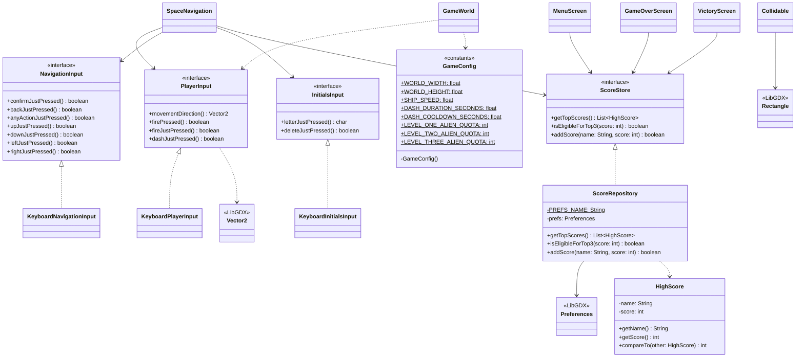
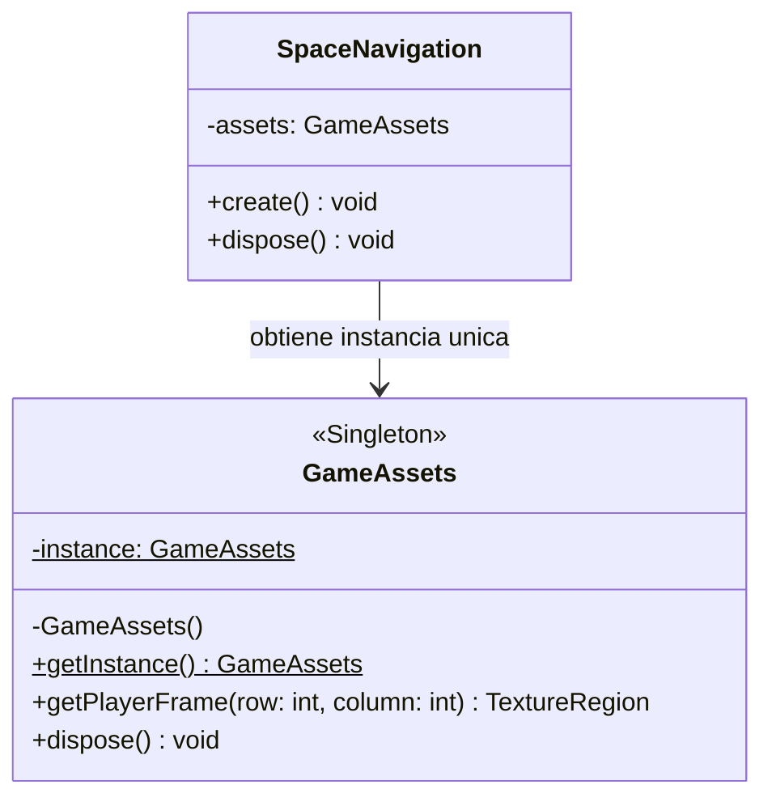
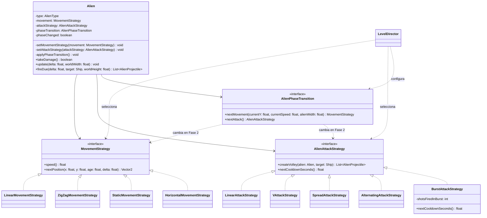
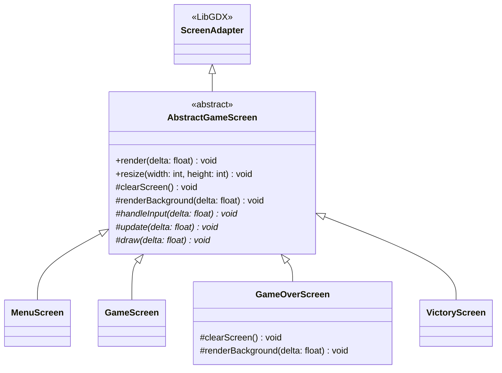
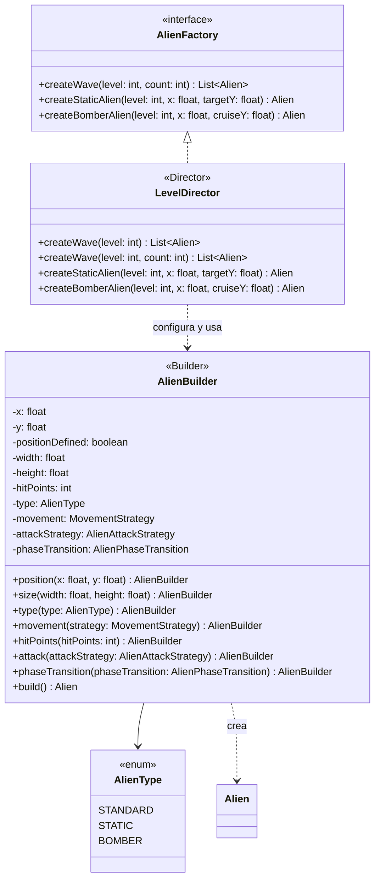

# UML Completo

Para poder leerlo cómodamente, realizamos una descomposición del diagrama en clases relacionadas más abajo.

Este documento describe la arquitectura implementada actualmente. El diagrama completo es la referencia;
las vistas por secciones son recortes del mismo modelo y pueden omitir detalles para facilitar la lectura,
pero no representan clases ni tecnologías distintas. La persistencia de puntajes usa LibGDX `Preferences`;
no existe una base de datos SQL ni una implementación SQLite. El paquete `puppy.code.prototype` se
considera código legado y queda fuera del flujo activo.

```mermaid
classDiagram
    direction LR

    namespace lwjgl3 {
        class Lwjgl3Launcher {
            +main(args: String[]) void$
            -createApplication() Lwjgl3Application$
            -getDefaultConfiguration() Lwjgl3ApplicationConfiguration$
        }
        class StartupHelper {
            -JVM_RESTARTED_ARG: String$
            -StartupHelper()
            +startNewJvmIfRequired() boolean$
            +startNewJvmIfRequired(redirectOutput: boolean) boolean$
        }
    }

    namespace app {
        class SpaceNavigation {
            -assets: GameAssets
            -navigationInput: NavigationInput
            -initialsInput: InitialsInput
            -playerInput: PlayerInput
            -levelDirector: LevelDirector
            -collisionSystem: CollisionSystem
            -scoreRepository: ScoreStore
            -currentWorld: GameWorld
            +create() void
            +showMenu() void
            +showGame() void
            +showGameOver() void
            +showGameOver(finalScore: int, levelReached: int) void
            +showVictory() void
            +showVictory(finalScore: int) void
            +dispose() void
        }
        class ScreenNavigator {
            <<interface>>
            +showMenu() void
            +showGame() void
            +showGameOver() void
            +showGameOver(finalScore: int, levelReached: int) void
            +showVictory() void
            +showVictory(finalScore: int) void
        }
    }

    namespace assets {
        class GameAssets {
            <<Singleton>>
            -instance: GameAssets$
            -textures: Map~String, Texture~
            -sounds: Map~String, Sound~
            -music: Map~String, Music~
            -musicBaseVolumes: Map~Music, Float~
            -playerFrames: TextureRegion[][]
            -alienStaticFrames: TextureRegion[][]
            -alienSentryFrames: TextureRegion[][]
            -alienBomberFrames: TextureRegion[][]
            -alienAmmoRegion: TextureRegion
            -batch: SpriteBatch
            -shapes: ShapeRenderer
            -font: BitmapFont
            -musicVolume: float
            -soundVolume: float
            -GameAssets()
            +getInstance() GameAssets$
            -loadAll() void
            -loadTexture(path: String) void
            -loadSound(path: String) void
            -loadMusic(path: String) void
            +getPlayerFrame(row: int, column: int) TextureRegion
            +getAlienStaticRegion() TextureRegion
            +getAlienStaticRegion(firing: boolean) TextureRegion
            +getAlienSentryRegion(firing: boolean) TextureRegion
            +getAlienBomberRegion(firing: boolean) TextureRegion
            +getAlienAmmoRegion() TextureRegion
            +getTexture(path: String) Texture
            +getSound(path: String) Sound
            +getMusic(path: String) Music
            +batch() SpriteBatch
            +shapes() ShapeRenderer
            +font() BitmapFont
            +getMusicVolume() float
            +setMusicVolume(volume: float) void
            +getSoundVolume() float
            +setSoundVolume(volume: float) void
            +playSound(path: String, volume: float) void
            +playMusic(path: String, loop: boolean, volume: float) void
            +stopMusic() void
            +dispose() void
        }
    }

    namespace config {
        class GameConfig {
            <<constants>>
            +WORLD_WIDTH: float$
            +WORLD_HEIGHT: float$
            +SHIP_WIDTH: float$
            +SHIP_HEIGHT: float$
            +SHIP_HITBOX_WIDTH: float$
            +SHIP_HITBOX_HEIGHT: float$
            +SHIP_SPEED: float$
            +PLAYER_PROJECTILE_SPEED: float$
            +PLAYER_FIRE_COOLDOWN_SECONDS: float$
            +DASH_SPEED_MULTIPLIER: float$
            +DASH_DURATION_SECONDS: float$
            +DASH_COOLDOWN_SECONDS: float$
            +DASH_INVULNERABILITY_POST_SECONDS: float$
            +INITIAL_LIVES: int$
            +RESPAWN_INVULNERABILITY_SECONDS: float$
            +FIRST_LEVEL: int$
            +SECOND_LEVEL: int$
            +LAST_LEVEL: int$
            +LEVEL_ONE_ALIEN_QUOTA: int$
            +LEVEL_TWO_ALIEN_QUOTA: int$
            +LEVEL_THREE_ALIEN_QUOTA: int$
            +ALIEN_SCORE: int$
            +ALIEN_WIDTH: float$
            +ALIEN_HEIGHT: float$
            +BOMBER_ALIEN_WIDTH: float$
            +BOMBER_ALIEN_HEIGHT: float$
            +LINEAR_ALIEN_SPEED: float$
            +ZIGZAG_ALIEN_SPEED: float$
            +ALIEN_PROJECTILE_SPEED: float$
            -GameConfig()
        }
    }

    namespace input {
        class PlayerInput {
            <<interface>>
            +movementDirection() Vector2
            +firePressed() boolean
            +fireJustPressed() boolean
            +dashJustPressed() boolean
        }
        class KeyboardPlayerInput {
            +movementDirection() Vector2
            +firePressed() boolean
            +fireJustPressed() boolean
            +dashJustPressed() boolean
        }
        class NavigationInput {
            <<interface>>
            +confirmJustPressed() boolean
            +backJustPressed() boolean
            +anyActionJustPressed() boolean
            +upJustPressed() boolean
            +downJustPressed() boolean
            +leftJustPressed() boolean
            +rightJustPressed() boolean
        }
        class KeyboardNavigationInput {
            +confirmJustPressed() boolean
            +backJustPressed() boolean
            +anyActionJustPressed() boolean
            +upJustPressed() boolean
            +downJustPressed() boolean
            +leftJustPressed() boolean
            +rightJustPressed() boolean
        }
        class InitialsInput {
            <<interface>>
            +letterJustPressed() char
            +deleteJustPressed() boolean
        }
        class KeyboardInitialsInput {
            +letterJustPressed() char
            +deleteJustPressed() boolean
        }
    }

    namespace screens {
        class AbstractGameScreen {
            <<abstract>>
            #assets: GameAssets
            #camera: OrthographicCamera
            #viewport: Viewport
            #starfield: Starfield
            -backgroundY: float
            #AbstractGameScreen(assets: GameAssets)
            +render(delta: float) void
            +resize(width: int, height: int) void
            #clearScreen() void
            #renderBackground(delta: float) void
            #handleInput(delta: float) void*
            #update(delta: float) void*
            #draw(delta: float) void*
        }
        class MenuScreen {
            -navigator: ScreenNavigator
            -navigationInput: NavigationInput
            -scoreRepository: ScoreStore
            -startRequested: boolean
            +MenuScreen(assets: GameAssets, navigator: ScreenNavigator, navigationInput: NavigationInput, scoreRepository: ScoreStore)
            #handleInput(delta: float) void
            #update(delta: float) void
            #draw(delta: float) void
        }
        class GameScreen {
            -navigator: ScreenNavigator
            -world: GameWorld
            -playerInput: PlayerInput
            -navigationInput: NavigationInput
            -glyphLayout: GlyphLayout
            -snapshot: WorldSnapshot
            -elapsedSeconds: float
            -dashEffectTimer: float
            -dashSpawnCooldown: float
            -paused: boolean
            -pauseState: PauseMenuState
            -pauseMenuIndex: int
            -optionsMenuIndex: int
            -debugMenuIndex: int
            -konamiIndex: int
            -debugUnlocked: boolean
            -shakeTimer: float
            -shakeDuration: float
            -shakeIntensity: float
            -activeTransition: TransitionType
            -transitionTimer: float
            -transitionCompleted: boolean
            -sectorCompletedTimer: float
            -afterImages: List~AfterImage~
            -fireRings: List~FireRing~
            -playerRings: List~PlayerRing~
            -debrisParticles: List~DebrisParticle~
            +GameScreen(assets: GameAssets, navigator: ScreenNavigator, world: GameWorld, playerInput: PlayerInput, navigationInput: NavigationInput)
            +show() void
            +hide() void
            #handleInput(delta: float) void
            #update(delta: float) void
            #draw(delta: float) void
            +onPlayerShoot() void
            +onPlayerDash() void
            +onPlayerHurt(centerX: float, centerY: float) void
            +onAlienHurt() void
            +onAlienDestroyed(centerX: float, centerY: float) void
            +onAlienShoot() void
            +onMeteoriteHit() void
            +onMeteoriteDestroyed(centerX: float, centerY: float, isMajor: boolean) void
            +onLevelCompleted() void
        }
        class GameOverScreen {
            -navigator: ScreenNavigator
            -input: NavigationInput
            -initialsInput: InitialsInput
            -scoreRepository: ScoreStore
            -finalScore: int
            -levelReached: int
            -eligibleForTop3: boolean
            -initials: StringBuilder
            -scoreSaved: boolean
            +GameOverScreen(assets: GameAssets, navigator: ScreenNavigator, input: NavigationInput, initialsInput: InitialsInput, scoreRepository: ScoreStore, finalScore: int, levelReached: int)
            +show() void
            +hide() void
            #clearScreen() void
            #renderBackground(delta: float) void
            #handleInput(delta: float) void
            #update(delta: float) void
            #draw(delta: float) void
        }
        class VictoryScreen {
            -navigator: ScreenNavigator
            -input: NavigationInput
            -initialsInput: InitialsInput
            -scoreRepository: ScoreStore
            -finalScore: int
            -eligibleForTop3: boolean
            -initials: StringBuilder
            -scoreSaved: boolean
            +VictoryScreen(assets: GameAssets, navigator: ScreenNavigator, input: NavigationInput, initialsInput: InitialsInput, scoreRepository: ScoreStore, finalScore: int)
            +show() void
            +hide() void
            #handleInput(delta: float) void
            #update(delta: float) void
            #draw(delta: float) void
        }
        class Starfield {
            -stars: List~Star~
            +Starfield(count: int)
            +updateAndRender(delta: float, shapes: ShapeRenderer, camera: OrthographicCamera) void
        }
        class Star {
            <<nested class>>
            ~x: float
            ~y: float
            ~speed: float
            ~size: float
            ~color: Color
            ~Star(randomInitialY: boolean)
        }
        class AfterImage {
            -x: float
            -y: float
            -width: float
            -height: float
            -region: TextureRegion
            -maxLifeTime: float
            -lifeTime: float
            -alpha: float
            +AfterImage(x: float, y: float, width: float, height: float, region: TextureRegion, lifeTime: float)
            +update(delta: float) boolean
            +getX() float
            +getY() float
            +getWidth() float
            +getHeight() float
            +getRegion() TextureRegion
            +getAlpha() float
        }
        class PlayerRing {
            <<nested class>>
            -x: float
            -y: float
            -radius: float
            -timer: float
            ~PlayerRing(x: float, y: float)
            +update(delta: float) boolean
            +getX() float
            +getY() float
            +getRadius() float
            +getAlpha() float
        }
        class FireRing {
            <<nested class>>
            -x: float
            -y: float
            -radius: float
            -timer: float
            ~FireRing(x: float, y: float)
            +update(delta: float) boolean
            +getX() float
            +getY() float
            +getRadius() float
            +getAlpha() float
        }
        class DebrisParticle {
            <<nested class>>
            -x: float
            -y: float
            -vx: float
            -vy: float
            -size: float
            -shade: float
            -timer: float
            -duration: float
            ~DebrisParticle(x: float, y: float, isMajor: boolean)
            +update(delta: float) boolean
            +getX() float
            +getY() float
            +getSize() float
            +getShade() float
            +getAlpha() float
        }
        class TransitionType {
            <<nested enum>>
            NONE
            GAME_OVER_FADE
            VICTORY_FADE
        }
        class PauseMenuState {
            <<nested enum>>
            MAIN
            OPTIONS
            DEBUG
        }
        class KonamiKey {
            <<nested enum>>
            UP
            DOWN
            LEFT
            RIGHT
            FIRE
            DASH
        }
    }

    namespace world {
        class GameWorld {
            -collisions: CollisionDetector
            -levelDirector: AlienFactory
            -playerWeapon: PlayerWeapon
            -ship: Ship
            -aliens: List~Alien~
            -meteorites: List~Meteorite~
            -playerProjectiles: List~PlayerProjectile~
            -alienProjectiles: List~AlienProjectile~
            -level: int
            -lives: int
            -score: int
            -aliensDestroyedInLevel: int
            -phase: GamePhase
            -meteoriteSpawnTimer: float
            -alienReinforcementTimer: float
            -audioListener: WorldAudioListener
            +GameWorld(levelDirector: AlienFactory, collisions: CollisionDetector)
            +restart() void
            +update(delta: float, input: PlayerInput) void
            +advanceToNextLevel() void
            +snapshot() WorldSnapshot
            +setAudioListener(audioListener: WorldAudioListener) void
            +isGodMode() boolean
            +setGodMode(godMode: boolean) void
        }
        class GamePhase {
            <<enum>>
            ACTIVE
            LEVEL_COMPLETED
            GAME_OVER
            VICTORY
        }
        class WorldSnapshot {
            -ship: EntityView
            -aliens: List~EntityView~
            -playerProjectiles: List~EntityView~
            -alienProjectiles: List~EntityView~
            -meteorites: List~EntityView~
            -lives: int
            -score: int
            -level: int
            -aliensDestroyedInLevel: int
            -quotaForLevel: int
            -phase: GamePhase
            -shipInvulnerable: boolean
            -shipDashReady: boolean
            -dashCooldownProgress: float
            -godMode: boolean
            +getShip() EntityView
            +getAliens() List~EntityView~
            +getPlayerProjectiles() List~EntityView~
            +getAlienProjectiles() List~EntityView~
            +getMeteorites() List~EntityView~
            +getLives() int
            +getScore() int
            +getLevel() int
            +getAliensDestroyedInLevel() int
            +getQuotaForLevel() int
            +getPhase() GamePhase
            +isShipInvulnerable() boolean
            +isShipDashReady() boolean
            +getDashCooldownProgress() float
            +isGodMode() boolean
        }
        class EntityView {
            <<value object>>
            -x: float
            -y: float
            -width: float
            -height: float
            -assetPath: String
            -rotation: float
            -firing: boolean
            -hurt: boolean
            -isStatic: boolean
            -isBomber: boolean
            +getX() float
            +getY() float
            +getWidth() float
            +getHeight() float
            +getAssetPath() String
            +getRotation() float
            +isFiring() boolean
            +isHurt() boolean
            +isStatic() boolean
            +isBomber() boolean
        }
        class WorldAudioListener {
            <<interface>>
            +onPlayerShoot() void
            +onPlayerDash() void
            +onPlayerHurt(centerX: float, centerY: float) void
            +onAlienHurt() void
            +onAlienDestroyed(centerX: float, centerY: float) void
            +onAlienShoot() void
            +onMeteoriteHit() void
            +onMeteoriteDestroyed(centerX: float, centerY: float, isMajor: boolean) void
            +onLevelCompleted() void
        }
    }

    namespace entities {
        class Collidable {
            <<interface>>
            +bounds() Rectangle
        }
        class GameEntity {
            <<abstract>>
            -x: float
            -y: float
            -width: float
            -height: float
            -active: boolean
            -hurtTimer: float
            #GameEntity(x: float, y: float, width: float, height: float)
            +getX() float
            +getY() float
            +getWidth() float
            +getHeight() float
            +isActive() boolean
            +deactivate() void
            +isHurt() boolean
            #triggerHurt() void
            #updateHurtTimer(delta: float) void
            +takeDamage() boolean
            +bounds() Rectangle
            #setPosition(x: float, y: float) void
            #setPositionInside(x: float, y: float, worldWidth: float, worldHeight: float) void
        }
        class Ship {
            -speed: float
            -invulnerabilityTimer: float
            -dashCooldownTimer: float
            -dashDurationTimer: float
            -dashDirection: Vector2
            -godMode: boolean
            +Ship(x: float, y: float)
            +bounds() Rectangle
            +update(delta: float, movementDirection: Vector2, worldWidth: float, worldHeight: float) void
            +triggerDash(inputDirection: Vector2) void
            +respawn(startX: float, startY: float, invulnerabilitySeconds: float) void
            +isInvulnerable() boolean
            +canDash() boolean
            +getDashCooldownProgress() float
            +isGodMode() boolean
            +setGodMode(godMode: boolean) void
        }
        class AlienType {
            <<enum>>
            STANDARD
            STATIC
            BOMBER
        }
        class Alien {
            -FIRING_FRAME_DURATION_SECONDS: float$
            -hitPoints: int
            -maxHitPoints: int
            -type: AlienType
            -movement: MovementStrategy
            -attackStrategy: AlienAttackStrategy
            -phaseTransition: AlienPhaseTransition
            -age: float
            -fireCooldownRemaining: float
            -firingTimer: float
            -phaseChanged: boolean
            +Alien(x: float, y: float, width: float, height: float, hitPoints: int, type: AlienType, movement: MovementStrategy, attackStrategy: AlienAttackStrategy, phaseTransition: AlienPhaseTransition)
            -setMovementStrategy(movement: MovementStrategy) void
            -setAttackStrategy(attackStrategy: AlienAttackStrategy) void
            -applyPhaseTransition() void
            +getType() AlienType
            +getHitPoints() int
            +isFiring() boolean
            +isStatic() boolean
            +isBomber() boolean
            +takeDamage() boolean
            +update(delta: float, worldWidth: float) void
            +fireDue(delta: float, target: Ship, worldHeight: float) List~AlienProjectile~
            +hasLeftWorld() boolean
        }
        class Meteorite {
            -size: MeteoriteSize
            -descentSpeed: float
            -hitPoints: int
            +Meteorite(x: float, y: float, size: MeteoriteSize, descentSpeed: float)
            +random(worldWidth: float, worldHeight: float) Meteorite$
            +takeDamage() boolean
            +update(delta: float) void
            +getSize() MeteoriteSize
            +getDescentSpeed() float
            +getHitPoints() int
            +getScoreValue() int
            +getAssetPath() String
        }
        class MeteoriteSize {
            <<enum>>
            SMALL
            MEDIUM
            LARGE
            -assetPath: String
            -width: float
            -height: float
            -hitPoints: int
            -scoreValue: int
            +getAssetPath() String
            +getWidth() float
            +getHeight() float
            +getHitPoints() int
            +getScoreValue() int
        }
        class PlayerProjectile {
            -speed: float
            +PlayerProjectile(x: float, y: float)
            +update(delta: float) void
            +getSpeed() float
        }
        class AlienProjectile {
            -direction: Vector2
            -speed: float
            +AlienProjectile(x: float, y: float, direction: Vector2)
            +update(delta: float) void
            +getSpeed() float
            +getRotation() float
        }
    }

    namespace behaviors {
        class MovementStrategy {
            <<interface>>
            +speed() float
            +nextPosition(x: float, y: float, age: float, delta: float) Vector2
        }
        class LinearMovementStrategy {
            -speed: float
            +LinearMovementStrategy(speed: float)
            +speed() float
            +nextPosition(x: float, y: float, age: float, delta: float) Vector2
        }
        class ZigZagMovementStrategy {
            -speed: float
            -halfPeriodSeconds: float
            +ZigZagMovementStrategy(speed: float, halfPeriodSeconds: float)
            +speed() float
            +nextPosition(x: float, y: float, age: float, delta: float) Vector2
        }
        class StaticMovementStrategy {
            -targetY: float
            -descentSpeed: float
            -hasTarget: boolean
            +StaticMovementStrategy(targetY: float, descentSpeed: float)
            +speed() float
            +nextPosition(x: float, y: float, age: float, delta: float) Vector2
        }
        class HorizontalMovementStrategy {
            -cruiseY: float
            -speed: float
            -descentSpeed: float
            -alienWidth: float
            -directionX: float
            +HorizontalMovementStrategy(cruiseY: float, speed: float, alienWidth: float)
            +speed() float
            +nextPosition(x: float, y: float, age: float, delta: float) Vector2
        }
        class AlienAttackStrategy {
            <<interface>>
            +createVolley(alien: Alien, target: Ship) List~AlienProjectile~
            +nextCooldownSeconds() float
        }
        class LinearAttackStrategy {
            +createVolley(alien: Alien, target: Ship) List~AlienProjectile~
            +validate(alien: Alien, target: Ship) void$
            +directionTo(alien: Alien, target: Ship) Vector2$
            +projectileFrom(alien: Alien, direction: Vector2) AlienProjectile$
            +projectileFrom(alien: Alien, direction: Vector2, offsetX: float, offsetY: float) AlienProjectile$
        }
        class VAttackStrategy {
            +createVolley(alien: Alien, target: Ship) List~AlienProjectile~
        }
        class SpreadAttackStrategy {
            +createVolley(alien: Alien, target: Ship) List~AlienProjectile~
        }
        class AlternatingAttackStrategy {
            +createVolley(alien: Alien, target: Ship) List~AlienProjectile~
        }
        class BurstAttackStrategy {
            -shotsFiredInBurst: int
            +createVolley(alien: Alien, target: Ship) List~AlienProjectile~
            +nextCooldownSeconds() float
        }
        class AlienPhaseTransition {
            <<interface>>
            +nextMovement(currentY: float, currentSpeed: float, alienWidth: float) MovementStrategy
            +nextAttack() AlienAttackStrategy
        }
    }

    namespace factories {
        class AlienFactory {
            <<interface>>
            +createWave(level: int, count: int) List~Alien~
            +createStaticAlien(level: int, x: float, targetY: float) Alien
            +createBomberAlien(level: int, x: float, cruiseY: float) Alien
        }
        class LevelDirector {
            <<Director>>
            -linearAttack: AlienAttackStrategy
            -vAttack: AlienAttackStrategy
            -spreadAttack: AlienAttackStrategy
            -alternatingAttack: AlienAttackStrategy
            +LevelDirector()
            +createWave(level: int) List~Alien~
            +createWave(level: int, count: int) List~Alien~
            +createStaticAlien(level: int, x: float, targetY: float) Alien
            +createBomberAlien(level: int, x: float, cruiseY: float) Alien
            -createStandardTransition() AlienPhaseTransition
            -createStaticTransition(initialAttack: AlienAttackStrategy) AlienPhaseTransition
            -createBomberTransition() AlienPhaseTransition
            -createVariedMovement(level: int) MovementStrategy
            -attackFor(level: int) AlienAttackStrategy
            -hitPointsFor(level: int) int
        }
        class AlienBuilder {
            <<Builder>>
            -x: float
            -y: float
            -positionDefined: boolean
            -width: float
            -height: float
            -hitPoints: int
            -type: AlienType
            -movement: MovementStrategy
            -attackStrategy: AlienAttackStrategy
            -phaseTransition: AlienPhaseTransition
            +position(x: float, y: float) AlienBuilder
            +size(width: float, height: float) AlienBuilder
            +type(type: AlienType) AlienBuilder
            +movement(movement: MovementStrategy) AlienBuilder
            +hitPoints(hitPoints: int) AlienBuilder
            +attack(attackStrategy: AlienAttackStrategy) AlienBuilder
            +phaseTransition(phaseTransition: AlienPhaseTransition) AlienBuilder
            +build() Alien
        }
    }

    namespace systems {
        class CollisionDetector {
            <<interface>>
            +collides(first: Collidable, second: Collidable) boolean
        }
        class CollisionSystem {
            +collides(first: Collidable, second: Collidable) boolean
            +collidingWith(subject: Collidable, candidates: List~T~) List~T~
        }
        class PlayerWeapon {
            -cooldownRemaining: float
            +update(delta: float, firePressed: boolean, ship: Ship) Optional~PlayerProjectile~
        }
        class ScoreStore {
            <<interface>>
            +getTopScores() List~HighScore~
            +isEligibleForTop3(score: int) boolean
            +addScore(name: String, score: int) boolean
        }
        class ScoreRepository {
            -PREFS_NAME: String$
            -prefs: Preferences
            +ScoreRepository()
            +getTopScores() List~HighScore~
            +isEligibleForTop3(score: int) boolean
            +addScore(name: String, score: int) boolean
            -normalizeName(name: String) String
        }
        class HighScore {
            -name: String
            -score: int
            +HighScore(name: String, score: int)
            +getName() String
            +getScore() int
            +compareTo(other: HighScore) int
        }
    }

    namespace libgdx {
        class Game {
            <<LibGDX>>
        }
        class ScreenAdapter {
            <<LibGDX>>
        }
        class Lwjgl3Application {
            <<LibGDX>>
        }
        class Lwjgl3ApplicationConfiguration {
            <<LibGDX>>
        }
        class SpriteBatch {
            <<LibGDX>>
        }
        class ShapeRenderer {
            <<LibGDX>>
        }
        class Color {
            <<LibGDX>>
        }
        class BitmapFont {
            <<LibGDX>>
        }
        class GlyphLayout {
            <<LibGDX>>
        }
        class Texture {
            <<LibGDX>>
        }
        class TextureRegion {
            <<LibGDX>>
        }
        class Sound {
            <<LibGDX>>
        }
        class Music {
            <<LibGDX>>
        }
        class Preferences {
            <<LibGDX>>
        }
        class OrthographicCamera {
            <<LibGDX>>
        }
        class Viewport {
            <<LibGDX>>
        }
        class FitViewport {
            <<LibGDX>>
        }
        class Rectangle {
            <<LibGDX>>
        }
        class Vector2 {
            <<LibGDX>>
        }
    }

    %% ---------- Herencia e implementacion ----------
    Game <|-- SpaceNavigation
    ScreenNavigator <|.. SpaceNavigation
    ScreenAdapter <|-- AbstractGameScreen
    AbstractGameScreen <|-- MenuScreen
    AbstractGameScreen <|-- GameScreen
    AbstractGameScreen <|-- GameOverScreen
    AbstractGameScreen <|-- VictoryScreen
    Viewport <|-- FitViewport
    WorldAudioListener <|.. GameScreen
    Collidable <|.. GameEntity
    GameEntity <|-- Ship
    GameEntity <|-- Alien
    GameEntity <|-- Meteorite
    GameEntity <|-- PlayerProjectile
    GameEntity <|-- AlienProjectile
    MovementStrategy <|.. LinearMovementStrategy
    MovementStrategy <|.. ZigZagMovementStrategy
    MovementStrategy <|.. StaticMovementStrategy
    MovementStrategy <|.. HorizontalMovementStrategy
    AlienAttackStrategy <|.. LinearAttackStrategy
    AlienAttackStrategy <|.. VAttackStrategy
    AlienAttackStrategy <|.. SpreadAttackStrategy
    AlienAttackStrategy <|.. AlternatingAttackStrategy
    AlienAttackStrategy <|.. BurstAttackStrategy
    AlienFactory <|.. LevelDirector
    CollisionDetector <|.. CollisionSystem
    PlayerInput <|.. KeyboardPlayerInput
    NavigationInput <|.. KeyboardNavigationInput
    InitialsInput <|.. KeyboardInitialsInput
    ScoreStore <|.. ScoreRepository

    %% ---------- Arranque y aplicacion ----------
    Lwjgl3Launcher ..> StartupHelper : usa
    Lwjgl3Launcher ..> Lwjgl3Application : crea
    Lwjgl3Launcher ..> Lwjgl3ApplicationConfiguration : configura
    Lwjgl3Launcher ..> SpaceNavigation : crea
    SpaceNavigation --> GameAssets : obtiene una vez
    SpaceNavigation --> GameWorld : conserva la partida
    SpaceNavigation --> LevelDirector
    SpaceNavigation --> CollisionSystem
    SpaceNavigation --> PlayerInput
    SpaceNavigation --> NavigationInput
    SpaceNavigation --> InitialsInput
    SpaceNavigation --> ScoreStore
    SpaceNavigation ..> KeyboardPlayerInput : crea
    SpaceNavigation ..> KeyboardNavigationInput : crea
    SpaceNavigation ..> KeyboardInitialsInput : crea
    SpaceNavigation ..> ScoreRepository : crea
    SpaceNavigation ..> MenuScreen : crea
    SpaceNavigation ..> GameScreen : crea
    SpaceNavigation ..> GameOverScreen : crea
    SpaceNavigation ..> VictoryScreen : crea

    %% ---------- Recursos ----------
    GameAssets *-- SpriteBatch
    GameAssets *-- ShapeRenderer
    GameAssets *-- BitmapFont
    GameAssets o-- Texture
    GameAssets o-- TextureRegion
    GameAssets o-- Sound
    GameAssets o-- Music

    %% ---------- Pantallas ----------
    AbstractGameScreen --> GameAssets
    AbstractGameScreen *-- Starfield
    Starfield *-- Star
    Star --> Color
    AbstractGameScreen *-- OrthographicCamera
    AbstractGameScreen *-- Viewport
    AbstractGameScreen ..> FitViewport : instancia
    MenuScreen --> ScreenNavigator
    MenuScreen --> NavigationInput
    MenuScreen --> ScoreStore
    GameScreen --> ScreenNavigator
    GameScreen --> GameWorld : actualiza y consulta
    GameScreen --> WorldSnapshot : presenta
    GameScreen --> PlayerInput
    GameScreen --> NavigationInput
    GameScreen *-- GlyphLayout
    GameScreen *-- AfterImage
    AfterImage --> TextureRegion
    GameScreen *-- FireRing
    GameScreen *-- PlayerRing
    GameScreen *-- DebrisParticle
    GameScreen --> PauseMenuState
    GameScreen --> TransitionType
    GameScreen ..> KonamiKey
    GameOverScreen --> ScreenNavigator
    GameOverScreen --> NavigationInput
    GameOverScreen --> InitialsInput
    GameOverScreen --> ScoreStore
    VictoryScreen --> ScreenNavigator
    VictoryScreen --> NavigationInput
    VictoryScreen --> InitialsInput
    VictoryScreen --> ScoreStore

    %% ---------- Mundo de juego y configuracion ----------
    GameWorld "1" *-- "1" Ship
    GameWorld "1" o-- "*" Alien
    GameWorld "1" o-- "*" Meteorite
    GameWorld "1" o-- "*" PlayerProjectile
    GameWorld "1" o-- "*" AlienProjectile
    GameWorld *-- PlayerWeapon
    GameWorld --> CollisionDetector
    GameWorld --> AlienFactory
    GameWorld --> GamePhase
    GameWorld --> WorldAudioListener : notifica eventos
    GameWorld ..> PlayerInput : lee acciones
    GameWorld ..> WorldSnapshot : crea
    GameWorld ..> GameConfig : usa constantes
    Ship ..> GameConfig : usa constantes
    LevelDirector ..> GameConfig : usa constantes
    AbstractGameScreen ..> GameConfig : usa constantes
    WorldSnapshot *-- EntityView
    WorldSnapshot --> GamePhase
    EntityView ..> GameEntity : proyecta
    PlayerWeapon ..> PlayerProjectile : crea
    PlayerWeapon ..> Ship
    CollisionDetector ..> Collidable
    CollisionSystem ..> Collidable

    %% ---------- Entidades ----------
    Collidable ..> Rectangle
    Ship *-- Vector2
    AlienProjectile *-- Vector2
    Meteorite --> MeteoriteSize
    Alien --> AlienType
    Alien --> MovementStrategy
    Alien --> AlienAttackStrategy
    Alien --> AlienPhaseTransition
    Alien ..> AlienProjectile : dispara
    Alien ..> Ship : apunta a

    %% ---------- Estrategias, fabrica y builder ----------
    MovementStrategy ..> Vector2
    AlienAttackStrategy ..> AlienProjectile
    AlienPhaseTransition ..> MovementStrategy : provee en Fase 2
    AlienPhaseTransition ..> AlienAttackStrategy : provee en Fase 2
    VAttackStrategy ..> LinearAttackStrategy : usa utilidades
    SpreadAttackStrategy ..> LinearAttackStrategy : usa utilidades
    AlternatingAttackStrategy ..> LinearAttackStrategy : usa utilidades
    BurstAttackStrategy ..> LinearAttackStrategy : usa utilidades
    LevelDirector ..> AlienBuilder : configura y usa
    LevelDirector ..> AlienType : asigna
    LevelDirector ..> MovementStrategy : selecciona
    LevelDirector ..> AlienAttackStrategy : selecciona
    LevelDirector ..> AlienPhaseTransition : crea y configura
    AlienBuilder --> AlienType
    AlienBuilder --> MovementStrategy
    AlienBuilder --> AlienAttackStrategy
    AlienBuilder --> AlienPhaseTransition
    AlienBuilder ..> Alien : construye

    %% ---------- Entradas y puntajes ----------
    PlayerInput ..> Vector2
    ScoreRepository --> Preferences
    ScoreRepository ..> HighScore : crea
    ScoreStore ..> HighScore

    %% ---------- Notas de patrones ----------
    note for GameAssets "GM-6 Singleton: instancia estatica unica (-instance$), constructor privado y +getInstance()$"
    note for MovementStrategy "GM-7 Strategy: 4 variantes de movimiento intercambiables en tiempo de ejecucion"
    note for AlienAttackStrategy "GM-7 Strategy: 5 variantes de ataque intercambiables en tiempo de ejecucion"
    note for AlienPhaseTransition "Transicion de fase dinamica al 50% de HP sin mutar la identidad (AlienType)"
    note for AbstractGameScreen "GM-8 Template Method: render es final y ejecuta clearScreen, renderBackground, handleInput*, update* y draw*"
    note for AlienBuilder "GM-9 Builder: valida posicion, tipo, estrategias, velocidad y vida en build(). LevelDirector es el Director"
    note for GameConfig "Constantes estaticas inmutables usadas por entidades, mundo, fabricas, sistemas y pantallas"
    note for GameWorld "Controller (GRASP): coordina simulacion, vidas, puntaje, cuotas y fases"
```

## Vistas por secciones

### UML del proyecto: Space Navigation - Lectura Simple

**Lenguaje:** Java 11 · **Motor:** LibGDX

## Clases de aplicacion, pantallas y recursos



## Dominio y coordinacion de la partida

```mermaid
classDiagram
    direction LR

    class GameWorld {
        -collisions: CollisionDetector
        -levelDirector: AlienFactory
        -playerWeapon: PlayerWeapon
        -ship: Ship
        -aliens: List~Alien~
        -meteorites: List~Meteorite~
        -playerProjectiles: List~PlayerProjectile~
        -alienProjectiles: List~AlienProjectile~
        -level: int
        -lives: int
        -score: int
        -aliensDestroyedInLevel: int
        -phase: GamePhase
        -audioListener: WorldAudioListener
        +restart() void
        +update(delta: float, input: PlayerInput) void
        +advanceToNextLevel() void
        +snapshot() WorldSnapshot
        +setAudioListener(audioListener: WorldAudioListener) void
        +isGodMode() boolean
        +setGodMode(godMode: boolean) void
    }
    class GamePhase {
        <<enum>>
        ACTIVE
        LEVEL_COMPLETED
        GAME_OVER
        VICTORY
    }
    class WorldSnapshot {
        -ship: EntityView
        -aliens: List~EntityView~
        -playerProjectiles: List~EntityView~
        -alienProjectiles: List~EntityView~
        -meteorites: List~EntityView~
        -score: int
        -lives: int
        -level: int
        -aliensDestroyedInLevel: int
        -quotaForLevel: int
        -phase: GamePhase
        -shipInvulnerable: boolean
        -shipDashReady: boolean
        -dashCooldownProgress: float
        -godMode: boolean
    }
    class EntityView {
        <<value object>>
        -x: float
        -y: float
        -width: float
        -height: float
        -assetPath: String
        -rotation: float
        -firing: boolean
        -hurt: boolean
        -isStatic: boolean
        -isBomber: boolean
    }
    class GameEntity {
        <<abstract>>
        -x: float
        -y: float
        -width: float
        -height: float
        -active: boolean
        -hurtTimer: float
        #triggerHurt() void
        #updateHurtTimer(delta: float) void
        +takeDamage() boolean
        +bounds() Rectangle
    }
    class Collidable {
        <<interface>>
        +bounds() Rectangle
    }
    class Ship {
        -speed: float
        -invulnerabilityTimer: float
        -dashCooldownTimer: float
        -dashDurationTimer: float
        -dashDirection: Vector2
        -godMode: boolean
        +bounds() Rectangle
        +update(delta: float, movementDirection: Vector2, worldWidth: float, worldHeight: float) void
        +triggerDash(inputDirection: Vector2) void
        +respawn(startX: float, startY: float, invulnerabilitySeconds: float) void
        +canDash() boolean
        +getDashCooldownProgress() float
    }
    class AlienType {
        <<enum>>
        STANDARD
        STATIC
        BOMBER
    }
    class Alien {
        -hitPoints: int
        -maxHitPoints: int
        -type: AlienType
        -movement: MovementStrategy
        -attackStrategy: AlienAttackStrategy
        -phaseTransition: AlienPhaseTransition
        -phaseChanged: boolean
        -setMovementStrategy(movement: MovementStrategy) void
        -setAttackStrategy(attackStrategy: AlienAttackStrategy) void
        -applyPhaseTransition() void
        +getType() AlienType
        +isStatic() boolean
        +isBomber() boolean
        +takeDamage() boolean
        +update(delta: float, worldWidth: float) void
        +fireDue(delta: float, target: Ship, worldHeight: float) List~AlienProjectile~
    }
    class Meteorite {
        -size: MeteoriteSize
        -descentSpeed: float
        -hitPoints: int
        +random(worldWidth: float, worldHeight: float) Meteorite$
        +takeDamage() boolean
        +update(delta: float) void
    }
    class PlayerProjectile {
        -speed: float
        +update(delta: float) void
    }
    class AlienProjectile {
        -direction: Vector2
        -speed: float
        +update(delta: float) void
        +getRotation() float
    }
    class MeteoriteSize {
        <<enum>>
        SMALL
        MEDIUM
        LARGE
    }
    class PlayerWeapon {
        -cooldownRemaining: float
        +update(delta: float, firePressed: boolean, ship: Ship) Optional~PlayerProjectile~
    }
    class CollisionDetector {
        <<interface>>
        +collides(first: Collidable, second: Collidable) boolean
    }
    class CollisionSystem {
        +collides(first: Collidable, second: Collidable) boolean
        +collidingWith(subject: Collidable, candidates: List~T~) List~T~
    }
    class AlienFactory {
        <<interface>>
        +createWave(level: int, count: int) List~Alien~
        +createStaticAlien(level: int, x: float, targetY: float) Alien
        +createBomberAlien(level: int, x: float, cruiseY: float) Alien
    }
    class LevelDirector {
        +createWave(level: int) List~Alien~
        +createWave(level: int, count: int) List~Alien~
        +createStaticAlien(level: int, x: float, targetY: float) Alien
        +createBomberAlien(level: int, x: float, cruiseY: float) Alien
    }
    class WorldAudioListener {
        <<interface>>
        +onPlayerShoot() void
        +onPlayerDash() void
        +onPlayerHurt(centerX: float, centerY: float) void
        +onAlienHurt() void
        +onAlienDestroyed(centerX: float, centerY: float) void
        +onAlienShoot() void
        +onMeteoriteHit() void
        +onMeteoriteDestroyed(centerX: float, centerY: float, isMajor: boolean) void
        +onLevelCompleted() void
    }
    class GameScreen

    GameEntity ..|> Collidable
    GameEntity <|-- Ship
    GameEntity <|-- Alien
    GameEntity <|-- Meteorite
    GameEntity <|-- PlayerProjectile
    GameEntity <|-- AlienProjectile
    Alien --> AlienType
    Meteorite --> MeteoriteSize
    GameWorld *-- Ship
    GameWorld o-- Alien
    GameWorld o-- Meteorite
    GameWorld o-- PlayerProjectile
    GameWorld o-- AlienProjectile
    GameWorld --> GamePhase
    GameWorld --> WorldSnapshot : crea
    WorldSnapshot *-- EntityView
    GameWorld *-- PlayerWeapon
    GameWorld --> CollisionDetector
    CollisionDetector <|.. CollisionSystem
    GameWorld --> AlienFactory
    AlienFactory <|.. LevelDirector
    GameWorld --> WorldAudioListener
    GameScreen ..|> WorldAudioListener
```



## Entradas, puntajes y tipos LibGDX



## GM-6 Singleton

**Problema:** las pantallas comparten texturas, audio y objetos de dibujo; varias instancias podrian duplicar recursos o liberar recursos que todavia se usan.

**Contexto:** `SpaceNavigation` crea la aplicacion y conecta las dependencias.
**Solucion:** `GameAssets` mantiene una instancia estática única (`-instance$`), tiene constructor privado (`-GameAssets()`) y expone el acceso estático sincronizado `+getInstance()$`, liberando sus recursos en `dispose()`.



## GM-7 Strategy

**Problema:** las trayectorias y descargas varian por tipo de alien, sector y fase de combate en tiempo de ejecucion.

**Contexto:** `Alien` participa en el mundo manteniendo su identidad inmutable (`AlienType`) sin acoplarse a cada algoritmo concreto de movimiento o ataque.
**Solucion:** `Alien` delega su comportamiento en los contratos `MovementStrategy` y `AlienAttackStrategy` y los reemplaza dinámicamente en tiempo de ejecución al bajar al 50% de vida mediante `AlienPhaseTransition`.



## GM-8 Template Method

**Problema:** las pantallas necesitan mantener el mismo orden de limpieza, entrada, actualizacion y dibujo.

**Contexto:** menu, partida, Game Over y Victoria comparten el ciclo, pero cada una presenta y actualiza contenido distinto.
**Solucion:** `AbstractGameScreen.render(delta)` fija el algoritmo como `final` y delega los pasos variables en métodos abstractos protegidos (`*`) y hooks.



## GM-9 Builder

**Problema:** un alien requiere combinar identidad visual, posicion, tamano, vida, estrategias iniciales y reglas de transicion de fase que deben formar una configuracion valida.

**Contexto:** los sectores y arquetipos (`STANDARD`, `STATIC`, `BOMBER`) combinan distintos valores y comportamientos.
**Solucion:** `AlienBuilder` permite definir esos valores por pasos encadenados y los valida en `build()`. `LevelDirector` actúa como Director definiendo las recetas de cada oleada y arquetipo.



## Notas de lectura

* Los miembros estáticos (`static`) llevan el sufijo `$` de Mermaid (que el motor renderiza subrayado según el estándar UML), y los métodos abstractos llevan el sufijo `*` (renderizado en cursiva).
* Los atributos de las instancias se muestran como privados (`-`) cuando forman parte del estado encapsulado, protegidos (`#`) en las superclases abstractas o con visibilidad de paquete (`~`) en clases auxiliares internas como `Star`.
* `GameAssets` carga recursos con mapas propios de `Texture` (con filtrado lineal `TextureFilter.Linear`), `Music` y `Sound`; no usa `AssetManager`.
* `ScoreRepository` implementa `ScoreStore` y guarda en LibGDX `Preferences`.
* Los datos que se dibujan durante la partida llegan a las pantallas mediante `WorldSnapshot`; las colecciones expuestas son de solo lectura (`Collections.unmodifiableList`).
* `puppy.code.prototype` queda como referencia del codigo base y no como parte del flujo activo.
* `Lwjgl3Launcher` y `StartupHelper` pertenecen al módulo `lwjgl3`; no forman parte de la ruta `core/src/main/java/puppy/code` revisada.