# Space Navigation — UML del corte actual

Nosotros mantenemos este diagrama fiel al código que ya existe. Las secciones siguientes distinguen
el corte implementado de los contratos y módulos que todavía reservamos para la siguiente etapa.
No modificamos `puppy.code.prototype` ni la carpeta `assets/`.

## Clases implementadas

```mermaid
classDiagram
    class Game {
        <<LibGDX>>
    }
    class Lwjgl3Launcher {
        <<LibGDX desktop>>
    }
    class ScreenAdapter {
        <<LibGDX>>
        +render(delta: float)
        +resize(width: int, height: int)
    }
    class OrthographicCamera {
        <<LibGDX>>
    }
    class Viewport {
        <<LibGDX>>
        +apply()
        +update(width: int, height: int, centerCamera: boolean)
    }
    class Vector2 {
        <<LibGDX>>
    }
    class SpriteBatch {
        <<LibGDX>>
    }
    class BitmapFont {
        <<LibGDX>>
    }
    class ShapeRenderer {
        <<LibGDX>>
    }
    class Texture {
        <<LibGDX>>
    }
    class Sound {
        <<LibGDX>>
    }
    class Music {
        <<LibGDX>>
    }
    class AssetManager {
        <<LibGDX>>
        +load(path: String, type: Class)
        +get(path: String, type: Class)
        +dispose()
    }
    class Rectangle {
        <<LibGDX>>
    }

    class SpaceNavigation {
        -assets: GameAssets
        -navigationInput: NavigationInput
        -playerInput: PlayerInput
        -levelDirector: LevelDirector
        -collisionSystem: CollisionSystem
        +create() void
        +showMainMenu() void
        +startNewGame() void
        +dispose() void
    }
    class ScreenNavigator {
        <<interface>>
        +showMainMenu() void
        +startNewGame() void
    }
    class GameAssets {
        -instance: GameAssets
        -manager: AssetManager
        -batch: SpriteBatch
        -font: BitmapFont
        -shapes: ShapeRenderer
        +getInstance() GameAssets
        +texture(path: String) Texture
        +sound(path: String) Sound
        +music(path: String) Music
        +dispose() void
    }

    class AbstractGameScreen {
        <<abstract>>
        #assets: GameAssets
        #camera: OrthographicCamera
        #viewport: Viewport
        +render(delta: float) final
        +resize(width: int, height: int) final
        #clearScreen() void
        #handleInput(delta: float) abstract
        #update(delta: float) abstract
        #draw(delta: float) abstract
    }
    class MenuScreen
    class GameScreen
    class NavigationInput {
        <<interface>>
        +confirmJustPressed() boolean
        +backJustPressed() boolean
    }
    class KeyboardNavigationInput
    class PlayerInput {
        <<interface>>
        +movementDirection() Vector2
        +firePressed() boolean
        +dashJustPressed() boolean
    }
    class KeyboardPlayerInput

    class GameConfig {
        <<constants>>
    }
    class GameWorld {
        -ship: Ship
        -aliens: List~Alien~
        -level: int
        -lives: int
        -phase: GamePhase
        +update(delta: float, input: PlayerInput) void
        +snapshot() WorldSnapshot
        +restart() void
    }
    class WorldSnapshot {
        -ship: EntityView
        -shipInvulnerable: boolean
        -aliens: List~EntityView~
        -lives: int
        -phase: GamePhase
        +getShip() EntityView
        +isShipInvulnerable() boolean
        +getAliens() List~EntityView~
        +getLives() int
        +getPhase() GamePhase
    }
    class GamePhase {
        <<enumeration>>
        PLAYING
        GAME_OVER
    }

    class GameEntity {
        <<abstract>>
        -x: float
        -y: float
        -width: float
        -height: float
        -active: boolean
        +bounds() Rectangle
        +deactivate() void
    }
    class Collidable {
        <<interface>>
        +bounds() Rectangle
    }
    class Ship {
        -speed: float
        -invulnerabilityRemaining: float
        +update(delta: float, direction: Vector2, worldWidth: float, worldHeight: float) void
        +respawn(x: float, y: float, seconds: float) void
    }
    class Alien {
        -hitPoints: int
        -movement: MovementStrategy
        -attackStrategy: AlienAttackStrategy
        -age: float
        -fireCooldownRemaining: float
        +update(delta: float, worldWidth: float) void
        +fireDue(delta: float, target: Ship) List~AlienProjectile~
    }
    class PlayerProjectile {
        -speed: float
        +update(delta: float) void
    }
    class AlienProjectile {
        -direction: Vector2
        -speed: float
        +update(delta: float) void
    }
    class Meteorite {
        -size: MeteoriteSize
        -descentSpeed: float
        -hitPoints: int
        +update(delta: float) void
    }
    class MeteoriteSize {
        <<enumeration>>
        SMALL
        MEDIUM
        LARGE
    }

    class CollisionSystem {
        +collides(first: Collidable, second: Collidable) boolean
        +collidingWith(subject: Collidable, candidates: List) List
    }
    class PlayerWeapon {
        -cooldownRemaining: float
        +update(delta: float, firePressed: boolean, ship: Ship) Optional
    }
    class MovementStrategy {
        <<interface>>
        +speed() float
        +nextPosition(x: float, y: float, age: float, delta: float) Vector2
    }
    class LinearMovementStrategy
    class ZigZagMovementStrategy
    class AlienAttackStrategy {
        <<interface>>
        +createVolley(alien: Alien, target: Ship) List~AlienProjectile~
    }
    class LinearAttackStrategy
    class VAttackStrategy

    class AlienBuilder {
        +position(x: float, y: float) AlienBuilder
        +size(width: float, height: float) AlienBuilder
        +hitPoints(hitPoints: int) AlienBuilder
        +movement(strategy: MovementStrategy) AlienBuilder
        +attack(strategy: AlienAttackStrategy) AlienBuilder
        +build() Alien
    }
    class LevelDirector {
        +createWave(level: int) List~Alien~
    }

    Lwjgl3Launcher --> SpaceNavigation : inicia
    SpaceNavigation --|> Game
    SpaceNavigation ..|> ScreenNavigator
    SpaceNavigation --> GameAssets : obtiene y libera
    SpaceNavigation --> MenuScreen : presenta
    SpaceNavigation --> GameScreen : inicia
    SpaceNavigation --> NavigationInput : configura
    SpaceNavigation --> PlayerInput : configura
    SpaceNavigation --> LevelDirector : comparte
    SpaceNavigation --> CollisionSystem : comparte

    ScreenAdapter <|-- AbstractGameScreen
    AbstractGameScreen <|-- MenuScreen
    AbstractGameScreen <|-- GameScreen
    AbstractGameScreen --> OrthographicCamera
    AbstractGameScreen --> Viewport
    AbstractGameScreen --> SpriteBatch : usa mediante GameAssets
    MenuScreen --> ScreenNavigator : solicita inicio
    GameScreen --> ScreenNavigator : solicita retorno
    MenuScreen --> NavigationInput
    GameScreen --> NavigationInput
    KeyboardNavigationInput ..|> NavigationInput
    KeyboardPlayerInput ..|> PlayerInput
    GameScreen --> PlayerInput
    GameScreen --> GameWorld : actualiza
    GameScreen --> WorldSnapshot : dibuja

    GameAssets --> AssetManager : carga una vez y libera
    GameAssets --> SpriteBatch
    GameAssets --> Texture
    GameAssets --> Sound
    GameAssets --> Music

    GameEntity ..|> Collidable
    GameEntity <|-- Ship
    GameEntity <|-- Alien
    GameEntity <|-- PlayerProjectile
    GameEntity <|-- AlienProjectile
    GameEntity <|-- Meteorite
    Collidable --> Rectangle : devuelve copia defensiva
    GameWorld *-- Ship : mantiene
    GameWorld *-- Alien : mantiene
    GameWorld --> PlayerInput : recibe
    GameWorld --> CollisionSystem : resuelve el corte existente
    GameWorld --> LevelDirector : solicita oleadas
    GameWorld --> WorldSnapshot : crea
    WorldSnapshot --> GamePhase : expone
    GameWorld --> GameConfig : consulta balance
    PlayerWeapon --> PlayerProjectile : crea

    Alien --> MovementStrategy : delega movimiento
    MovementStrategy <|.. LinearMovementStrategy
    MovementStrategy <|.. ZigZagMovementStrategy
    Alien --> AlienAttackStrategy : delega descarga
    AlienAttackStrategy <|.. LinearAttackStrategy
    AlienAttackStrategy <|.. VAttackStrategy
    AlienAttackStrategy --> AlienProjectile : prepara
    AlienBuilder --> Alien : construye
    AlienBuilder --> MovementStrategy : valida velocidad
    AlienBuilder --> AlienAttackStrategy : requiere
    LevelDirector --> AlienBuilder : dirige
    LevelDirector --> GameConfig : configura nivel
    Meteorite --> MeteoriteSize : usa apariencia
```

## Contratos que reservamos para el siguiente trabajo

Nosotros todavía no implementamos `ScoreRepository`, `ScoreEntry` ni `HighScoreService`; los dejamos
fuera del diagrama actual para no presentarlos como código. Tampoco extendimos `ScreenNavigator` con
las transiciones finales ni `GamePhase` con nivel superado y victoria. El siguiente UML de integración
debe añadir esos contratos cuando queden conectados al juego.

La integración de `PlayerWeapon`, los proyectiles, los meteoritos y `Alien.fireDue()` en `GameWorld`,
así como los impactos y la progresión, también queda pendiente. En el diagrama mostramos sus modelos
y dependencias locales, pero no una relación de composición falsa con el mundo.
