# Space Navigation — UML de la demo jugable

Nosotros actualizamos este diagrama para reflejar el código integrado en la primera demo. El menú queda fuera de GamePhase. La clase ScoreRepository existe, pero la captura del nombre y su conexión con Game Over y Victoria siguen pendientes.

```mermaid
classDiagram
    class Game {
        <<LibGDX>>
    }
    class ScreenAdapter {
        <<LibGDX>>
        +render(delta: float)
    }
    class SpriteBatch {
        <<LibGDX>>
    }
    class AssetManager {
        <<LibGDX>>
        +load(path: String, type: Class)
        +get(path: String, type: Class)
        +dispose()
    }
    class Rectangle {
        <<LibGDX>>
    }
    class Preferences {
        <<LibGDX>>
    }
    class Vector2 {
        <<LibGDX>>
    }
    class Texture {
        <<LibGDX>>
    }
    class ShapeRenderer {
        <<LibGDX>>
    }
    class TextureRegion {
        <<LibGDX>>
    }

    class SpaceNavigation {
        -assets: GameAssets
        -currentWorld: GameWorld
        -navigationInput: NavigationInput
        -playerInput: PlayerInput
        -levelDirector: LevelDirector
        -collisionSystem: CollisionSystem
        +create()
        +showMenu()
        +showGame()
        +showGameOver(finalScore, levelReached)
        +showVictory(finalScore)
        +dispose()
    }
    class ScreenNavigator {
        <<interface>>
        +showMenu()
        +showGame()
        +showGameOver()
        +showVictory()
        +showGameOver(finalScore, levelReached)
        +showVictory(finalScore)
    }
    class GameAssets {
        -instance: GameAssets
        -manager: AssetManager
        -batch: SpriteBatch
        +getInstance() GameAssets
        +getTexture(path) Texture
        +playMusic(path, loop, volume)
        +dispose()
    }
    class GameConfig {
        <<constants>>
        +SHIP_SPEED
        +PLAYER_FIRE_COOLDOWN_SECONDS
        +DASH_DURATION_SECONDS
        +DASH_COOLDOWN_SECONDS
        +LEVEL_ONE_ALIEN_QUOTA
        +LEVEL_TWO_ALIEN_QUOTA
        +LEVEL_THREE_ALIEN_QUOTA
    }

    class AbstractGameScreen {
        <<abstract>>
        #assets: GameAssets
        +render(delta) final
        #clearScreen()
        #handleInput(delta) abstract
        #update(delta) abstract
        #draw(delta) abstract
    }
    class MenuScreen
    class GameScreen
    class GameOverScreen
    class VictoryScreen
    class AfterImage
    class Lwjgl3Launcher
    class StartupHelper
    class NavigationInput {
        <<interface>>
        +confirmJustPressed() boolean
        +backJustPressed() boolean
        +anyActionJustPressed() boolean
    }
    class KeyboardNavigationInput
    class PlayerInput {
        <<interface>>
        +movementDirection() Vector2
        +firePressed() boolean
        +dashJustPressed() boolean
    }
    class KeyboardPlayerInput

    class GameWorld {
        -ship: Ship
        -aliens: List~Alien~
        -meteorites: List~Meteorite~
        -playerProjectiles: List~PlayerProjectile~
        -alienProjectiles: List~AlienProjectile~
        -lives: int
        -score: int
        -level: int
        -aliensDestroyedInLevel: int
        -phase: GamePhase
        +update(delta, input)
        +advanceToNextLevel()
        +snapshot() WorldSnapshot
        +restart()
    }
    class WorldSnapshot {
        -ship: EntityView
        -aliens: List~EntityView~
        -meteorites: List~EntityView~
        -playerProjectiles: List~EntityView~
        -alienProjectiles: List~EntityView~
        -lives: int
        -score: int
        -level: int
        -phase: GamePhase
    }
    class GamePhase {
        <<enumeration>>
        ACTIVE
        LEVEL_COMPLETED
        GAME_OVER
        VICTORY
    }

    class GameEntity {
        <<abstract>>
        -x: float
        -y: float
        -width: float
        -height: float
        -active: boolean
        +bounds() Rectangle
        +deactivate()
    }
    class Collidable {
        <<interface>>
        +bounds() Rectangle
    }
    class Ship {
        -speed: float
        -invulnerabilityTimer: float
        -dashCooldownTimer: float
        -dashDurationTimer: float
        +update(delta, direction, worldWidth, worldHeight)
        +triggerDash(direction)
        +respawn(x, y, seconds)
    }
    class Alien {
        -hitPoints: int
        -movement: MovementStrategy
        -attackStrategy: AlienAttackStrategy
        +takeDamage() boolean
        +update(delta, worldWidth)
        +fireDue(delta, target) List~AlienProjectile~
    }
    class PlayerProjectile {
        -speed: float
        +update(delta)
    }
    class AlienProjectile {
        -direction: Vector2
        -speed: float
        +update(delta)
    }
    class Meteorite {
        -size: MeteoriteSize
        -descentSpeed: float
        +random(worldWidth, worldHeight) Meteorite
        +getScoreValue() int
        +update(delta)
    }
    class MeteoriteSize {
        <<enumeration>>
        SMALL
        MEDIUM
        LARGE
    }

    class CollisionSystem {
        +collides(first, second) boolean
        +collidingWith(subject, candidates) List
    }
    class PlayerWeapon {
        -cooldownRemaining: float
        +update(delta, firePressed, ship) Optional
    }
    class MovementStrategy {
        <<interface>>
        +speed() float
        +nextPosition(x, y, age, delta) Vector2
    }
    class LinearMovementStrategy
    class ZigZagMovementStrategy
    class AlienAttackStrategy {
        <<interface>>
        +createVolley(alien, target) List~AlienProjectile~
    }
    class LinearAttackStrategy
    class VAttackStrategy
    class AlienBuilder {
        +position(x, y) AlienBuilder
        +hitPoints(value) AlienBuilder
        +movement(strategy) AlienBuilder
        +attack(strategy) AlienBuilder
        +build() Alien
    }
    class LevelDirector {
        +createWave(level) List~Alien~
    }
    class ScoreRepository {
        <<local storage, not connected to end screens>>
        +getTopScores() List
        +isEligibleForTop3(score) boolean
        +addScore(name, score)
    }

    Game <|-- SpaceNavigation
    Lwjgl3Launcher --> SpaceNavigation
    Lwjgl3Launcher ..> StartupHelper
    ScreenNavigator <|.. SpaceNavigation
    ScreenAdapter <|-- AbstractGameScreen
    AbstractGameScreen <|-- MenuScreen
    AbstractGameScreen <|-- GameScreen
    AbstractGameScreen <|-- GameOverScreen
    AbstractGameScreen <|-- VictoryScreen
    GameAssets *-- AssetManager
    GameAssets *-- SpriteBatch
    GameAssets *-- ShapeRenderer
    GameAssets ..> Texture
    GameAssets ..> TextureRegion
    SpaceNavigation --> GameAssets
    SpaceNavigation --> ScreenNavigator
    SpaceNavigation --> MenuScreen
    SpaceNavigation --> GameScreen
    SpaceNavigation --> GameOverScreen
    SpaceNavigation --> VictoryScreen
    MenuScreen --> NavigationInput
    MenuScreen --> ScreenNavigator
    GameScreen --> GameWorld
    GameScreen --> WorldSnapshot
    GameScreen --> PlayerInput
    GameScreen --> NavigationInput
    GameScreen --> ScreenNavigator
    GameScreen o-- AfterImage
    GameWorld *-- Ship
    GameWorld o-- Alien
    GameWorld o-- Meteorite
    GameWorld o-- PlayerProjectile
    GameWorld o-- AlienProjectile
    GameWorld --> CollisionSystem
    GameWorld --> PlayerWeapon
    GameWorld --> LevelDirector
    GameWorld --> WorldSnapshot
    GameWorld --> GamePhase
    GameEntity ..|> Collidable
    GameEntity <|-- Ship
    GameEntity <|-- Alien
    GameEntity <|-- Meteorite
    GameEntity <|-- PlayerProjectile
    GameEntity <|-- AlienProjectile
    Collidable ..> Rectangle
    Alien --> MovementStrategy
    Alien --> AlienAttackStrategy
    MovementStrategy <|.. LinearMovementStrategy
    MovementStrategy <|.. ZigZagMovementStrategy
    AlienAttackStrategy <|.. LinearAttackStrategy
    AlienAttackStrategy <|.. VAttackStrategy
    LevelDirector --> AlienBuilder
    AlienBuilder ..> Alien
    PlayerWeapon ..> PlayerProjectile
    ScoreRepository --> Preferences
```

## Pendiente para la siguiente etapa

Nos falta conectar ScoreRepository a las pantallas finales y agregar el ingreso del nombre de tres caracteres. Dejamos provisional el multiplicador del dash en 3 hasta validarlo jugando. Todavía debemos revisar la atribución y las licencias de los recursos.
