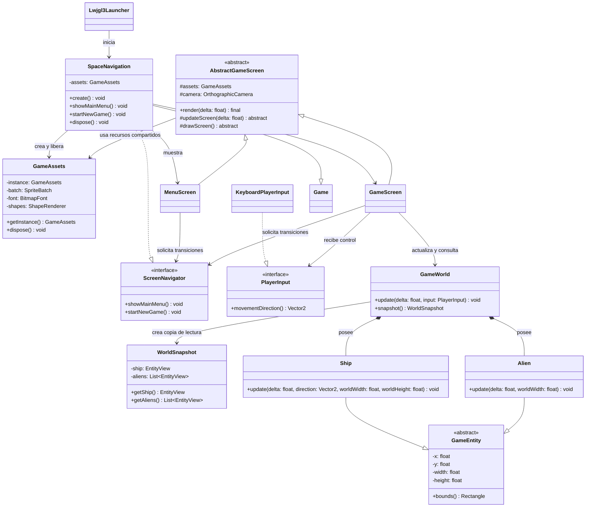

# Space Navigation — estructura inicial

Este diagrama refleja las clases que ya usamos como punto de partida para el nuevo flujo de escritorio. Las figuras de la nave y el alien son temporales; todavía no representan el combate ni los recursos finales.

## Responsabilidades actuales

- `app.SpaceNavigation` inicia el juego y conecta sus dependencias. Es el único lugar donde consultamos el Singleton de `GameAssets`.
- `ScreenNavigator` limita las transiciones que pueden solicitar las pantallas.
- `GameAssets` es dueño del `SpriteBatch`, la fuente y el `ShapeRenderer`; las pantallas los usan, pero no los liberan.
- `AbstractGameScreen` fija el orden limpiar, actualizar y dibujar. `MenuScreen` y `GameScreen` implementan el comportamiento específico.
- `PlayerInput` describe la intención de movimiento. `KeyboardPlayerInput` es el adaptador que lee las teclas.
- `GameWorld` mantiene privadas sus entidades, actualiza la nave y el alien y produce un `WorldSnapshot`.
- `WorldSnapshot` copia los valores necesarios para dibujar. No expone las entidades ni una colección mutable.
- `GameEntity` mantiene privada la posición y entrega una copia de sus límites.

## Siguiente etapa

Todavía tenemos que definir e implementar proyectiles, colisiones, puntaje, vidas, cuotas de nivel, dash, victoria y Game Over. Incorporaremos `MovementStrategy`, Builder y persistencia cuando tengamos reglas concretas que justifiquen esas abstracciones. El código anterior se conserva en el paquete `puppy.code.prototype` y no lo usa el lanzador nuevo.
