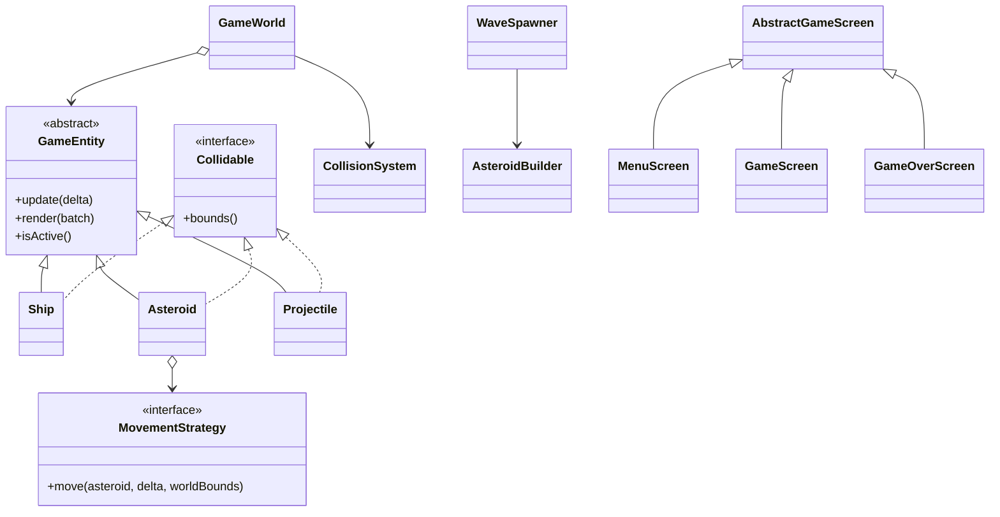

# UML inicial — Space Navigation

Diagrama de colaboración preliminar para implementar el juego. El modelo final GM-3 debe actualizarse con las clases propias y las clases base LibGDX que realmente use el código.

El diagrama no representa todavía el estado implementado. Su finalidad es acordar contratos y repartir el primer incremento; actualizarlo en esta carpeta junto con el código y la evidencia GM-3.
