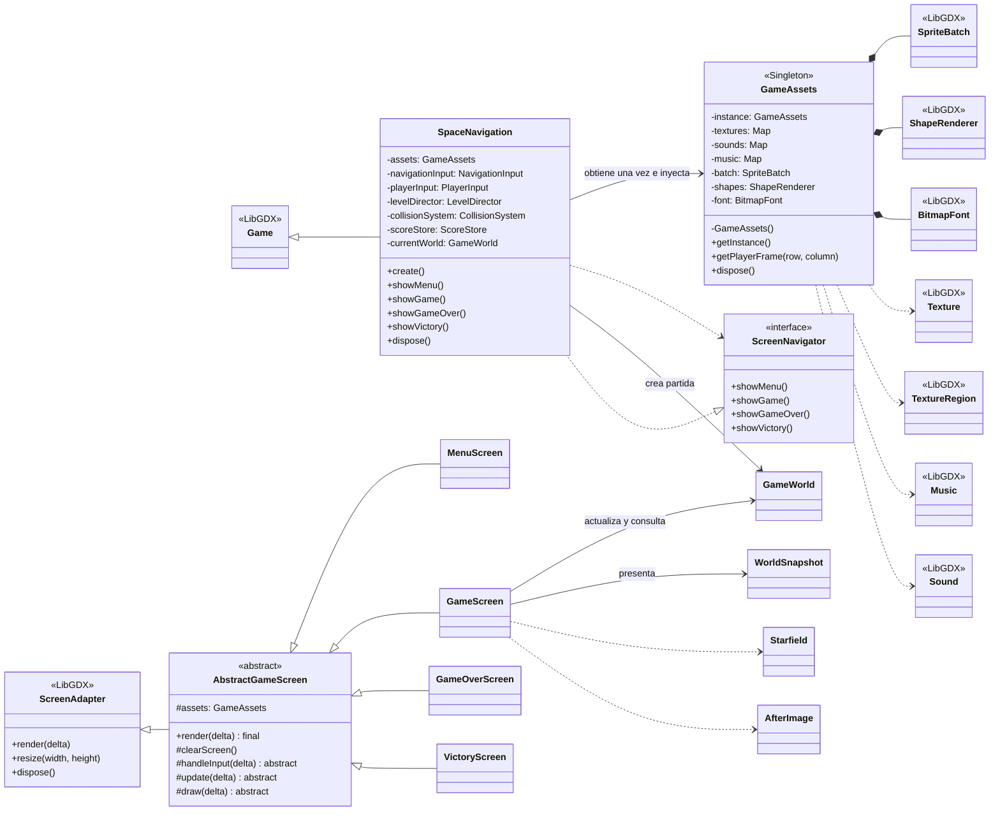
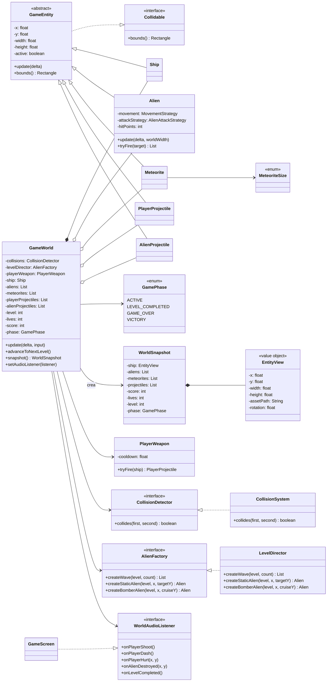
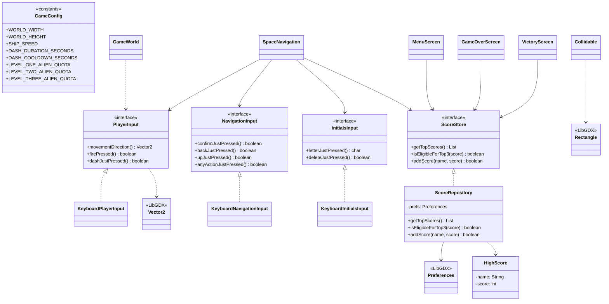
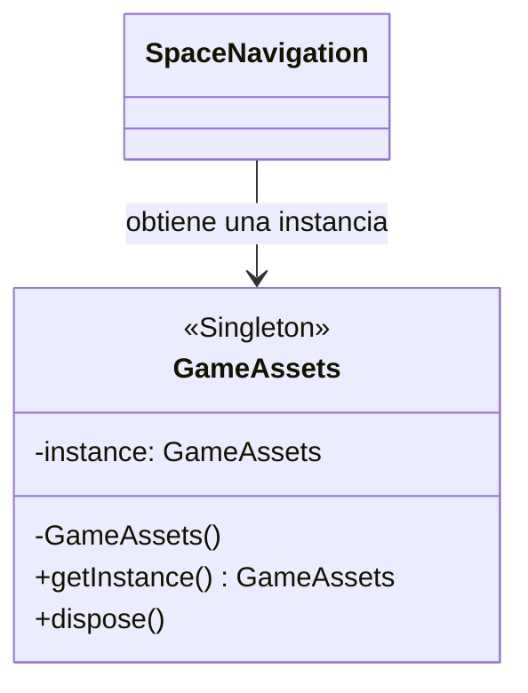
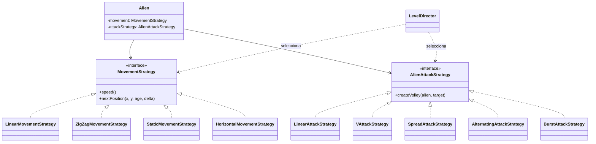
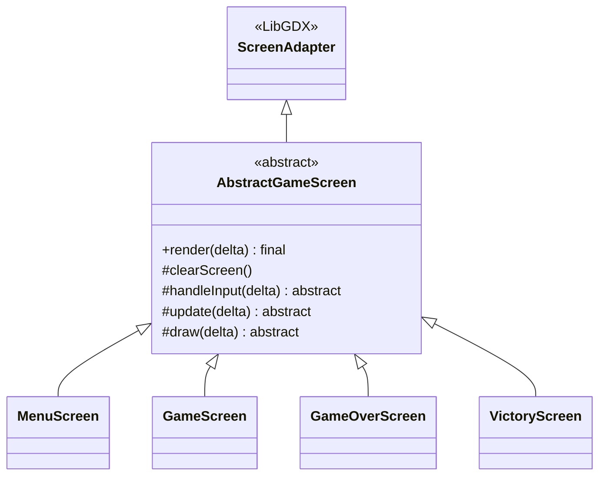
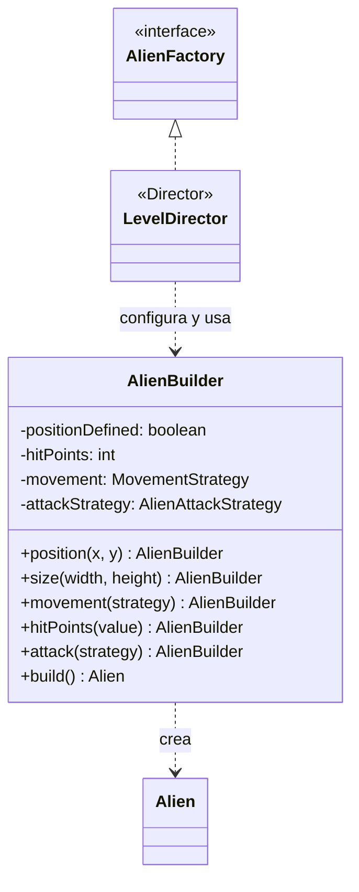

# UML del proyecto: Space Navigation

**Rama de referencia:** `feature/overhaul-assets`

**Lenguaje:** Java 11 · **Motor:** LibGDX

Este diagrama describe el código de la rama indicada. El paquete `puppy.code.prototype` conserva el esqueleto anterior para contrastar su organización con el flujo activo, pero no participa en la creación de la partida actual.

## Clases de aplicación, pantallas y recursos

## Dominio y coordinación de la partida

## Entradas, puntajes y tipos LibGDX

## GM-6 Singleton

**Problema:** las pantallas comparten texturas, audio y objetos de dibujo; varias instancias podrían duplicar recursos o liberar recursos que todavía se usan.

**Contexto:** `SpaceNavigation` crea la aplicación y conecta las dependencias.
**Solución:** `GameAssets` mantiene una instancia, tiene constructor privado y libera sus recursos en `dispose()`. El punto de composición obtiene esa instancia y la entrega a las pantallas.

## GM-7 Strategy

**Problema:** las trayectorias y descargas varían por tipo de alien y sector.

**Contexto:** `Alien` participa en el mundo sin necesitar conocer cada algoritmo de movimiento o ataque.
**Solución:** recibe los contratos `MovementStrategy` y `AlienAttackStrategy`; `LevelDirector` selecciona las variantes al construir la oleada.

## GM-8 Template Method

**Problema:** las pantallas necesitan mantener el mismo orden de limpieza, entrada, actualización y dibujo.

**Contexto:** menú, partida, Game Over y Victoria comparten el ciclo, pero cada una presenta y actualiza contenido distinto.
**Solución:** `AbstractGameScreen.render(delta)` fija el algoritmo y delega los pasos variables en métodos protegidos.

## GM-9 Builder

**Problema:** un alien requiere varios valores que deben formar una configuración válida.

**Contexto:** los sectores y arquetipos combinan posición, tamaño, vida, movimiento y ataque.
**Solución:** `AlienBuilder` permite definir esos valores por pasos y los valida en `build()`. `LevelDirector` decide las combinaciones para cada oleada y arquetipo.

## Notas de lectura

- Los atributos de las instancias se muestran como privados cuando forman parte del estado encapsulado. Las constantes públicas de `GameConfig` se muestran aparte.
- `GameAssets` carga recursos con mapas propios de `Texture`, `Music` y `Sound`; no usa `AssetManager`.
- `ScoreRepository` implementa `ScoreStore` y guarda en LibGDX `Preferences`.
- Los datos que se dibujan durante la partida llegan a las pantallas mediante `WorldSnapshot`; las colecciones expuestas son de solo lectura.
- `puppy.code.prototype` queda como referencia del código base y no como parte del flujo activo.
