# Space Navigation - UML de la demo jugable

Nosotros actualizamos este diagrama para reflejar el código integrado en la demo jugable. El menú queda fuera de GamePhase. El Top 3 local se consulta desde el menú y las pantallas finales; cuando el resultado califica, pedimos tres iniciales antes de guardarlo.

```mermaid
classDiagram
    class Game {
        <<LibGDX>>
    }
    class ScreenAdapter {
        <<LibGDX>>
        +render(delta: float)
    }
    class SpriteBatch {
        <<LibGDX>>
    }
    class BitmapFont {
        <<LibGDX>>
    }
    class Sound {
        <<LibGDX>>
    }
    class Music {
        <<LibGDX>>
    }
    class AssetManager {
        <<LibGDX>>
        +load(path: String, type: Class)
        +get(path: String, type: Class)
        +dispose()
    }
    class Rectangle {
        <<LibGDX>>
    }
    class OrthographicCamera {
        <<LibGDX>>
    }
    class Viewport {
        <<LibGDX>>
    }
    class Preferences {
        <<LibGDX>>
    }
    class Vector2 {
        <<LibGDX>>
    }
    class Texture {
        <<LibGDX>>
    }
    class ShapeRenderer {
        <<LibGDX>>
    }
    class TextureRegion {
        <<LibGDX>>
    }

    class SpaceNavigation {
        -assets: GameAssets
        -currentWorld: GameWorld
        -navigationInput: NavigationInput
        -playerInput: PlayerInput
        -levelDirector: LevelDirector
        -collisionSystem: CollisionSystem
        -scoreRepository: ScoreRepository
        -initialsInput: InitialsInput
        +create()
        +showMenu()
        +showGame()
        +showGameOver(finalScore, levelReached)
        +showVictory(finalScore)
        +dispose()
    }
    class ScreenNavigator {
        <<interface>>
        +showMenu()
        +showGame()
        +showGameOver()
        +showVictory()
        +showGameOver(finalScore, levelReached)
        +showVictory(finalScore)
    }
    class GameAssets {
        -instance: GameAssets
        -manager: AssetManager
        -batch: SpriteBatch
        -font: BitmapFont
        -shapes: ShapeRenderer
        -disposed: boolean
        -playerFrames: TextureRegion[][]
        -alienFrames: TextureRegion[][]
        -alienStaticRegion: TextureRegion
        -currentMusic: Music
        +getInstance() GameAssets
        +getTexture(path) Texture
        +getSound(path) Sound
        +getMusic(path) Music
        +playSound(path, volume)
        +playMusic(path, loop, volume)
        +dispose()
    }
    class GameConfig {
        <<constants>>
        +SHIP_SPEED
        +PLAYER_FIRE_COOLDOWN_SECONDS
        +DASH_DURATION_SECONDS
        +DASH_COOLDOWN_SECONDS
        +LEVEL_ONE_ALIEN_QUOTA
        +LEVEL_TWO_ALIEN_QUOTA
        +LEVEL_THREE_ALIEN_QUOTA
    }

    class AbstractGameScreen {
        <<abstract>>
        -assets: GameAssets
        -camera: OrthographicCamera
        -viewport: Viewport
        #getAssets() GameAssets
        #getCamera() OrthographicCamera
        #getViewport() Viewport
        +render(delta) final
        #resize(width, height) final
        #clearScreen()
        #handleInput(delta) abstract
        #update(delta) abstract
        #draw(delta) abstract
    }
    class MenuScreen {
        -scoreRepository: ScoreRepository
    }
    class GameScreen {
        -navigator: ScreenNavigator
        -world: GameWorld
        -playerInput: PlayerInput
        -navigationInput: NavigationInput
        -afterImages: List~AfterImage~
        -snapshot: WorldSnapshot
        +update(delta)
        +draw(delta)
    }
    class GameOverScreen {
        -initialsInput: InitialsInput
        -scoreRepository: ScoreRepository
        -eligibleForTop3: boolean
    }
    class VictoryScreen {
        -initialsInput: InitialsInput
        -scoreRepository: ScoreRepository
        -eligibleForTop3: boolean
    }
    class AfterImage
    class Lwjgl3Launcher
    class StartupHelper
    class NavigationInput {
        <<interface>>
        +confirmJustPressed() boolean
        +backJustPressed() boolean
        +anyActionJustPressed() boolean
    }
    class KeyboardNavigationInput
    class InitialsInput {
        <<interface>>
        +letterJustPressed() char
        +deleteJustPressed() boolean
    }
    class KeyboardInitialsInput
    class PlayerInput {
        <<interface>>
        +movementDirection() Vector2
        +firePressed() boolean
        +dashJustPressed() boolean
    }
    class KeyboardPlayerInput

    class GameWorld {
        -ship: Ship
        -aliens: List~Alien~
        -meteorites: List~Meteorite~
        -playerProjectiles: List~PlayerProjectile~
        -alienProjectiles: List~AlienProjectile~
        -lives: int
        -score: int
        -level: int
        -aliensDestroyedInLevel: int
        -phase: GamePhase
        -playerFiredThisFrame: boolean
        -entityExplodedThisFrame: boolean
        -shipHurtThisFrame: boolean
        +update(delta, input)
        +advanceToNextLevel()
        +snapshot() WorldSnapshot
        +restart()
    }
    class WorldSnapshot {
        -ship: EntityView
        -shipInvulnerable: boolean
        -shipDashReady: boolean
        -aliens: List~EntityView~
        -meteorites: List~EntityView~
        -playerProjectiles: List~EntityView~
        -alienProjectiles: List~EntityView~
        -lives: int
        -score: int
        -level: int
        -aliensDestroyedInLevel: int
        -quotaForLevel: int
        -phase: GamePhase
        -playerFiredThisFrame: boolean
        -entityExplodedThisFrame: boolean
        -shipHurtThisFrame: boolean
        +didPlayerFireThisFrame() boolean
        +didEntityExplodeThisFrame() boolean
        +didShipGetHurtThisFrame() boolean
    }
    class EntityView {
        -x: float
        -y: float
        -width: float
        -height: float
        -assetPath: String
        +getX() float
        +getY() float
        +getWidth() float
        +getHeight() float
        +getAssetPath() String
    }
    class GamePhase {
        <<enumeration>>
        ACTIVE
        LEVEL_COMPLETED
        GAME_OVER
        VICTORY
    }

    class GameEntity {
        <<abstract>>
        -x: float
        -y: float
        -width: float
        -height: float
        -active: boolean
        +bounds() Rectangle
        +deactivate()
    }
    class Collidable {
        <<interface>>
        +bounds() Rectangle
    }
    class Ship {
        -speed: float
        -invulnerabilityTimer: float
        -dashCooldownTimer: float
        -dashDurationTimer: float
        +update(delta, direction, worldWidth, worldHeight)
        +triggerDash(direction)
        +respawn(x, y, seconds)
    }
    class Alien {
        -hitPoints: int
        -movement: MovementStrategy
        -attackStrategy: AlienAttackStrategy
        +takeDamage() boolean
        +update(delta, worldWidth)
        +fireDue(delta, target) List~AlienProjectile~
    }
    class PlayerProjectile {
        -speed: float
        +update(delta)
    }
    class AlienProjectile {
        -direction: Vector2
        -speed: float
        +update(delta)
    }
    class Meteorite {
        -size: MeteoriteSize
        -descentSpeed: float
        +random(worldWidth, worldHeight) Meteorite
        +getScoreValue() int
        +update(delta)
    }
    class MeteoriteSize {
        <<enumeration>>
        SMALL
        MEDIUM
        LARGE
    }

    class CollisionSystem {
        +collides(first, second) boolean
        +collidingWith(subject, candidates) List
    }
    class PlayerWeapon {
        -cooldownRemaining: float
        +update(delta, firePressed, ship) Optional
    }
    class MovementStrategy {
        <<interface>>
        +speed() float
        +nextPosition(x, y, age, delta) Vector2
    }
    class LinearMovementStrategy
    class ZigZagMovementStrategy
    class AlienAttackStrategy {
        <<interface>>
        +createVolley(alien, target) List~AlienProjectile~
    }
    class LinearAttackStrategy
    class VAttackStrategy
    class AlienBuilder {
        +position(x, y) AlienBuilder
        +hitPoints(value) AlienBuilder
        +movement(strategy) AlienBuilder
        +attack(strategy) AlienBuilder
        +build() Alien
    }
    class LevelDirector {
        +createWave(level) List~Alien~
    }
    class ScoreRepository {
        <<persistent local storage>>
        +getTopScores() List
        +isEligibleForTop3(score) boolean
        +addScore(name, score) boolean
    }
    class HighScore {
        <<nested value object>>
        -name: String
        -score: int
        +getName() String
        +getScore() int
        +compareTo(other) int
    }

    Game <|-- SpaceNavigation
    Lwjgl3Launcher --> SpaceNavigation
    Lwjgl3Launcher ..> StartupHelper
    ScreenNavigator <|.. SpaceNavigation
    ScreenAdapter <|-- AbstractGameScreen
    AbstractGameScreen <|-- MenuScreen
    AbstractGameScreen <|-- GameScreen
    AbstractGameScreen <|-- GameOverScreen
    AbstractGameScreen <|-- VictoryScreen
    AbstractGameScreen *-- OrthographicCamera
    AbstractGameScreen *-- Viewport
    GameAssets *-- AssetManager
    GameAssets *-- SpriteBatch
    GameAssets *-- BitmapFont
    GameAssets *-- ShapeRenderer
    GameAssets ..> Texture
    GameAssets ..> TextureRegion
    GameAssets ..> Sound
    GameAssets ..> Music
    SpaceNavigation --> GameAssets
    SpaceNavigation --> GameConfig
    SpaceNavigation --> ScreenNavigator
    SpaceNavigation --> ScoreRepository
    SpaceNavigation --> InitialsInput
    SpaceNavigation --> MenuScreen
    SpaceNavigation --> GameScreen
    SpaceNavigation --> GameOverScreen
    SpaceNavigation --> VictoryScreen
    MenuScreen --> NavigationInput
    MenuScreen --> ScreenNavigator
    MenuScreen --> ScoreRepository
    GameScreen --> GameWorld
    GameScreen --> WorldSnapshot
    GameScreen --> PlayerInput
    GameScreen --> NavigationInput
    GameScreen --> ScreenNavigator
    GameScreen o-- AfterImage
    GameWorld *-- Ship
    GameWorld o-- Alien
    GameWorld o-- Meteorite
    GameWorld o-- PlayerProjectile
    GameWorld o-- AlienProjectile
    GameWorld --> CollisionSystem
    GameWorld --> PlayerWeapon
    GameWorld --> LevelDirector
    GameWorld --> WorldSnapshot
    GameWorld --> GamePhase
    Collidable <|.. GameEntity
    GameEntity <|-- Ship
    GameEntity <|-- Alien
    GameEntity <|-- Meteorite
    GameEntity <|-- PlayerProjectile
    GameEntity <|-- AlienProjectile
    Collidable ..> Rectangle
    WorldSnapshot *-- EntityView
    Alien --> MovementStrategy
    Alien --> AlienAttackStrategy
    MovementStrategy <|.. LinearMovementStrategy
    MovementStrategy <|.. ZigZagMovementStrategy
    AlienAttackStrategy <|.. LinearAttackStrategy
    AlienAttackStrategy <|.. VAttackStrategy
    LevelDirector --> AlienBuilder
    AlienBuilder ..> Alien
    PlayerWeapon ..> PlayerProjectile
    GameOverScreen --> ScoreRepository
    GameOverScreen --> InitialsInput
    VictoryScreen --> ScoreRepository
    VictoryScreen --> InitialsInput
    InitialsInput <|.. KeyboardInitialsInput
    ScoreRepository --> Preferences
    ScoreRepository *-- HighScore
```

## Estado y límites conocidos

Nosotros conectamos ScoreRepository con el menú, Game Over y Victoria. Un resultado que supera el tercer puntaje permite ingresar tres letras A-Z; Enter guarda y Retroceso borra. La pantalla muestra el Top 3 persistente almacenado con Preferences.

Dejamos provisional el multiplicador del dash en 3 hasta validarlo jugando. No contamos con información verificable sobre el origen o la licencia de los recursos gráficos y de audio.
