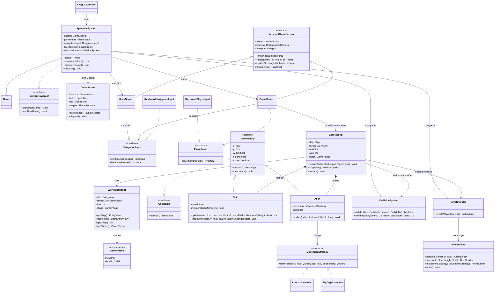

# Space Navigation — base implementada

Este diagrama refleja el corte inicial que compila y sirve como punto de partida. Incluye los
patrones exigidos GM-6 a GM-9 y la separación básica entre entrada, mundo, entidades y pantallas.
No representa todavía el juego completo: proyectiles, puntaje, cuotas, dash, victoria, persistencia
y pantallas finales siguen pendientes.

## Patrones y principios visibles en el código

- **GM-4 — abstracción e interfaz:** `AbstractGameScreen` es la clase abstracta usada por `MenuScreen` y `GameScreen`; `MovementStrategy` tiene dos implementaciones usadas por `Alien`.
- **GM-5 — encapsulamiento y responsabilidades:** `GameWorld` coordina la partida (Controller); las pantallas dibujan snapshots inmutables; las entidades no consultan teclado ni pantallas; `CollisionSystem` detecta contactos y `GameWorld` aplica sus consecuencias.
- **GM-6 — Singleton:** `GameAssets` limita su construcción y centraliza los recursos compartidos; `SpaceNavigation` obtiene la instancia y controla su ciclo de vida.
- **GM-7 — Strategy:** `Alien` delega su movimiento en `LinearMovement` o `ZigZagMovement` mediante `MovementStrategy`.
- **GM-8 — Template Method:** `AbstractGameScreen.render()` es final y conserva el orden limpiar, actualizar y dibujar; cada pantalla concreta aporta actualización y dibujo.
- **GM-9 — Builder:** `AlienBuilder` valida la posición y la estrategia requeridas; `LevelDirector` define y construye las oleadas.

## Pendiente para las siguientes etapas

La base solo modela movimiento y contacto físico nave-alien. Faltan proyectiles, combate, puntaje,
cuotas y avance de nivel, dash, meteoritos, fases de victoria/nivel superado, pantallas finales,
repositorio de récords, y completar las transiciones de `ScreenNavigator`. La alternancia de movimiento
por paridad de nivel y el tamaño de oleada son provisionales.
